# Devya social calendar

Generated from `calendar.json` by `render/build-md.mjs`. Edit the JSON, not this file. Times are Africa/Cairo.
Slots: LinkedIn 10:00, LinkedIn video + Reels 13:00, Facebook + Story 19:30, Instagram + Story 21:00.

| Day | Date | Pillar | Layout | Topic | FB / IG language |
|---|---|---|---|---|---|
| 1 | Sun 15 Nov | bts | terminal | Three open-source guardrails on every repo: leakhook, envcheck, i18n-check | AR / EN |
| 2 | Mon 16 Nov | client-value | checklist | Ask for a v1 cut line before you ask for a quote | AR / EN |
| 3 | Tue 17 Nov | engineering | code | N+1 queries: fast locally, slow in production | EN / AR |
| 4 | Wed 18 Nov | product | product | Devya X-Ray: an engineering review that reads the code | AR / EN |
| 5 | Thu 19 Nov | client-value | checklist | The five lines a weekly dev update should contain | AR / EN |
| 6 | Fri 20 Nov | bts | statement | What 'done' means at Devya: merged isn't done | AR / EN |
| 7 | Sat 21 Nov | case-study | compare | Arabic Business Resources: a verified bilingual guide we built | EN / AR |
| 8 | Sun 22 Nov | client-value | compare | Build MENA products Arabic-first, then derive English | AR / EN |
| 9 | Mon 23 Nov | engineering | terminal | Mocks agree with you, Postgres does not: Testcontainers | AR / EN |
| 10 | Tue 24 Nov | product | product | CopyForge: Arabic ad copy that doesn't read translated | EN / AR |
| 11 | Wed 25 Nov | client-value | checklist | Engineer swaps: the handover clauses to ask for | AR / EN |
| 12 | Thu 26 Nov | engineering | code | Parallel AI coding agents with git worktrees | AR / EN |
| 13 | Fri 27 Nov | case-study | product | Urania: a bilingual guide to the constellations we built | AR / EN |
| 14 | Sat 28 Nov | engineering | code | Stop adding Postgres indexes by guesswork: EXPLAIN ANALYZE | EN / AR |

## Day 1 · Sun 15 Nov · Three open-source guardrails on every repo: leakhook, envcheck, i18n-check

Pillar **bts** · layout **terminal** · accent lime · source https://www.devya.dev/projects/leakhook

Basis: Devya open-source projects envcheck, leakhook, i18n-check (devya.dev/projects)

### LinkedIn · 10:00 · English

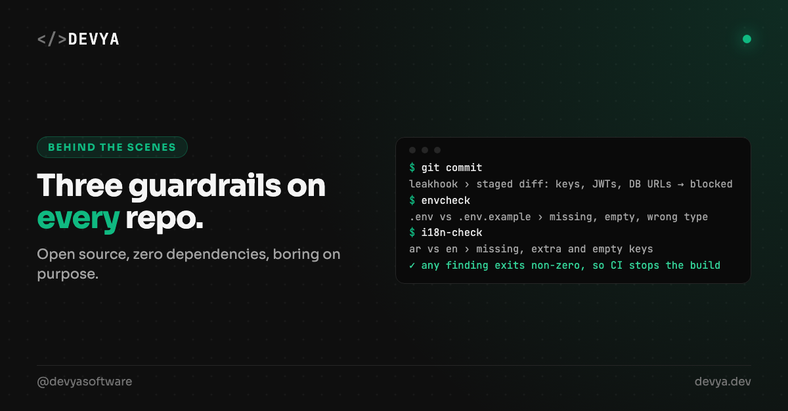 `1200×627`

```text
Three checks run on every Devya repo before code reaches a reviewer. We open-sourced all three.

1. leakhook: a pre-commit hook that scans the staged diff for AWS, GitHub, Stripe, Slack and Google keys, private-key blocks, JWTs and database URLs with credentials. The commit stops before anything leaks.
2. envcheck: treats .env.example as the schema and checks the real .env against it, flagging missing keys, empty required values and wrong types. It exits non-zero, so CI catches it before a deploy does.
3. i18n-check: compares every locale file against the base and reports missing, extra and empty keys. On bilingual EN/AR products, this is the check that stops a half-translated screen from shipping.

Each one is zero-dependency and small enough to read in one sitting. None of them is clever. That's the point: guardrails that are boring to install actually get installed.

Code and docs: https://www.devya.dev/projects/leakhook?utm_source=linkedin&utm_medium=social

#BuildWithDevya #OpenSource #DevSecOps #NodeJS
```

### Facebook · 19:30 · Arabic

 `1080×1350`

```text
قبل أن يصل أي سطر برمجي إلى المراجعة، تمر مشاريعنا بثلاثة فحوص بسيطة، وقد أتحناها مجانًا للجميع:

• أداة leakhook تمنع رفع المفاتيح السرية وكلمات المرور إلى المستودع.
• أداة envcheck تتأكد من اكتمال إعدادات التشغيل قبل أن يعمل التطبيق.
• أداة i18n-check تكشف النصوص الناقصة بين النسختين العربية والإنجليزية.

لماذا يهمك هذا كصاحب مشروع؟ لأن كثيرًا من الأعطال المحرجة لا يأتي من أكواد معقدة، بل من خطأ صغير لم يُفحص.

التفاصيل: https://www.devya.dev/projects/leakhook?utm_source=facebook&utm_medium=social
```

### Instagram · 21:00 · English

 `1080×1350`

```text
Three boring checks on every repo we touch:
🔒 leakhook blocks secrets at commit time
🧾 envcheck checks .env against .env.example
🌐 i18n-check catches missing Arabic or English keys
All three are free and open source. Link in bio.

#BuildWithDevya #OpenSource #WebDevelopment #NodeJS #DevSecOps #Cairo
```

### Vertical video · 1080×1920, 10 s · `visuals/2026-11-15/reel-<lang>.mp4` (rendered on the day)

One-liner EN: Three checks on every Devya repo, all open source: leakhook, envcheck, i18n-check.

One-liner AR: ثلاثة فحوص على كل مستودع لدينا، وكلها مفتوحة المصدر: leakhook و envcheck و i18n-check.

**LinkedIn video** · 13:00 · English

```text
Three checks on every Devya repo, all open source: leakhook, envcheck, i18n-check.

#BuildWithDevya #OpenSource #DevSecOps
```

**Facebook Reel** · 13:00 · Arabic

```text
ثلاثة فحوص على كل مستودع لدينا، وكلها مفتوحة المصدر: leakhook و envcheck و i18n-check.

التفاصيل: https://www.devya.dev/projects/leakhook?utm_source=facebook&utm_medium=social&utm_content=reel
```

**Instagram Reel** · 13:00 · English

```text
Three checks on every Devya repo, all open source: leakhook, envcheck, i18n-check.

#BuildWithDevya #OpenSource #WebDevelopment #NodeJS #DevSecOps
```

**Stories** (same video, no caption): Facebook 19:30 Arabic · Instagram 21:00 English

## Day 2 · Mon 16 Nov · Ask for a v1 cut line before you ask for a quote

Pillar **client-value** · layout **checklist** · accent ember · source https://www.devya.dev/services

Basis: devya-market-intel 2026-11-15 guide.do: costed feature list with a v1 cut line

### LinkedIn · 10:00 · English

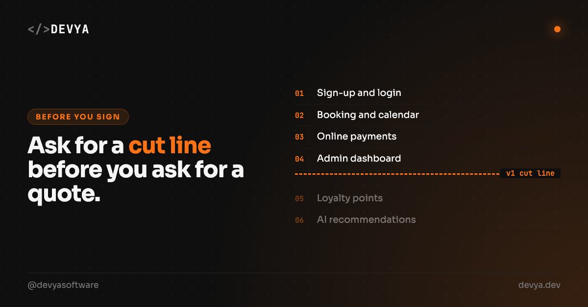 `1200×627`

```text
Most quotes answer the wrong question. "How much for the whole app?" gets you one number and no way to change it.

Ask for a cut line instead:

1. Every feature listed, ranked by what it's worth to your users.
2. A cost next to each one.
3. A line drawn where your budget ends.
4. Everything above the line is v1. Everything below waits until real users ask for it.

Now you can trade: drop loyalty points, keep online payments, and watch the total move. You stay in control of scope, and the team you hire has to understand your users before it can rank anything.

If a vendor can't produce this list, they haven't understood the product yet. That's worth knowing before you sign.

#ProductDevelopment #Startups #MENA #BuildWithDevya
```

### Facebook · 19:30 · Arabic

 `1080×1350`

```text
قبل أن تطلب عرض سعر لتطبيقك، اطلب شيئًا أهم: «خط الإصدار الأول».

الفكرة بسيطة:
1. قائمة بكل الميزات، مرتبة حسب قيمتها لعملائك.
2. تكلفة واضحة أمام كل ميزة.
3. خط عند حدود ميزانيتك.

ما فوق الخط يُبنى في الإصدار الأول، وما تحته ينتظر حتى يطلبه المستخدمون فعلًا. بهذا تتحكم في النطاق والتكلفة، بدل رقم إجمالي واحد لا تعرف ما وراءه.

تخطط لتطبيق جديد؟ ابدأ من هنا: https://www.devya.dev/contact?utm_source=facebook&utm_medium=social
```

### Instagram · 21:00 · English

 `1080×1350`

```text
Don't ask "how much for the app?"
Ask for a cut line: every feature ranked, a cost on each, and a line where your budget ends. Above the line ships in v1. Below it waits for real users.
Save this for your next quote.

#BuildWithDevya #Startups #ProductDevelopment #AppDevelopment #Founders #MVP
```

### Vertical video · 1080×1920, 10 s · `visuals/2026-11-16/reel-<lang>.mp4` (rendered on the day)

One-liner EN: Before the quote, ask for the cut line: what ships in v1, and what waits.

One-liner AR: قبل عرض السعر، اطلب خط الإصدار الأول: ما الذي يُبنى الآن، وما الذي ينتظر.

**LinkedIn video** · 13:00 · English

```text
Before the quote, ask for the cut line: what ships in v1, and what waits.

#ProductDevelopment #Startups #MENA
```

**Facebook Reel** · 13:00 · Arabic

```text
قبل عرض السعر، اطلب خط الإصدار الأول: ما الذي يُبنى الآن، وما الذي ينتظر.

التفاصيل: https://www.devya.dev/services?utm_source=facebook&utm_medium=social&utm_content=reel
```

**Instagram Reel** · 13:00 · English

```text
Before the quote, ask for the cut line: what ships in v1, and what waits.

#BuildWithDevya #Startups #ProductDevelopment #AppDevelopment #Founders
```

**Stories** (same video, no caption): Facebook 19:30 Arabic · Instagram 21:00 English

## Day 3 · Tue 17 Nov · N+1 queries: fast locally, slow in production

Pillar **engineering** · layout **code** · accent azure · source https://www.devya.dev/blogs/n-plus-1-queries-nodejs-dataloader-query-budget-field-notes

Basis: Devya blog field notes: N+1 queries, DataLoader, query budget

### LinkedIn · 10:00 · English

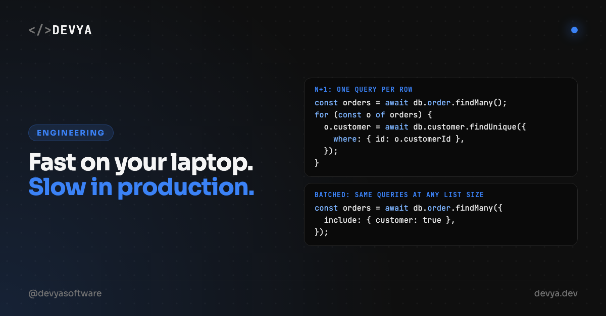 `1200×627`

```text
An N+1 query is invisible on your laptop. Ten seed rows, a local database, and every page feels instant.

In production the same loop runs once per row: one query for the list, then one more for every item in it. A page with 200 orders makes 201 round trips, and each one pays network latency.

What we do now:
→ Load relations in one go (include or JOIN), or batch per request with DataLoader.
→ Log query counts per request in development, so the loop shows up before a customer notices.
→ Give each endpoint a query budget in tests and fail the build when it goes over.

The fix is usually five lines. Finding it is the hard part, so make the count visible.

Field notes with the full setup: https://www.devya.dev/blogs/n-plus-1-queries-nodejs-dataloader-query-budget-field-notes?utm_source=linkedin&utm_medium=social

#NodeJS #PostgreSQL #BackendEngineering #BuildWithDevya
```

### Facebook · 19:30 · English

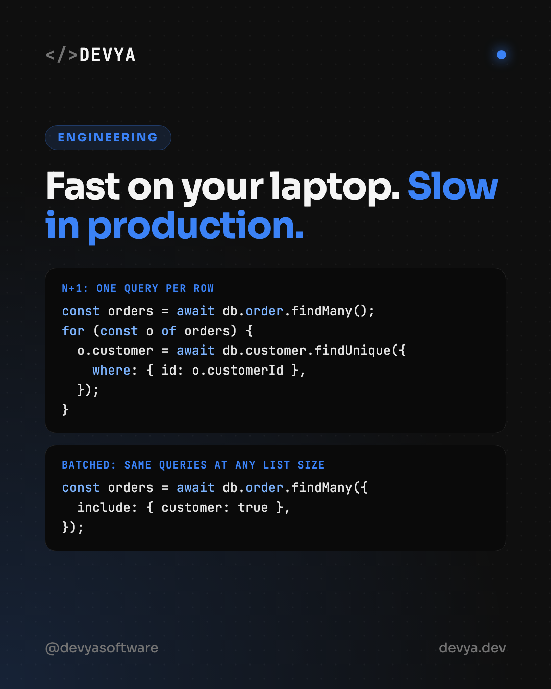 `1080×1350`

```text
Why does an app that felt fast in the demo slow down after launch?

One common reason has a name: the N+1 query. The app fetches a list, then goes back to the database once for every item in it. With 10 test records nobody notices. With thousands of real customers, every page waits.

It's cheap to fix and easy to prevent: count the database queries on every request during development, and fail the build when a page goes over its budget.

How we do it, in our engineering notes: https://www.devya.dev/blogs/n-plus-1-queries-nodejs-dataloader-query-budget-field-notes?utm_source=facebook&utm_medium=social
```

### Instagram · 21:00 · Arabic

 `1080×1350`

```text
تطبيق سريع في العرض التجريبي ثم بطيء بعد الإطلاق؟
أحد الأسباب الشائعة اسمه «استعلام N+1»: التطبيق يجلب قائمة، ثم يعود إلى قاعدة البيانات مرة لكل عنصر فيها.
الحل غالبًا بضعة أسطر، والأهم أن تراقب عدد الاستعلامات قبل أن يلاحظ عملاؤك.
الرابط في البايو.

#برمجة #تطوير_البرمجيات #قواعد_البيانات #تقنية #مصر #BuildWithDevya
```

### Vertical video · 1080×1920, 10 s · `visuals/2026-11-17/reel-<lang>.mp4` (rendered on the day)

One-liner EN: Fast on your laptop, slow in production: the N+1 query, and the fix.

One-liner AR: سريع على جهازك وبطيء في الإنتاج: استعلام N+1 وحلّه في بضعة أسطر.

**LinkedIn video** · 13:00 · English

```text
Fast on your laptop, slow in production: the N+1 query, and the fix.

#NodeJS #PostgreSQL #BackendEngineering
```

**Facebook Reel** · 13:00 · English

```text
Fast on your laptop, slow in production: the N+1 query, and the fix.

More: https://www.devya.dev/blogs/n-plus-1-queries-nodejs-dataloader-query-budget-field-notes?utm_source=facebook&utm_medium=social&utm_content=reel
```

**Instagram Reel** · 13:00 · Arabic

```text
سريع على جهازك وبطيء في الإنتاج: استعلام N+1 وحلّه في بضعة أسطر.

#برمجة #تطوير_البرمجيات #قواعد_البيانات #تقنية #مصر
```

**Stories** (same video, no caption): Facebook 19:30 English · Instagram 21:00 Arabic

## Day 4 · Wed 18 Nov · Devya X-Ray: an engineering review that reads the code

Pillar **product** · layout **product** · accent lime · source https://www.devya.dev/projects/devya-xray

Basis: devya.dev/projects/devya-xray (live at xray.devya.dev, free snapshot)

### LinkedIn · 10:00 · English

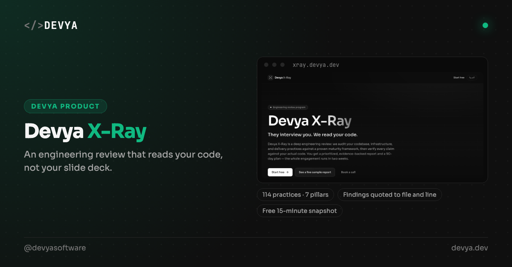 `1200×627`

```text
Ask an engineering team how healthy its codebase is and you get what the team believes. Open the repository and you get what is actually there.

Devya X-Ray does both:
→ Your team self-assesses against 114 practices in seven pillars, from delivery and requirements to security, reliability and AI-native engineering.
→ We then check every claim against the code itself. Each finding is quoted to a file and line.
→ You get a code-verified report and a prioritised 90-day roadmap. Access is read-only, and code is never copied.

It starts with a free snapshot that takes about fifteen minutes, with no card and no call.

Useful before a fundraise, in a new CTO's first month, or when you've inherited a codebase from another vendor.

https://www.devya.dev/projects/devya-xray?utm_source=linkedin&utm_medium=social

#EngineeringLeadership #CodeQuality #CTO #BuildWithDevya
```

### Facebook · 19:30 · Arabic

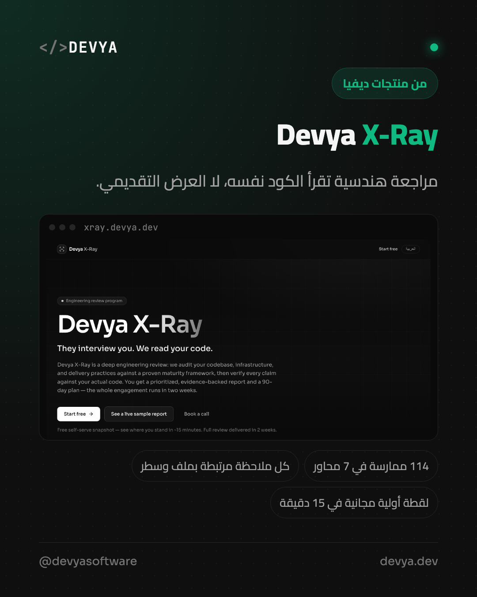 `1080×1350`

```text
هل ورثت تطبيقًا من شركة برمجة سابقة ولا تعرف حالته الحقيقية؟

أداة Devya X-Ray تراجع الكود نفسه، لا الوعود:
• يقيّم فريقك نفسه وفق 114 ممارسة هندسية في سبعة محاور.
• ثم نتحقق من كل إجابة في الكود، وكل ملاحظة مرتبطة بملف وسطر محددين.
• تحصل على تقرير موثّق وخطة أولويات لمدة 90 يومًا.

البداية بلقطة مجانية تستغرق نحو 15 دقيقة، دون بطاقة دفع ودون مكالمة.

https://www.devya.dev/projects/devya-xray?utm_source=facebook&utm_medium=social
```

### Instagram · 21:00 · English

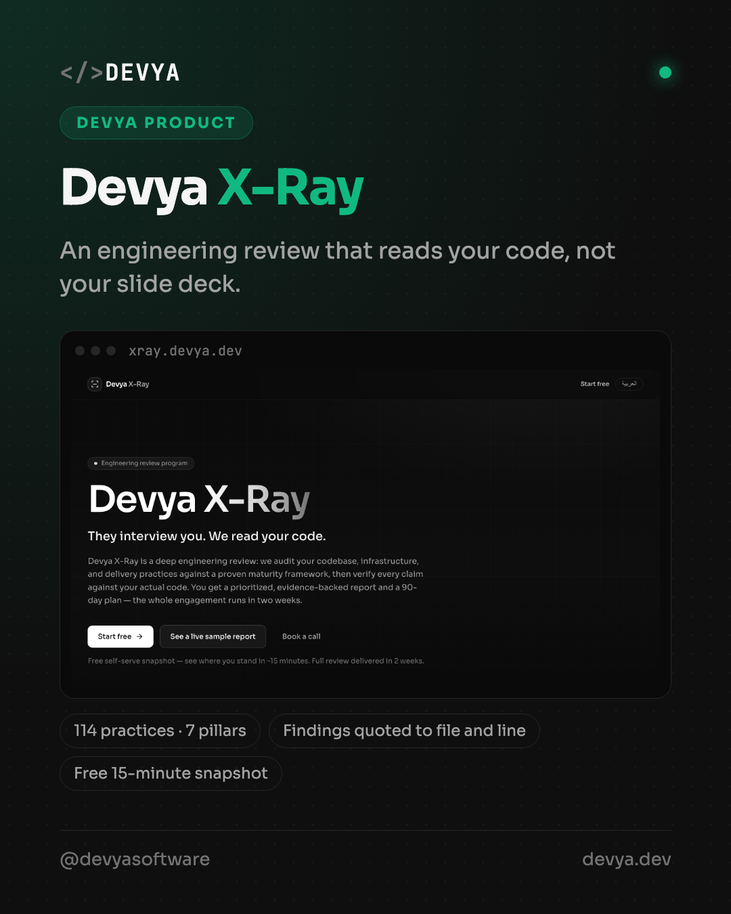 `1080×1350`

```text
Your team says the codebase is fine. Does the code agree?
Devya X-Ray checks 114 engineering practices against the actual repository, every finding quoted to a file and line. Start with a free 15-minute snapshot. Link in bio.

#BuildWithDevya #CodeReview #SoftwareEngineering #CTO #TechLeadership #SaaS
```

### Vertical video · 1080×1920, 10 s · `visuals/2026-11-18/reel-<lang>.mp4` (rendered on the day)

One-liner EN: Devya X-Ray reads your code, not your slide deck. Free 15-minute snapshot.

One-liner AR: أداة Devya X-Ray تقرأ الكود نفسه، لا العرض التقديمي. لقطة أولية مجانية في 15 دقيقة.

**LinkedIn video** · 13:00 · English

```text
Devya X-Ray reads your code, not your slide deck. Free 15-minute snapshot.

#EngineeringLeadership #CodeQuality #CTO
```

**Facebook Reel** · 13:00 · Arabic

```text
أداة Devya X-Ray تقرأ الكود نفسه، لا العرض التقديمي. لقطة أولية مجانية في 15 دقيقة.

التفاصيل: https://www.devya.dev/projects/devya-xray?utm_source=facebook&utm_medium=social&utm_content=reel
```

**Instagram Reel** · 13:00 · English

```text
Devya X-Ray reads your code, not your slide deck. Free 15-minute snapshot.

#BuildWithDevya #CodeReview #SoftwareEngineering #CTO #TechLeadership
```

**Stories** (same video, no caption): Facebook 19:30 Arabic · Instagram 21:00 English

## Day 5 · Thu 19 Nov · The five lines a weekly dev update should contain

Pillar **client-value** · layout **checklist** · accent ember · source https://www.devya.dev/services

Basis: devya-market-intel 2026-11-15 guide.avoid: silent schedule risk, unlogged client-side risks

### LinkedIn · 10:00 · English

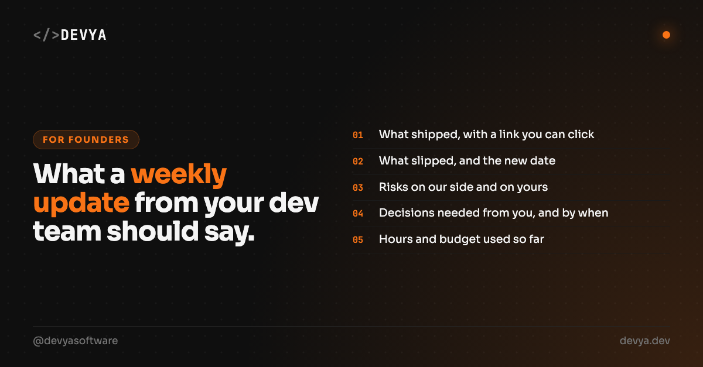 `1200×627`

```text
A good weekly update is boring to read and impossible to misread. Five lines are enough:

1. What shipped, with a link you can click, not a percentage.
2. What slipped, and the new date. Sent the day it slips, not the day it was due.
3. Risks on both sides: ours (a hard integration, an engineer out sick) and yours (late approvals, missing content, a change of sponsor).
4. Decisions needed from you, each with a date.
5. Hours and budget used against the plan.

If your vendor's update is a paragraph of adjectives, ask for these five lines. If they can't fill line 2 honestly, they will fill it later with overtime and a surprise.

#ProjectManagement #Startups #SoftwareDevelopment #BuildWithDevya
```

### Facebook · 19:30 · Arabic

 `1080×1350`

```text
هل تعرف فعلًا ما الذي يحدث في مشروعك البرمجي هذا الأسبوع؟

التقرير الأسبوعي الجيد من فريق التطوير لا يحتاج إلى أكثر من خمسة أسطر:
1. ما الذي أُنجز، مع رابط تستطيع فتحه بنفسك.
2. ما الذي تأخر، وما الموعد الجديد.
3. المخاطر من جهة الفريق ومن جهتك، مثل تأخر الموافقات أو المحتوى.
4. القرارات المطلوبة منك، ومتى.
5. الساعات والميزانية المستهلكة مقارنة بالخطة.

إن لم يصلك تقرير بهذا الوضوح، فاطلبه. من حقك أن تعرف.

https://www.devya.dev/contact?utm_source=facebook&utm_medium=social
```

### Instagram · 21:00 · English

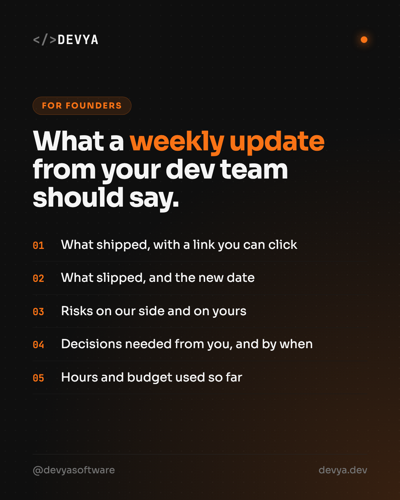 `1080×1350`

```text
Five lines every weekly dev update should have:
1 What shipped (with a link)
2 What slipped (and the new date)
3 Risks on both sides
4 Decisions needed from you
5 Budget used vs plan
Send this to whoever builds your product.

#BuildWithDevya #Founders #ProductManagement #SoftwareDevelopment #TechTips #Startups
```

### Vertical video · 1080×1920, 10 s · `visuals/2026-11-19/reel-<lang>.mp4` (rendered on the day)

One-liner EN: Five lines every weekly update from your dev team should have.

One-liner AR: خمسة أسطر يجب أن يتضمنها كل تقرير أسبوعي من فريق التطوير.

**LinkedIn video** · 13:00 · English

```text
Five lines every weekly update from your dev team should have.

#ProjectManagement #Startups #SoftwareDevelopment
```

**Facebook Reel** · 13:00 · Arabic

```text
خمسة أسطر يجب أن يتضمنها كل تقرير أسبوعي من فريق التطوير.

التفاصيل: https://www.devya.dev/services?utm_source=facebook&utm_medium=social&utm_content=reel
```

**Instagram Reel** · 13:00 · English

```text
Five lines every weekly update from your dev team should have.

#BuildWithDevya #Founders #ProductManagement #SoftwareDevelopment #TechTips
```

**Stories** (same video, no caption): Facebook 19:30 Arabic · Instagram 21:00 English

## Day 6 · Fri 20 Nov · What 'done' means at Devya: merged isn't done

Pillar **bts** · layout **statement** · accent lime · source https://www.devya.dev/about

Basis: Devya engineering rules: CI gate on every PR, global secret-scan pre-commit hook, bilingual checks, post-deploy verification

### LinkedIn · 10:00 · English

 `1200×627`

```text
A pull request being merged doesn't mean the work is done. Here's the bar every change at Devya clears before we call it done:

→ The CI check on the pull request is green. No merging on red, and no merging without it.
→ Every commit passed a secret scan on the developer's machine first.
→ In bilingual products, anything a user reads exists in English and Arabic, and someone opened both.
→ After deploy, someone loads the live URL and checks the change is actually there.

None of this is novel. It's written down so it doesn't depend on who's on shift or how close the deadline is.

What's on your team's definition of done that most teams skip?

#SoftwareEngineering #DevOps #QualityAssurance #BuildWithDevya
```

### Facebook · 19:30 · Arabic

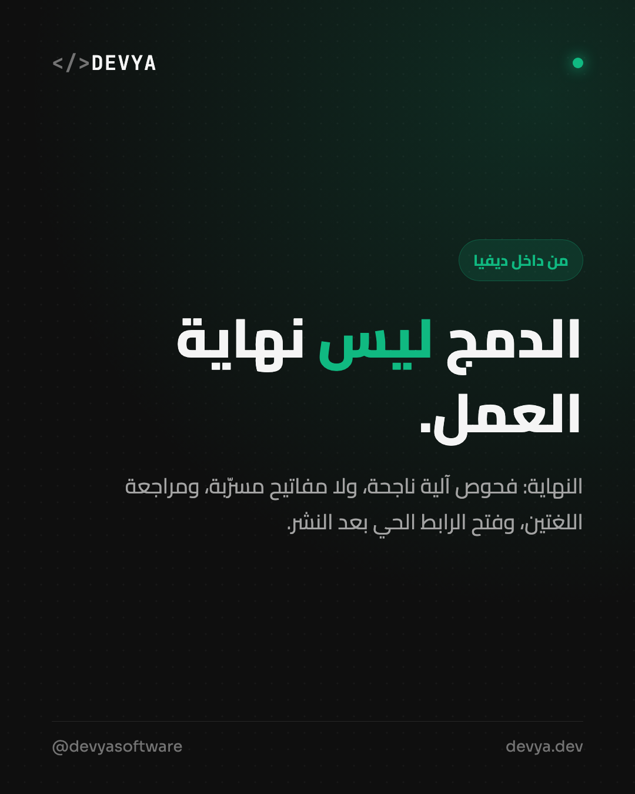 `1080×1350`

```text
متى نعتبر العمل «منتهيًا» في ديفيا؟ ليس عند دمج الكود، بل عندما:
• تنجح الفحوص الآلية على طلب التعديل، فلا دمج قبلها.
• يمر كل حفظ للكود بفحص يمنع تسريب المفاتيح السرية.
• نراجع النصوص العربية والإنجليزية بأنفسنا في المنتجات ثنائية اللغة.
• نفتح الرابط الحي بعد النشر ونتأكد أن التعديل يعمل فعلًا.

قواعد بسيطة، لكنها مكتوبة حتى لا تتخطاها ضغوط المواعيد.

https://www.devya.dev/?utm_source=facebook&utm_medium=social
```

### Instagram · 21:00 · English

 `1080×1350`

```text
Merged isn't done.
Done here means: CI green on the pull request, secrets scanned on every commit, both languages checked in bilingual products, and the live URL opened after deploy.
Boring rules, written down, so deadlines can't skip them.

#BuildWithDevya #SoftwareEngineering #DevOps #WebDevelopment #CodeQuality
```

### Vertical video · 1080×1920, 10 s · `visuals/2026-11-20/reel-<lang>.mp4` (rendered on the day)

One-liner EN: Merged isn't done. Here's what done means at Devya.

One-liner AR: الدمج ليس نهاية العمل. هكذا نعرّف العمل المنتهي في ديفيا.

**LinkedIn video** · 13:00 · English

```text
Merged isn't done. Here's what done means at Devya.

#SoftwareEngineering #DevOps #QualityAssurance
```

**Facebook Reel** · 13:00 · Arabic

```text
الدمج ليس نهاية العمل. هكذا نعرّف العمل المنتهي في ديفيا.

التفاصيل: https://www.devya.dev/about?utm_source=facebook&utm_medium=social&utm_content=reel
```

**Instagram Reel** · 13:00 · English

```text
Merged isn't done. Here's what done means at Devya.

#BuildWithDevya #SoftwareEngineering #DevOps #WebDevelopment #CodeQuality
```

**Stories** (same video, no caption): Facebook 19:30 Arabic · Instagram 21:00 English

## Day 7 · Sat 21 Nov · Arabic Business Resources: a verified bilingual guide we built

Pillar **case-study** · layout **compare** · accent lime · source https://www.devya.dev/projects/arabic-business-resources

Basis: devya.dev/projects/arabic-business-resources (live, 20+ verified sources, 5 categories)

### LinkedIn · 10:00 · English

 `1200×627`

```text
Free Arabic material on finance and investment terminology exists, but it's scattered, and nothing tells you whether a source is formal MSA or regional colloquial, still online, or actually free.

So we built a small guide that fixes exactly that:
→ 20+ verified sources in five categories: official glossaries, course platforms, podcast case studies, governance and risk, and a Pan-Arab section.
→ Every entry tagged MSA or colloquial, free or paid.
→ Every card links straight to the primary source and shows when it was last verified, so a dead link never hides.

It's a static, bilingual page with full RTL and zero dependencies. Small, careful and maintained beats big and stale.

https://www.devya.dev/projects/arabic-business-resources?utm_source=linkedin&utm_medium=social

#Arabic #FinancialLiteracy #OpenKnowledge #BuildWithDevya
```

### Facebook · 19:30 · English

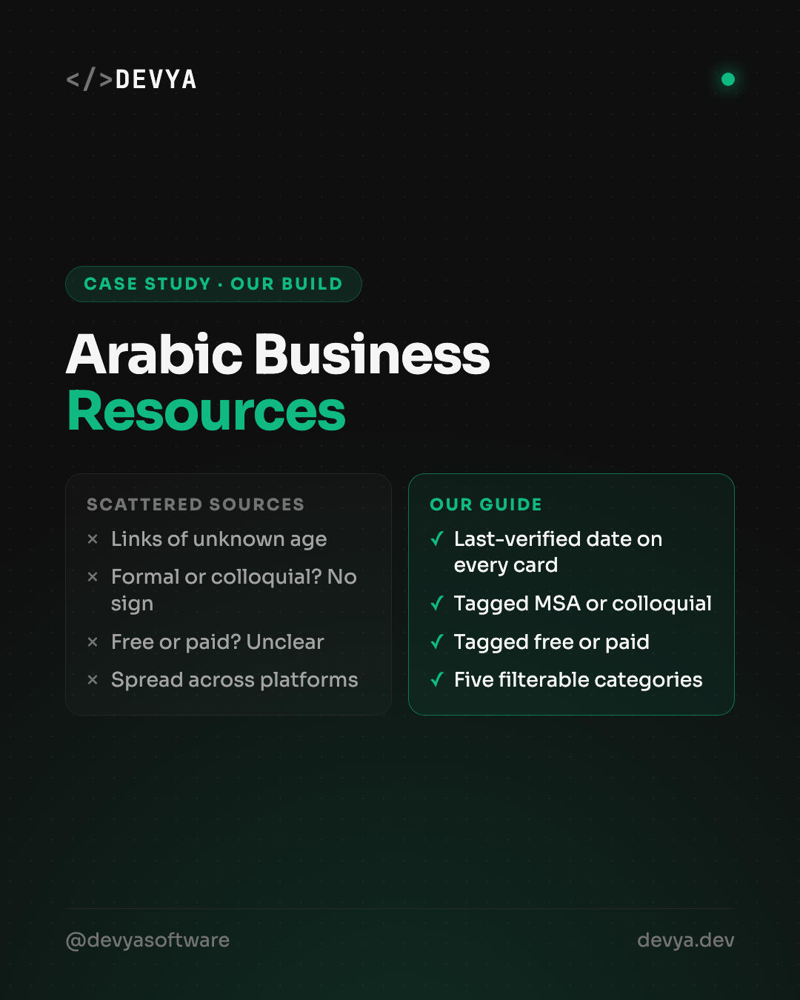 `1080×1350`

```text
Learning finance or investment terms in Arabic? Free material exists, but it's scattered, and it's hard to tell a formal government glossary from a colloquial podcast.

We put together a free bilingual guide: 20+ verified sources in five categories, each tagged MSA or colloquial and free or paid, each linking straight to the original, with the date it was last checked.

Free to use: https://www.devya.dev/projects/arabic-business-resources?utm_source=facebook&utm_medium=social
```

### Instagram · 21:00 · Arabic

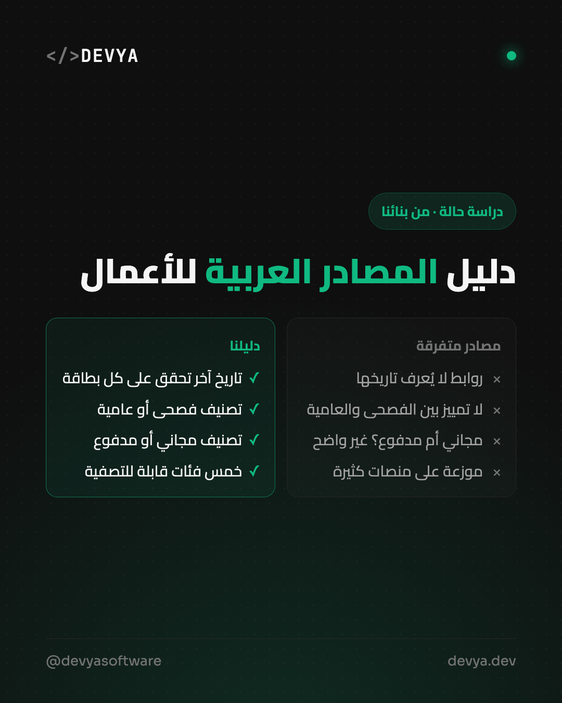 `1080×1350`

```text
تبحث عن مصادر عربية مجانية لتعلّم مصطلحات المال والاستثمار؟
جمعنا أكثر من 20 مصدرًا موثّقًا في دليل واحد ثنائي اللغة، وكل مصدر مصنّف فصحى أو عامية، مجاني أو مدفوع، مع تاريخ آخر تحقق.
الرابط في البايو.

#ريادة_الأعمال #الاستثمار #تعلم #اللغة_العربية #مصادر_مجانية #BuildWithDevya
```

### Vertical video · 1080×1920, 10 s · `visuals/2026-11-21/reel-<lang>.mp4` (rendered on the day)

One-liner EN: Free Arabic resources for finance and investment, verified and tagged.

One-liner AR: مصادر عربية مجانية للمال والاستثمار، موثّقة ومصنّفة.

**LinkedIn video** · 13:00 · English

```text
Free Arabic resources for finance and investment, verified and tagged.

#Arabic #FinancialLiteracy #OpenKnowledge
```

**Facebook Reel** · 13:00 · English

```text
Free Arabic resources for finance and investment, verified and tagged.

More: https://www.devya.dev/projects/arabic-business-resources?utm_source=facebook&utm_medium=social&utm_content=reel
```

**Instagram Reel** · 13:00 · Arabic

```text
مصادر عربية مجانية للمال والاستثمار، موثّقة ومصنّفة.

#ريادة_الأعمال #الاستثمار #تعلم #اللغة_العربية #مصادر_مجانية
```

**Stories** (same video, no caption): Facebook 19:30 English · Instagram 21:00 Arabic

## Day 8 · Sun 22 Nov · Build MENA products Arabic-first, then derive English

Pillar **client-value** · layout **compare** · accent ember · source https://www.devya.dev/services

Basis: devya-market-intel 2026-11-15 guide.do: Arabic-first copy and RTL layouts, local formats from sprint one

### LinkedIn · 10:00 · English

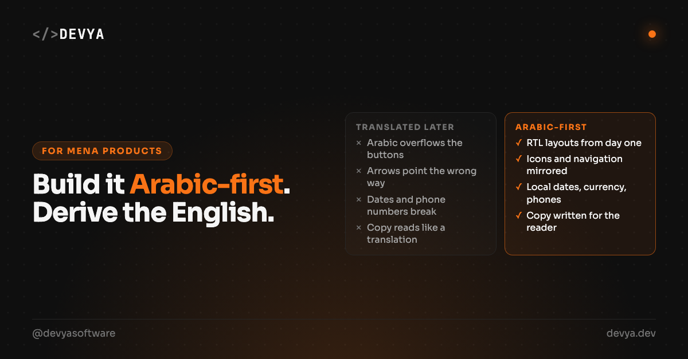 `1200×627`

```text
If your customers are in Egypt or the Gulf, the Arabic version isn't a translation task at the end of the project. It's the primary product.

What goes wrong when Arabic comes last:
→ Labels overflow their buttons, because Arabic runs a different length.
→ Arrows, progress bars and swipe gestures point the wrong way.
→ Dates, currency and phone numbers break in RTL.
→ The copy reads like it was translated, because it was.

What we do instead: design the RTL layout first, write the Arabic for the reader, then derive the English. Mirroring, local formats (SAR and EGP, Hijri dates where they're needed, +966 and +20 phone numbers) and bilingual admin screens belong in sprint one, not in a "localisation phase".

Starting this way is cheaper than retrofitting it.

#Localization #RTL #ProductDesign #SaudiArabia
```

### Facebook · 19:30 · Arabic

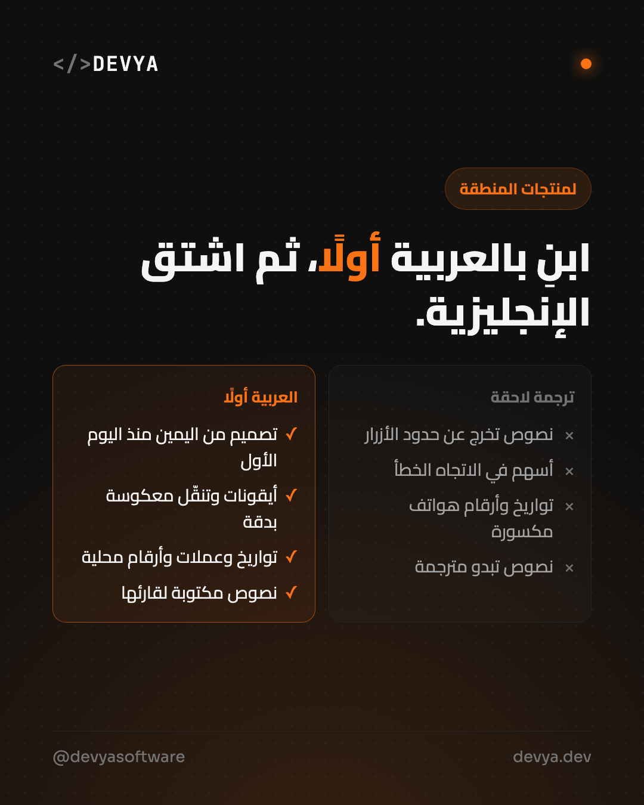 `1080×1350`

```text
إذا كان عملاؤك في مصر أو الخليج، فالنسخة العربية من تطبيقك ليست ترجمة تُضاف في النهاية، بل هي المنتج الأساسي.

حين تأتي العربية متأخرة تظهر المشكلات: نصوص تخرج عن الأزرار، وأسهم في الاتجاه المعاكس، وتواريخ وأرقام هواتف لا تُعرض بشكل صحيح، وكلام يبدو مترجمًا.

لذلك نبدأ بتصميم الواجهة العربية من اليمين إلى اليسار، ونكتب النص العربي لقارئه، ثم نشتق النسخة الإنجليزية.

تخطط لمنتج لعملاء عرب؟ تحدث معنا: https://www.devya.dev/contact?utm_source=facebook&utm_medium=social
```

### Instagram · 21:00 · English

 `1080×1350`

```text
Selling to Egypt or the Gulf? Build it Arabic-first.
Design RTL from day one, write Arabic for the reader, then derive the English. Retrofitting Arabic later means broken buttons, backwards arrows and copy that reads translated.

#BuildWithDevya #RTL #Localization #UXDesign #ProductDesign #SaudiArabia
```

### Vertical video · 1080×1920, 10 s · `visuals/2026-11-22/reel-<lang>.mp4` (rendered on the day)

One-liner EN: Selling to Egypt or the Gulf? Build it Arabic-first.

One-liner AR: تبيع لعملاء في مصر أو الخليج؟ ابنِ منتجك بالعربية أولًا.

**LinkedIn video** · 13:00 · English

```text
Selling to Egypt or the Gulf? Build it Arabic-first.

#Localization #RTL #ProductDesign
```

**Facebook Reel** · 13:00 · Arabic

```text
تبيع لعملاء في مصر أو الخليج؟ ابنِ منتجك بالعربية أولًا.

التفاصيل: https://www.devya.dev/services?utm_source=facebook&utm_medium=social&utm_content=reel
```

**Instagram Reel** · 13:00 · English

```text
Selling to Egypt or the Gulf? Build it Arabic-first.

#BuildWithDevya #RTL #Localization #UXDesign #ProductDesign
```

**Stories** (same video, no caption): Facebook 19:30 Arabic · Instagram 21:00 English

## Day 9 · Mon 23 Nov · Mocks agree with you, Postgres does not: Testcontainers

Pillar **engineering** · layout **terminal** · accent azure · source https://www.devya.dev/blogs/testcontainers-nodejs-postgres-integration-tests-field-notes

Basis: Devya blog field notes: integration tests against real PostgreSQL with Testcontainers

### LinkedIn · 10:00 · English

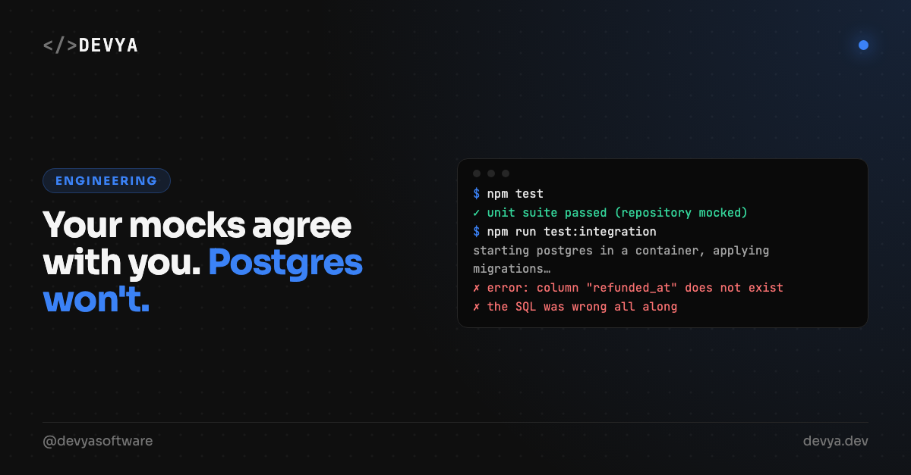 `1200×627`

```text
Mocked repositories have one flaw: they agree with whatever you assumed. Our tests stayed green while the SQL underneath was wrong.

So our repository tests now run against a real PostgreSQL, started for each test run with Testcontainers:
→ The same database engine production runs, with the real migrations applied.
→ Unit tests may mock the repository. Repository tests never do.
→ CI runs the same containers as the laptop, so "works on my machine" stops being an argument.

It's slower than a mock. In exchange, a renamed column or a wrong JOIN fails on the laptop instead of in front of a customer.

How we set it up in Node.js: https://www.devya.dev/blogs/testcontainers-nodejs-postgres-integration-tests-field-notes?utm_source=linkedin&utm_medium=social

#NodeJS #PostgreSQL #Testing #BuildWithDevya
```

### Facebook · 19:30 · Arabic

 `1080×1350`

```text
كيف تنجح كل الاختبارات ثم يتعطل التطبيق عند العميل؟

أحد الأسباب: اختبارات تعتمد على «محاكاة» لقاعدة البيانات بدل قاعدة بيانات حقيقية. المحاكاة توافق دائمًا على افتراضاتك، حتى لو كان الاستعلام خاطئًا.

لهذا نشغّل اختبارات طبقة البيانات على قاعدة PostgreSQL حقيقية داخل حاوية، مع ملفات الترحيل نفسها المستخدمة في الإنتاج. أبطأ قليلًا، لكن الخطأ يظهر على جهاز المطوّر لا أمام عملائك.

التفاصيل التقنية: https://www.devya.dev/blogs/testcontainers-nodejs-postgres-integration-tests-field-notes?utm_source=facebook&utm_medium=social
```

### Instagram · 21:00 · English

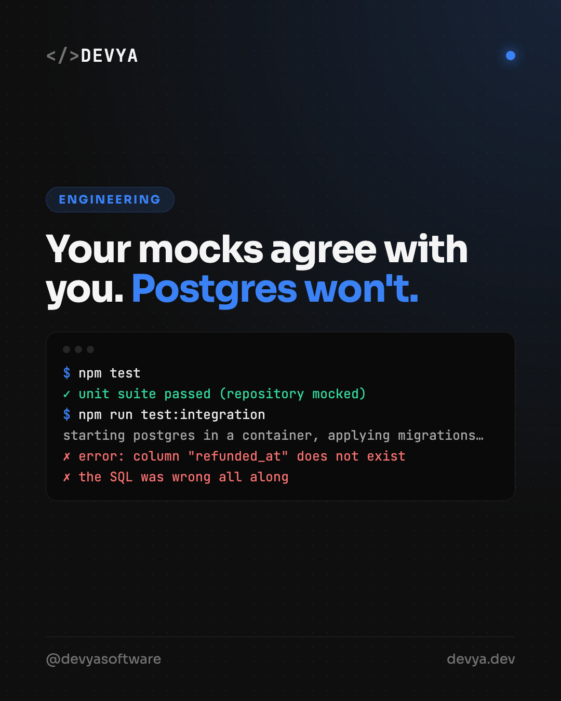 `1080×1350`

```text
Green tests, broken app?
Mocks agree with your assumptions, even when the SQL is wrong. We run repository tests against a real Postgres in a container, migrations and all. Slower, and worth it.
Link in bio.

#BuildWithDevya #Testing #PostgreSQL #NodeJS #SoftwareEngineering #DevOps
```

### Vertical video · 1080×1920, 10 s · `visuals/2026-11-23/reel-<lang>.mp4` (rendered on the day)

One-liner EN: Your mocks agree with you. A real Postgres won't.

One-liner AR: المحاكاة توافقك دائمًا، أما قاعدة البيانات الحقيقية فلا.

**LinkedIn video** · 13:00 · English

```text
Your mocks agree with you. A real Postgres won't.

#NodeJS #PostgreSQL #Testing
```

**Facebook Reel** · 13:00 · Arabic

```text
المحاكاة توافقك دائمًا، أما قاعدة البيانات الحقيقية فلا.

التفاصيل: https://www.devya.dev/blogs/testcontainers-nodejs-postgres-integration-tests-field-notes?utm_source=facebook&utm_medium=social&utm_content=reel
```

**Instagram Reel** · 13:00 · English

```text
Your mocks agree with you. A real Postgres won't.

#BuildWithDevya #Testing #PostgreSQL #NodeJS #SoftwareEngineering
```

**Stories** (same video, no caption): Facebook 19:30 Arabic · Instagram 21:00 English

## Day 10 · Tue 24 Nov · CopyForge: Arabic ad copy that doesn't read translated

Pillar **product** · layout **product** · accent lime · source https://www.devya.dev/projects/copyforge

Basis: devya.dev/projects/copyforge (live, 20 free credits, MSA/Egyptian/Khaleeji)

### LinkedIn · 10:00 · English

 `1200×627`

```text
Most AI writing tools were built for English first. Ask them for Arabic and you get a translation: correct, stiff, and obviously not written by someone from the market.

CopyForge is our answer for MENA sellers:
→ One generation returns a full ad set for Meta or TikTok (five hooks, three bodies, three calls to action) or a complete Salla or Zid product description.
→ Written natively in the dialect you pick: Modern Standard Arabic, Egyptian or Khaleeji.
→ Credits instead of a subscription. Credits never expire, and new accounts start with 20 free.
→ Recent generations stay in your browser, not on our servers.

Built on the Vercel AI SDK with Google Gemini. Live in Arabic and English.

https://www.devya.dev/projects/copyforge?utm_source=linkedin&utm_medium=social

#ArabicMarketing #Ecommerce #AI #BuildWithDevya
```

### Facebook · 19:30 · English

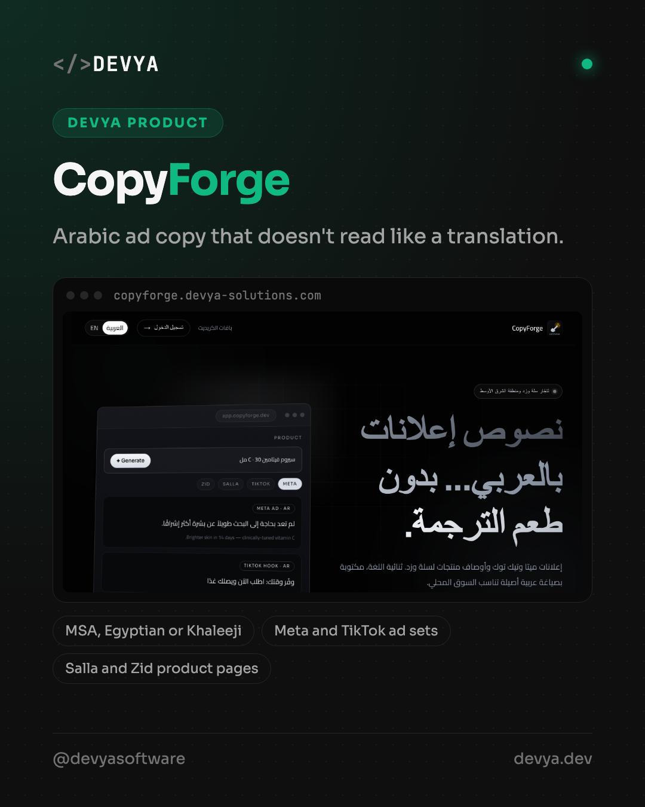 `1080×1350`

```text
Selling on Salla or Zid, or running Meta and TikTok ads in Arabic?

CopyForge writes your ad sets and product descriptions natively in Modern Standard Arabic, Egyptian or Khaleeji, so they don't read like a translation. One credit per generation, credits never expire, and every new account starts with 20 free credits.

Try it: https://www.devya.dev/projects/copyforge?utm_source=facebook&utm_medium=social
```

### Instagram · 21:00 · Arabic

 `1080×1350`

```text
إعلانات عربية لا تبدو مترجمة.
أداة CopyForge تكتب إعلانات ميتا وتيك توك وأوصاف منتجات سلة وزد بالفصحى أو المصرية أو الخليجية، حسب اختيارك.
عشرون رصيدًا مجانيًا لكل حساب جديد. الرابط في البايو.

#تسويق_إلكتروني #التجارة_الإلكترونية #سلة #زد #كتابة_إعلانية #BuildWithDevya
```

### Vertical video · 1080×1920, 10 s · `visuals/2026-11-24/reel-<lang>.mp4` (rendered on the day)

One-liner EN: CopyForge: Arabic ad copy that doesn't read like a translation.

One-liner AR: أداة CopyForge تكتب نصوصًا إعلانية عربية لا تبدو مترجمة.

**LinkedIn video** · 13:00 · English

```text
CopyForge: Arabic ad copy that doesn't read like a translation.

#ArabicMarketing #Ecommerce #AI
```

**Facebook Reel** · 13:00 · English

```text
CopyForge: Arabic ad copy that doesn't read like a translation.

More: https://www.devya.dev/projects/copyforge?utm_source=facebook&utm_medium=social&utm_content=reel
```

**Instagram Reel** · 13:00 · Arabic

```text
أداة CopyForge تكتب نصوصًا إعلانية عربية لا تبدو مترجمة.

#تسويق_إلكتروني #التجارة_الإلكترونية #سلة #زد #كتابة_إعلانية
```

**Stories** (same video, no caption): Facebook 19:30 English · Instagram 21:00 Arabic

## Day 11 · Wed 25 Nov · Engineer swaps: the handover clauses to ask for

Pillar **client-value** · layout **checklist** · accent ember · source https://www.devya.dev/services

Basis: devya-market-intel 2026-11-15 guide.avoid: engineer swaps without a handover protocol

### LinkedIn · 10:00 · English

 `1200×627`

```text
Projects rarely fail on the day an engineer leaves. They fail three weeks later, when nobody remembers why the payment retry works the way it does.

Engineer changes happen: people get sick, get promoted, move on. What matters is the handover. Put this in your contract:

1. Two weeks' written notice before anyone rotates off your project.
2. An overlap period where the leaving and joining engineers work together.
3. A written handover note: open work, known risks, and the decisions behind the odd parts.
4. A demo from the new engineer, on your codebase, before the handover is signed off.
5. Your approval before the swap is final.

A vendor who agrees to this easily has done it before. One who resists is telling you something.

#ProjectManagement #Outsourcing #Startups #BuildWithDevya
```

### Facebook · 19:30 · Arabic

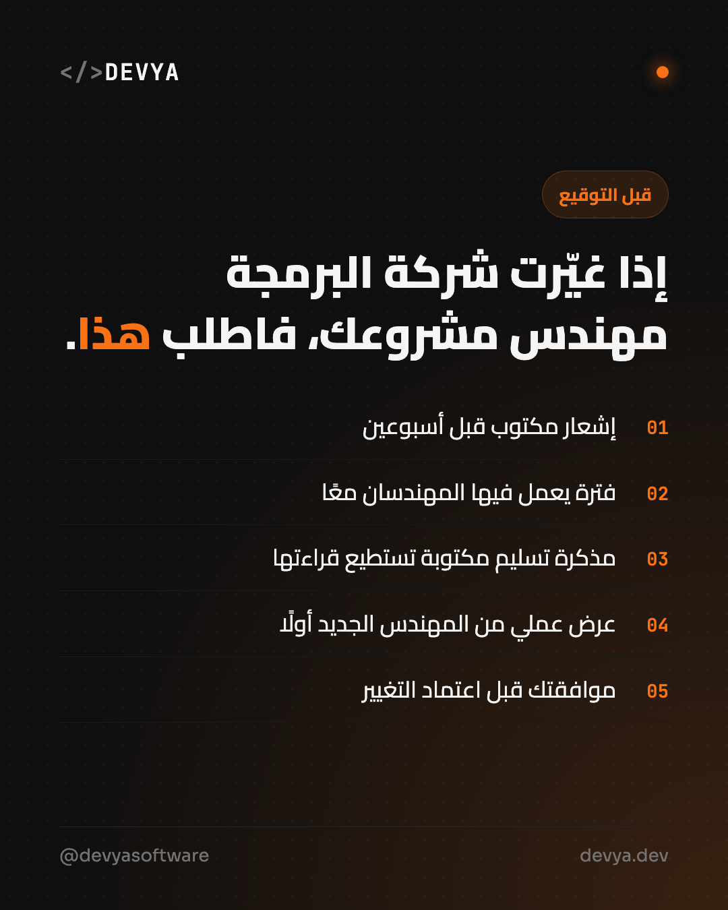 `1080×1350`

```text
تغيير المهندس المسؤول عن مشروعك أمر وارد، لكن التسليم السيئ هو ما يعطّل المشروع.

إن كنت تتعامل مع شركة برمجة، فاطلب في العقد:
1. إشعارًا مكتوبًا قبل أسبوعين من أي تغيير.
2. فترة يعمل فيها المهندس القديم والجديد معًا.
3. مذكرة تسليم مكتوبة بالأعمال المفتوحة والمخاطر المعروفة.
4. عرضًا عمليًا من المهندس الجديد قبل اعتماد التسليم.
5. موافقتك قبل أن يصبح التغيير نهائيًا.

بنود بسيطة تحمي وقتك ومالك.

https://www.devya.dev/contact?utm_source=facebook&utm_medium=social
```

### Instagram · 21:00 · English

 `1080×1350`

```text
Your vendor is swapping your engineer. Ask for:
1 Two weeks' written notice
2 An overlap period
3 A written handover note
4 A demo from the new engineer
5 Your sign-off before it's final
Save it for your next contract.

#BuildWithDevya #Founders #Outsourcing #ProjectManagement #TechTips #Startups
```

### Vertical video · 1080×1920, 10 s · `visuals/2026-11-25/reel-<lang>.mp4` (rendered on the day)

One-liner EN: Your vendor is swapping your engineer. Ask for these five things.

One-liner AR: شركة البرمجة ستغيّر مهندس مشروعك؟ اطلب هذه البنود الخمسة.

**LinkedIn video** · 13:00 · English

```text
Your vendor is swapping your engineer. Ask for these five things.

#ProjectManagement #Outsourcing #Startups
```

**Facebook Reel** · 13:00 · Arabic

```text
شركة البرمجة ستغيّر مهندس مشروعك؟ اطلب هذه البنود الخمسة.

التفاصيل: https://www.devya.dev/services?utm_source=facebook&utm_medium=social&utm_content=reel
```

**Instagram Reel** · 13:00 · English

```text
Your vendor is swapping your engineer. Ask for these five things.

#BuildWithDevya #Founders #Outsourcing #ProjectManagement #TechTips
```

**Stories** (same video, no caption): Facebook 19:30 Arabic · Instagram 21:00 English

## Day 12 · Thu 26 Nov · Parallel AI coding agents with git worktrees

Pillar **engineering** · layout **code** · accent azure · source https://www.devya.dev/blogs/git-worktrees-parallel-ai-coding-agents-field-notes

Basis: Devya blog field notes: running parallel AI coding agents with git worktrees

### LinkedIn · 10:00 · English

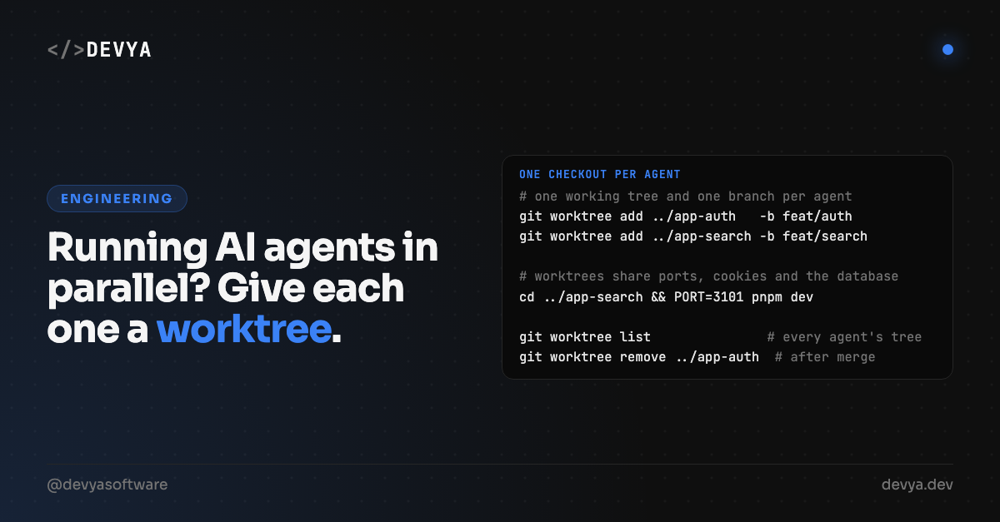 `1200×627`

```text
We run several AI coding agents against the same repository at once. The first thing that breaks isn't the code. It's the shared folder: two agents editing one checkout overwrite each other's work.

Git worktrees fix the file problem with one command. Each agent gets its own working directory on its own branch, all backed by one repository.

What worktrees don't isolate, and you have to split yourself:
→ Ports. Two dev servers both want 3000, so give each tree its own.
→ Localhost cookies. Sessions on localhost leak between apps; use a separate hostname per tree.
→ The database. A seed script in one tree can wipe data another tree depends on.

Treat each worktree as a separate machine and parallel agents stop stepping on each other.

Field notes: https://www.devya.dev/blogs/git-worktrees-parallel-ai-coding-agents-field-notes?utm_source=linkedin&utm_medium=social

#AIEngineering #Git #DeveloperProductivity #BuildWithDevya
```

### Facebook · 19:30 · Arabic

 `1080×1350`

```text
نستخدم عدة وكلاء برمجة بالذكاء الاصطناعي على المشروع نفسه في الوقت ذاته. أول مشكلة واجهتنا لم تكن في الكود، بل في المجلد المشترك: وكيلان يعدّلان الملفات نفسها فيمحو أحدهما عمل الآخر.

الحل في Git اسمه worktree: لكل وكيل مجلد عمل وفرع خاص به، وكلها مرتبطة بمستودع واحد.

لكن انتبه: المنافذ وملفات تعريف الارتباط وقاعدة البيانات تبقى مشتركة ما لم تفصلها بنفسك.

الملاحظات الكاملة: https://www.devya.dev/blogs/git-worktrees-parallel-ai-coding-agents-field-notes?utm_source=facebook&utm_medium=social
```

### Instagram · 21:00 · English

 `1080×1350`

```text
Running several AI coding agents on one repo?
Give each its own git worktree: own folder, own branch, same repository. Then split what worktrees don't: ports, localhost cookies and the database.
Link in bio.

#BuildWithDevya #AI #Git #DeveloperTools #SoftwareEngineering #Coding
```

### Vertical video · 1080×1920, 10 s · `visuals/2026-11-26/reel-<lang>.mp4` (rendered on the day)

One-liner EN: Running AI coding agents in parallel? Give each one a git worktree.

One-liner AR: تشغّل عدة وكلاء برمجة معًا؟ امنح كلًّا منهم worktree خاصًا.

**LinkedIn video** · 13:00 · English

```text
Running AI coding agents in parallel? Give each one a git worktree.

#AIEngineering #Git #DeveloperProductivity
```

**Facebook Reel** · 13:00 · Arabic

```text
تشغّل عدة وكلاء برمجة معًا؟ امنح كلًّا منهم worktree خاصًا.

التفاصيل: https://www.devya.dev/blogs/git-worktrees-parallel-ai-coding-agents-field-notes?utm_source=facebook&utm_medium=social&utm_content=reel
```

**Instagram Reel** · 13:00 · English

```text
Running AI coding agents in parallel? Give each one a git worktree.

#BuildWithDevya #AI #Git #DeveloperTools #SoftwareEngineering
```

**Stories** (same video, no caption): Facebook 19:30 Arabic · Instagram 21:00 English

## Day 13 · Fri 27 Nov · Urania: a bilingual guide to the constellations we built

Pillar **case-study** · layout **product** · accent lime · source https://www.devya.dev/projects/urania

Basis: devya.dev/projects/urania (bilingual EN/AR illustrated constellation guide)

### LinkedIn · 10:00 · English

 `1200×627`

```text
Not everything we build is for a client. Urania is a bilingual, illustrated guide to the constellations and the Greek myths behind them, in English and Arabic.

Side projects like this are where we practise the details client work depends on: Arabic typography that holds up next to Latin, RTL layouts that are designed rather than flipped, and content that reads natively in both languages instead of one being a translation of the other.

It's free and open to anyone curious about the sky. Look up tonight.

#Arabic #Bilingual #Astronomy #BuildWithDevya
```

### Facebook · 19:30 · Arabic

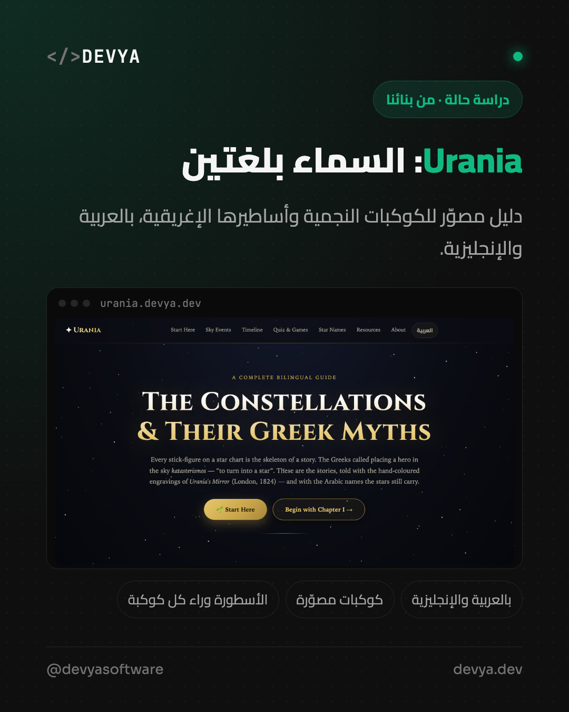 `1080×1350`

```text
ليس كل ما نبنيه لعملاء. «Urania» دليل مصوّر ومجاني للكوكبات النجمية والأساطير الإغريقية المرتبطة بها، بالعربية والإنجليزية.

في مشاريع كهذه نتدرّب على التفاصيل التي يحتاجها عملاؤنا: خط عربي واضح بجوار الإنجليزي، وتصميم من اليمين إلى اليسار مدروس لا مقلوب، ونصوص تُقرأ بطبيعية في اللغتين.

جرّبه الليلة: https://www.devya.dev/projects/urania?utm_source=facebook&utm_medium=social
```

### Instagram · 21:00 · English

 `1080×1350`

```text
Not everything we build is for a client.
Urania is a free, illustrated guide to the constellations and their Greek myths, in English and Arabic. It's where we practise Arabic typography and RTL layouts that are designed, not flipped.
Link in bio.

#BuildWithDevya #Astronomy #Constellations #Arabic #WebDesign #SideProject
```

### Vertical video · 1080×1920, 10 s · `visuals/2026-11-27/reel-<lang>.mp4` (rendered on the day)

One-liner EN: Urania: the constellations and their myths, in English and Arabic.

One-liner AR: دليل Urania يشرح الكوكبات النجمية وأساطيرها، بالعربية والإنجليزية.

**LinkedIn video** · 13:00 · English

```text
Urania: the constellations and their myths, in English and Arabic.

#Arabic #Bilingual #Astronomy
```

**Facebook Reel** · 13:00 · Arabic

```text
دليل Urania يشرح الكوكبات النجمية وأساطيرها، بالعربية والإنجليزية.

التفاصيل: https://www.devya.dev/projects/urania?utm_source=facebook&utm_medium=social&utm_content=reel
```

**Instagram Reel** · 13:00 · English

```text
Urania: the constellations and their myths, in English and Arabic.

#BuildWithDevya #Astronomy #Constellations #Arabic #WebDesign
```

**Stories** (same video, no caption): Facebook 19:30 Arabic · Instagram 21:00 English

## Day 14 · Sat 28 Nov · Stop adding Postgres indexes by guesswork: EXPLAIN ANALYZE

Pillar **engineering** · layout **code** · accent azure · source https://www.devya.dev/blogs/postgres-explain-analyze-query-plans-indexes-field-notes

Basis: Devya blog field notes: reading PostgreSQL EXPLAIN ANALYZE

### LinkedIn · 10:00 · English

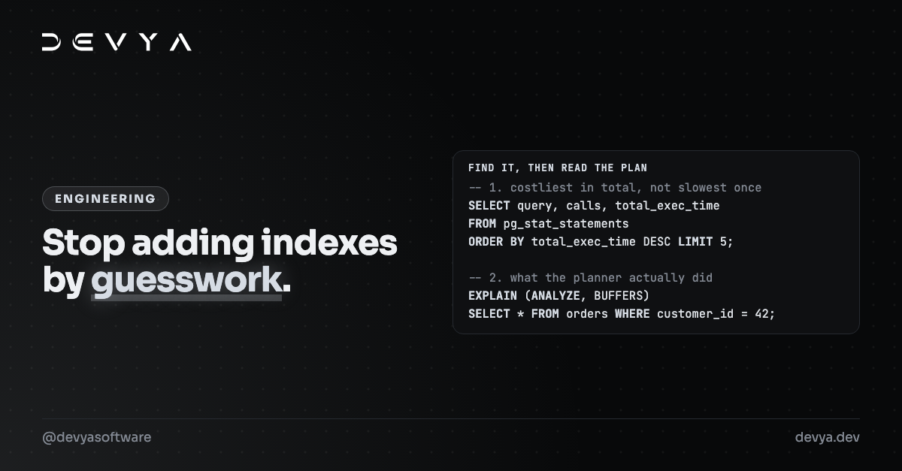 `1200×627`

```text
We used to add PostgreSQL indexes the way most teams do: someone says a page is slow, someone adds an index, everyone hopes.

Our process now has three steps:
1. Find the costliest query in pg_stat_statements, ordered by total execution time rather than the slowest single run. A fast query called a million times can cost more than a slow report run once a day.
2. Run EXPLAIN (ANALYZE, BUFFERS) on it and read what the planner actually did: sequential scans on big tables, row estimates that are far off, sorts spilling to disk.
3. Add the one index the plan asks for, then run it again and compare.

Every index slows down writes and costs disk. Each one should come with the plan that justified it.

#PostgreSQL #Database #BackendEngineering #BuildWithDevya
```

### Facebook · 19:30 · English

 `1080×1350`

```text
When an app gets slow, the usual fix is to "add an index" and hope.

We do it in order instead: find the database query that costs the most in total, read the plan PostgreSQL actually used, add the one index that plan asks for, then measure again. Every index has a cost on writes, so each one has to earn its place.

Engineering notes: https://www.devya.dev/blogs/postgres-explain-analyze-query-plans-indexes-field-notes?utm_source=facebook&utm_medium=social
```

### Instagram · 21:00 · Arabic

 `1080×1350`

```text
توقف عن إضافة الفهارس إلى قاعدة البيانات بالتخمين.
ابحث أولًا عن الاستعلام الأعلى تكلفة إجمالًا، ثم اقرأ خطة التنفيذ الفعلية عبر EXPLAIN ANALYZE، وأضف الفهرس الذي تطلبه الخطة فقط، ثم قِس من جديد.
الرابط في البايو.

#قواعد_البيانات #برمجة #تطوير_البرمجيات #تقنية #مطورين #BuildWithDevya
```

### Vertical video · 1080×1920, 10 s · `visuals/2026-11-28/reel-<lang>.mp4` (rendered on the day)

One-liner EN: Stop adding indexes by guesswork. Read the plan first.

One-liner AR: توقف عن إضافة الفهارس بالتخمين. اقرأ خطة التنفيذ أولًا.

**LinkedIn video** · 13:00 · English

```text
Stop adding indexes by guesswork. Read the plan first.

#PostgreSQL #Database #BackendEngineering
```

**Facebook Reel** · 13:00 · English

```text
Stop adding indexes by guesswork. Read the plan first.

More: https://www.devya.dev/blogs/postgres-explain-analyze-query-plans-indexes-field-notes?utm_source=facebook&utm_medium=social&utm_content=reel
```

**Instagram Reel** · 13:00 · Arabic

```text
توقف عن إضافة الفهارس بالتخمين. اقرأ خطة التنفيذ أولًا.

#قواعد_البيانات #برمجة #تطوير_البرمجيات #تقنية #مطورين
```

**Stories** (same video, no caption): Facebook 19:30 English · Instagram 21:00 Arabic
