# Devya social calendar

Generated from `calendar.json` by `render/build-md.mjs`. Edit the JSON, not this file. Times are Africa/Cairo.
Slots: LinkedIn 10:00, LinkedIn video + Reels 13:00, Facebook + Story 19:30, Instagram + Story 21:00.

| Day | Date | Pillar | Layout | Topic | FB / IG language |
|---|---|---|---|---|---|
| 1 | Sun 15 Nov | bts | terminal | Three open-source guardrails on every repo: leakhook, envcheck, i18n-check | AR / EN |
| 2 | Mon 16 Nov | client-value | checklist | Ask for a v1 cut line before you ask for a quote | AR / EN |
| 3 | Tue 17 Nov | engineering | code | N+1 queries: fast locally, slow in production | EN / AR |
| 4 | Wed 18 Nov | product | product | Devya X-Ray: an engineering review that reads the code | AR / EN |
| 5 | Thu 19 Nov | client-value | checklist | The five lines a weekly dev update should contain | AR / EN |
| 6 | Fri 20 Nov | bts | statement | What 'done' means at Devya: merged isn't done | AR / EN |
| 7 | Sat 21 Nov | case-study | compare | Arabic Business Resources: a verified bilingual guide we built | EN / AR |
| 8 | Sun 22 Nov | client-value | compare | Build MENA products Arabic-first, then derive English | AR / EN |
| 9 | Mon 23 Nov | engineering | terminal | Mocks agree with you, Postgres does not: Testcontainers | AR / EN |
| 10 | Tue 24 Nov | product | product | CopyForge: Arabic ad copy that doesn't read translated | EN / AR |
| 11 | Wed 25 Nov | client-value | checklist | Engineer swaps: the handover clauses to ask for | AR / EN |
| 12 | Thu 26 Nov | engineering | code | Parallel AI coding agents with git worktrees | AR / EN |
| 13 | Fri 27 Nov | case-study | product | Urania: a bilingual guide to the constellations we built | AR / EN |
| 14 | Sat 28 Nov | engineering | code | Stop adding Postgres indexes by guesswork: EXPLAIN ANALYZE | EN / AR |
| 15 | Sun 29 Nov | client-value | checklist | Ask for repo, staging and admin access from sprint one | AR / EN |
| 16 | Mon 30 Nov | engineering | compare | A JWT is encoded, not encrypted: decoding isn't verifying | AR / EN |
| 17 | Tue 1 Dec | product | product | Devya Converse: AI chat that answers from your own content | EN / AR |
| 18 | Wed 2 Dec | client-value | statement | Ask for the real start date and the named team in writing | AR / EN |
| 19 | Thu 3 Dec | engineering | code | A wrong cron line still runs: read it back before it ships | AR / EN |
| 20 | Fri 4 Dec | bts | checklist | Our security practices on one page, before procurement asks | AR / EN |
| 21 | Sat 5 Dec | product | product | og-preview: see your link card before you share it | EN / AR |
| 22 | Sun 6 Dec | client-value | checklist | Before launch, ask for a written test pass on real content | AR / EN |
| 23 | Mon 7 Dec | engineering | code | Light grey text can fail WCAG contrast: measure it | AR / EN |
| 24 | Tue 8 Dec | product | product | Moving POS: a restaurant POS with an AI companion that reads your own sales | EN / AR |
| 25 | Wed 9 Dec | engineering | terminal | Random 502s behind a load balancer: the Node.js keep-alive timeout | AR / EN |
| 26 | Thu 10 Dec | product | compare | Moving Loyalty: loyalty cards in Apple Wallet and Google Wallet, no app | AR / EN |
| 27 | Fri 11 Dec | bts | statement | Rules an AI coding agent must never skip live in hooks, not the prompt | AR / EN |
| 28 | Sat 12 Dec | client-value | checklist | Ask your vendor: can a retried payment charge twice? | EN / AR |
| 29 | Sun 13 Dec | product | product | Moving Stores: an online store whose menu comes from the till | AR / EN |
| 30 | Mon 14 Dec | engineering | code | OFFSET pagination slows down on every page: keyset cursors | AR / EN |
| 31 | Tue 15 Dec | product | checklist | Moving Accounting: double-entry books with ZATCA and ETA e-invoicing built in | EN / AR |

## Day 1 · Sun 15 Nov · Three open-source guardrails on every repo: leakhook, envcheck, i18n-check

Pillar **bts** · layout **terminal** · accent lime · source https://www.devya.dev/projects/leakhook

Basis: Devya open-source projects envcheck, leakhook, i18n-check (devya.dev/projects)

### LinkedIn · 10:00 · English

 `1200×627`

```text
Three checks run on every Devya repo before code reaches a reviewer. We open-sourced all three.

1. leakhook: a pre-commit hook that scans the staged diff for AWS, GitHub, Stripe, Slack and Google keys, private-key blocks, JWTs and database URLs with credentials. The commit stops before anything leaks.
2. envcheck: treats .env.example as the schema and checks the real .env against it, flagging missing keys, empty required values and wrong types. It exits non-zero, so CI catches it before a deploy does.
3. i18n-check: compares every locale file against the base and reports missing, extra and empty keys. On bilingual EN/AR products, this is the check that stops a half-translated screen from shipping.

Each one is zero-dependency and small enough to read in one sitting. None of them is clever. That's the point: guardrails that are boring to install actually get installed.

Code and docs: https://www.devya.dev/projects/leakhook?utm_source=linkedin&utm_medium=social

#BuildWithDevya #OpenSource #DevSecOps #NodeJS
```

### Facebook · 19:30 · Arabic

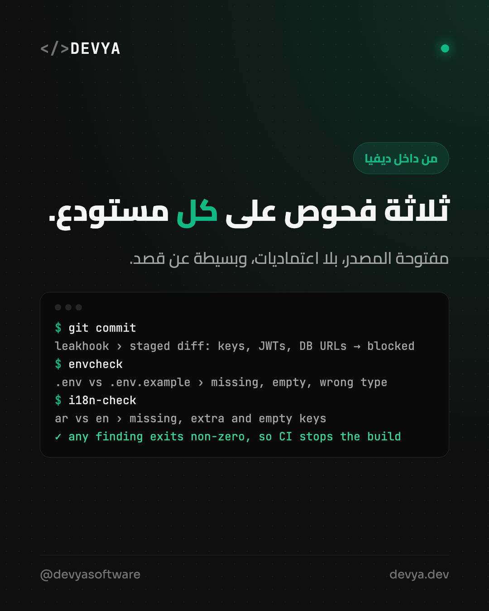 `1080×1350`

```text
قبل أن يصل أي سطر برمجي إلى المراجعة، تمر مشاريعنا بثلاثة فحوص بسيطة، وقد أتحناها مجانًا للجميع:

• أداة leakhook تمنع رفع المفاتيح السرية وكلمات المرور إلى المستودع.
• أداة envcheck تتأكد من اكتمال إعدادات التشغيل قبل أن يعمل التطبيق.
• أداة i18n-check تكشف النصوص الناقصة بين النسختين العربية والإنجليزية.

لماذا يهمك هذا كصاحب مشروع؟ لأن كثيرًا من الأعطال المحرجة لا يأتي من أكواد معقدة، بل من خطأ صغير لم يُفحص.

التفاصيل: https://www.devya.dev/projects/leakhook?utm_source=facebook&utm_medium=social
```

### Instagram · 21:00 · English

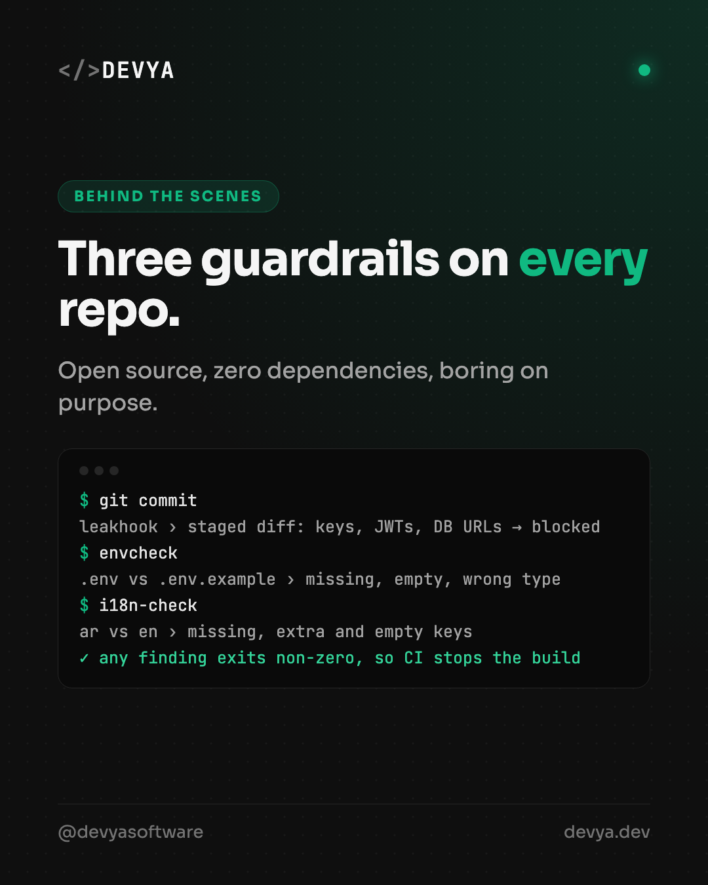 `1080×1350`

```text
Three boring checks on every repo we touch:
🔒 leakhook blocks secrets at commit time
🧾 envcheck checks .env against .env.example
🌐 i18n-check catches missing Arabic or English keys
All three are free and open source. Link in bio.

#BuildWithDevya #OpenSource #WebDevelopment #NodeJS #DevSecOps #Cairo
```

### Vertical video · 1080×1920, 10 s · `visuals/2026-11-15/reel-<lang>.mp4` (rendered on the day)

One-liner EN: Three checks on every Devya repo, all open source: leakhook, envcheck, i18n-check.

One-liner AR: ثلاثة فحوص على كل مستودع لدينا، وكلها مفتوحة المصدر: leakhook و envcheck و i18n-check.

**LinkedIn video** · 13:00 · English

```text
Three checks on every Devya repo, all open source: leakhook, envcheck, i18n-check.

#BuildWithDevya #OpenSource #DevSecOps
```

**Facebook Reel** · 13:00 · Arabic

```text
ثلاثة فحوص على كل مستودع لدينا، وكلها مفتوحة المصدر: leakhook و envcheck و i18n-check.

التفاصيل: https://www.devya.dev/projects/leakhook?utm_source=facebook&utm_medium=social&utm_content=reel
```

**Instagram Reel** · 13:00 · English

```text
Three checks on every Devya repo, all open source: leakhook, envcheck, i18n-check.

#BuildWithDevya #OpenSource #WebDevelopment #NodeJS #DevSecOps
```

**Stories** (same video, no caption): Facebook 19:30 Arabic · Instagram 21:00 English

## Day 2 · Mon 16 Nov · Ask for a v1 cut line before you ask for a quote

Pillar **client-value** · layout **checklist** · accent ember · source https://www.devya.dev/services

Basis: devya-market-intel 2026-11-15 guide.do: costed feature list with a v1 cut line

### LinkedIn · 10:00 · English

 `1200×627`

```text
Most quotes answer the wrong question. "How much for the whole app?" gets you one number and no way to change it.

Ask for a cut line instead:

1. Every feature listed, ranked by what it's worth to your users.
2. A cost next to each one.
3. A line drawn where your budget ends.
4. Everything above the line is v1. Everything below waits until real users ask for it.

Now you can trade: drop loyalty points, keep online payments, and watch the total move. You stay in control of scope, and the team you hire has to understand your users before it can rank anything.

If a vendor can't produce this list, they haven't understood the product yet. That's worth knowing before you sign.

#ProductDevelopment #Startups #MENA #BuildWithDevya
```

### Facebook · 19:30 · Arabic

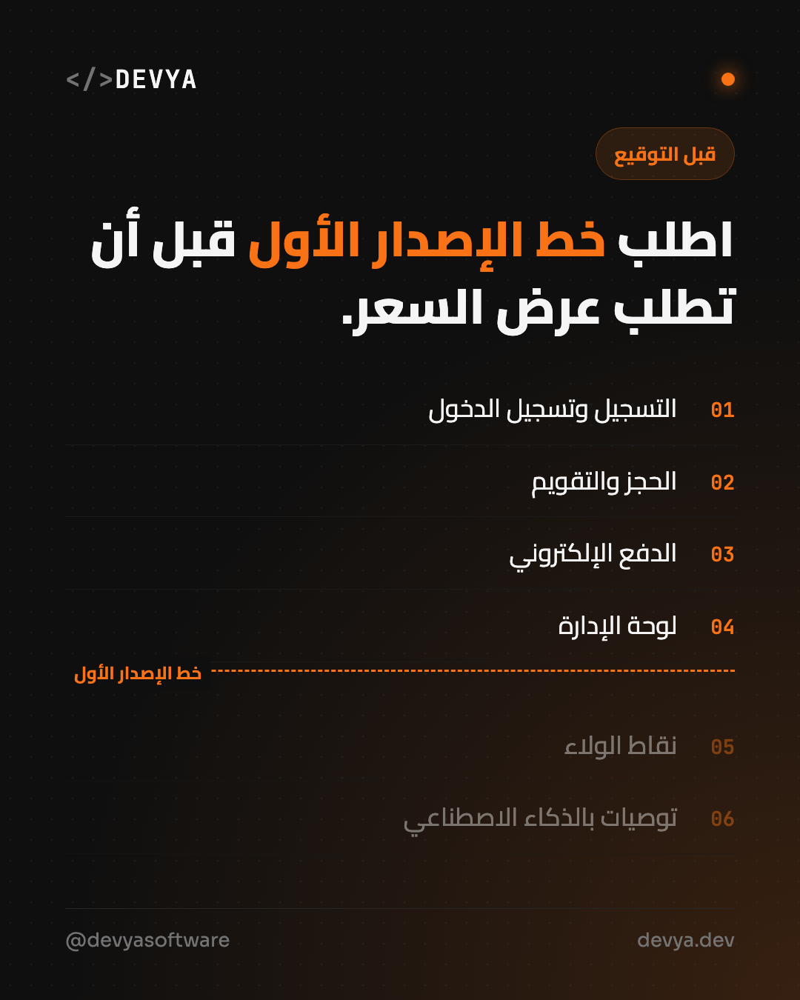 `1080×1350`

```text
قبل أن تطلب عرض سعر لتطبيقك، اطلب شيئًا أهم: «خط الإصدار الأول».

الفكرة بسيطة:
1. قائمة بكل الميزات، مرتبة حسب قيمتها لعملائك.
2. تكلفة واضحة أمام كل ميزة.
3. خط عند حدود ميزانيتك.

ما فوق الخط يُبنى في الإصدار الأول، وما تحته ينتظر حتى يطلبه المستخدمون فعلًا. بهذا تتحكم في النطاق والتكلفة، بدل رقم إجمالي واحد لا تعرف ما وراءه.

تخطط لتطبيق جديد؟ ابدأ من هنا: https://www.devya.dev/contact?utm_source=facebook&utm_medium=social
```

### Instagram · 21:00 · English

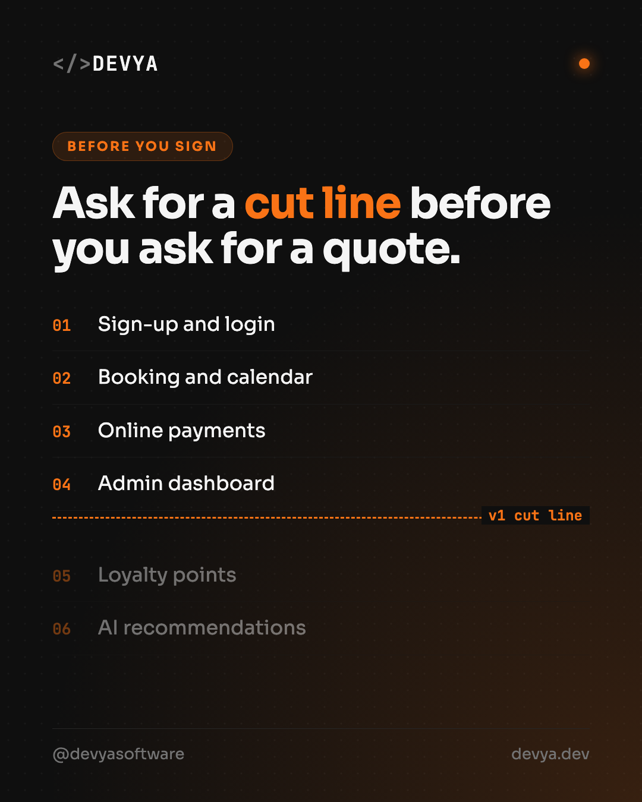 `1080×1350`

```text
Don't ask "how much for the app?"
Ask for a cut line: every feature ranked, a cost on each, and a line where your budget ends. Above the line ships in v1. Below it waits for real users.
Save this for your next quote.

#BuildWithDevya #Startups #ProductDevelopment #AppDevelopment #Founders #MVP
```

### Vertical video · 1080×1920, 10 s · `visuals/2026-11-16/reel-<lang>.mp4` (rendered on the day)

One-liner EN: Before the quote, ask for the cut line: what ships in v1, and what waits.

One-liner AR: قبل عرض السعر، اطلب خط الإصدار الأول: ما الذي يُبنى الآن، وما الذي ينتظر.

**LinkedIn video** · 13:00 · English

```text
Before the quote, ask for the cut line: what ships in v1, and what waits.

#ProductDevelopment #Startups #MENA
```

**Facebook Reel** · 13:00 · Arabic

```text
قبل عرض السعر، اطلب خط الإصدار الأول: ما الذي يُبنى الآن، وما الذي ينتظر.

التفاصيل: https://www.devya.dev/services?utm_source=facebook&utm_medium=social&utm_content=reel
```

**Instagram Reel** · 13:00 · English

```text
Before the quote, ask for the cut line: what ships in v1, and what waits.

#BuildWithDevya #Startups #ProductDevelopment #AppDevelopment #Founders
```

**Stories** (same video, no caption): Facebook 19:30 Arabic · Instagram 21:00 English

## Day 3 · Tue 17 Nov · N+1 queries: fast locally, slow in production

Pillar **engineering** · layout **code** · accent azure · source https://www.devya.dev/blogs/n-plus-1-queries-nodejs-dataloader-query-budget-field-notes

Basis: Devya blog field notes: N+1 queries, DataLoader, query budget

### LinkedIn · 10:00 · English

 `1200×627`

```text
An N+1 query is invisible on your laptop. Ten seed rows, a local database, and every page feels instant.

In production the same loop runs once per row: one query for the list, then one more for every item in it. A page with 200 orders makes 201 round trips, and each one pays network latency.

What we do now:
→ Load relations in one go (include or JOIN), or batch per request with DataLoader.
→ Log query counts per request in development, so the loop shows up before a customer notices.
→ Give each endpoint a query budget in tests and fail the build when it goes over.

The fix is usually five lines. Finding it is the hard part, so make the count visible.

Field notes with the full setup: https://www.devya.dev/blogs/n-plus-1-queries-nodejs-dataloader-query-budget-field-notes?utm_source=linkedin&utm_medium=social

#NodeJS #PostgreSQL #BackendEngineering #BuildWithDevya
```

### Facebook · 19:30 · English

 `1080×1350`

```text
Why does an app that felt fast in the demo slow down after launch?

One common reason has a name: the N+1 query. The app fetches a list, then goes back to the database once for every item in it. With 10 test records nobody notices. With thousands of real customers, every page waits.

It's cheap to fix and easy to prevent: count the database queries on every request during development, and fail the build when a page goes over its budget.

How we do it, in our engineering notes: https://www.devya.dev/blogs/n-plus-1-queries-nodejs-dataloader-query-budget-field-notes?utm_source=facebook&utm_medium=social
```

### Instagram · 21:00 · Arabic

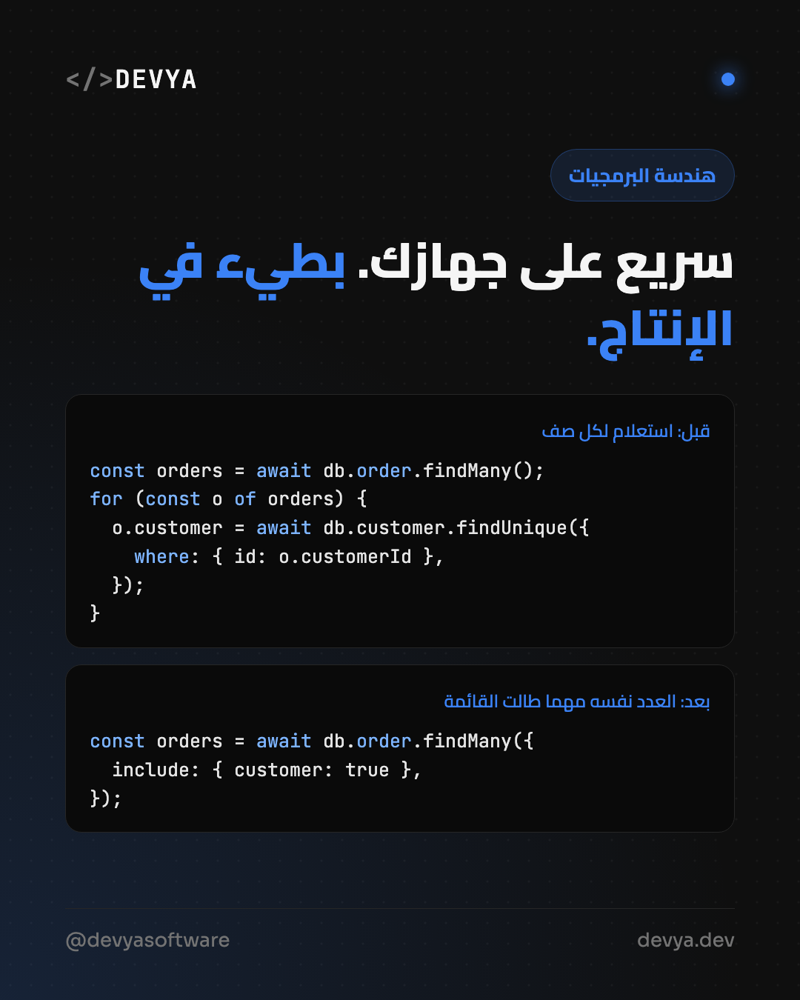 `1080×1350`

```text
تطبيق سريع في العرض التجريبي ثم بطيء بعد الإطلاق؟
أحد الأسباب الشائعة اسمه «استعلام N+1»: التطبيق يجلب قائمة، ثم يعود إلى قاعدة البيانات مرة لكل عنصر فيها.
الحل غالبًا بضعة أسطر، والأهم أن تراقب عدد الاستعلامات قبل أن يلاحظ عملاؤك.
الرابط في البايو.

#برمجة #تطوير_البرمجيات #قواعد_البيانات #تقنية #مصر #BuildWithDevya
```

### Vertical video · 1080×1920, 10 s · `visuals/2026-11-17/reel-<lang>.mp4` (rendered on the day)

One-liner EN: Fast on your laptop, slow in production: the N+1 query, and the fix.

One-liner AR: سريع على جهازك وبطيء في الإنتاج: استعلام N+1 وحلّه في بضعة أسطر.

**LinkedIn video** · 13:00 · English

```text
Fast on your laptop, slow in production: the N+1 query, and the fix.

#NodeJS #PostgreSQL #BackendEngineering
```

**Facebook Reel** · 13:00 · English

```text
Fast on your laptop, slow in production: the N+1 query, and the fix.

More: https://www.devya.dev/blogs/n-plus-1-queries-nodejs-dataloader-query-budget-field-notes?utm_source=facebook&utm_medium=social&utm_content=reel
```

**Instagram Reel** · 13:00 · Arabic

```text
سريع على جهازك وبطيء في الإنتاج: استعلام N+1 وحلّه في بضعة أسطر.

#برمجة #تطوير_البرمجيات #قواعد_البيانات #تقنية #مصر
```

**Stories** (same video, no caption): Facebook 19:30 English · Instagram 21:00 Arabic

## Day 4 · Wed 18 Nov · Devya X-Ray: an engineering review that reads the code

Pillar **product** · layout **product** · accent lime · source https://www.devya.dev/projects/devya-xray

Basis: devya.dev/projects/devya-xray (live at xray.devya.dev, free snapshot)

### LinkedIn · 10:00 · English

 `1200×627`

```text
Ask an engineering team how healthy its codebase is and you get what the team believes. Open the repository and you get what is actually there.

Devya X-Ray does both:
→ Your team self-assesses against 114 practices in seven pillars, from delivery and requirements to security, reliability and AI-native engineering.
→ We then check every claim against the code itself. Each finding is quoted to a file and line.
→ You get a code-verified report and a prioritised 90-day roadmap. Access is read-only, and code is never copied.

It starts with a free snapshot that takes about fifteen minutes, with no card and no call.

Useful before a fundraise, in a new CTO's first month, or when you've inherited a codebase from another vendor.

https://www.devya.dev/projects/devya-xray?utm_source=linkedin&utm_medium=social

#EngineeringLeadership #CodeQuality #CTO #BuildWithDevya
```

### Facebook · 19:30 · Arabic

 `1080×1350`

```text
هل ورثت تطبيقًا من شركة برمجة سابقة ولا تعرف حالته الحقيقية؟

أداة Devya X-Ray تراجع الكود نفسه، لا الوعود:
• يقيّم فريقك نفسه وفق 114 ممارسة هندسية في سبعة محاور.
• ثم نتحقق من كل إجابة في الكود، وكل ملاحظة مرتبطة بملف وسطر محددين.
• تحصل على تقرير موثّق وخطة أولويات لمدة 90 يومًا.

البداية بلقطة مجانية تستغرق نحو 15 دقيقة، دون بطاقة دفع ودون مكالمة.

https://www.devya.dev/projects/devya-xray?utm_source=facebook&utm_medium=social
```

### Instagram · 21:00 · English

 `1080×1350`

```text
Your team says the codebase is fine. Does the code agree?
Devya X-Ray checks 114 engineering practices against the actual repository, every finding quoted to a file and line. Start with a free 15-minute snapshot. Link in bio.

#BuildWithDevya #CodeReview #SoftwareEngineering #CTO #TechLeadership #SaaS
```

### Vertical video · 1080×1920, 10 s · `visuals/2026-11-18/reel-<lang>.mp4` (rendered on the day)

One-liner EN: Devya X-Ray reads your code, not your slide deck. Free 15-minute snapshot.

One-liner AR: أداة Devya X-Ray تقرأ الكود نفسه، لا العرض التقديمي. لقطة أولية مجانية في 15 دقيقة.

**LinkedIn video** · 13:00 · English

```text
Devya X-Ray reads your code, not your slide deck. Free 15-minute snapshot.

#EngineeringLeadership #CodeQuality #CTO
```

**Facebook Reel** · 13:00 · Arabic

```text
أداة Devya X-Ray تقرأ الكود نفسه، لا العرض التقديمي. لقطة أولية مجانية في 15 دقيقة.

التفاصيل: https://www.devya.dev/projects/devya-xray?utm_source=facebook&utm_medium=social&utm_content=reel
```

**Instagram Reel** · 13:00 · English

```text
Devya X-Ray reads your code, not your slide deck. Free 15-minute snapshot.

#BuildWithDevya #CodeReview #SoftwareEngineering #CTO #TechLeadership
```

**Stories** (same video, no caption): Facebook 19:30 Arabic · Instagram 21:00 English

## Day 5 · Thu 19 Nov · The five lines a weekly dev update should contain

Pillar **client-value** · layout **checklist** · accent ember · source https://www.devya.dev/services

Basis: devya-market-intel 2026-11-15 guide.avoid: silent schedule risk, unlogged client-side risks

### LinkedIn · 10:00 · English

 `1200×627`

```text
A good weekly update is boring to read and impossible to misread. Five lines are enough:

1. What shipped, with a link you can click, not a percentage.
2. What slipped, and the new date. Sent the day it slips, not the day it was due.
3. Risks on both sides: ours (a hard integration, an engineer out sick) and yours (late approvals, missing content, a change of sponsor).
4. Decisions needed from you, each with a date.
5. Hours and budget used against the plan.

If your vendor's update is a paragraph of adjectives, ask for these five lines. If they can't fill line 2 honestly, they will fill it later with overtime and a surprise.

#ProjectManagement #Startups #SoftwareDevelopment #BuildWithDevya
```

### Facebook · 19:30 · Arabic

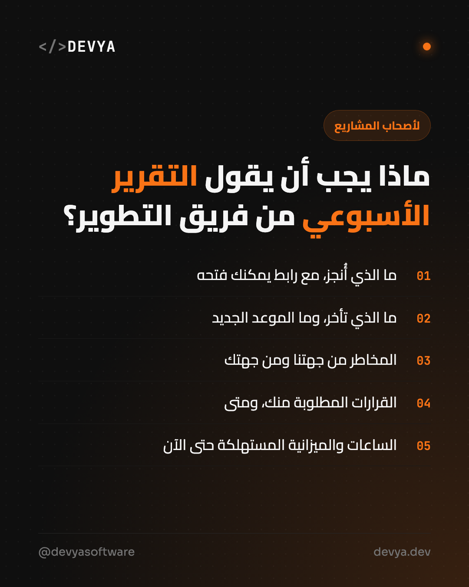 `1080×1350`

```text
هل تعرف فعلًا ما الذي يحدث في مشروعك البرمجي هذا الأسبوع؟

التقرير الأسبوعي الجيد من فريق التطوير لا يحتاج إلى أكثر من خمسة أسطر:
1. ما الذي أُنجز، مع رابط تستطيع فتحه بنفسك.
2. ما الذي تأخر، وما الموعد الجديد.
3. المخاطر من جهة الفريق ومن جهتك، مثل تأخر الموافقات أو المحتوى.
4. القرارات المطلوبة منك، ومتى.
5. الساعات والميزانية المستهلكة مقارنة بالخطة.

إن لم يصلك تقرير بهذا الوضوح، فاطلبه. من حقك أن تعرف.

https://www.devya.dev/contact?utm_source=facebook&utm_medium=social
```

### Instagram · 21:00 · English

 `1080×1350`

```text
Five lines every weekly dev update should have:
1 What shipped (with a link)
2 What slipped (and the new date)
3 Risks on both sides
4 Decisions needed from you
5 Budget used vs plan
Send this to whoever builds your product.

#BuildWithDevya #Founders #ProductManagement #SoftwareDevelopment #TechTips #Startups
```

### Vertical video · 1080×1920, 10 s · `visuals/2026-11-19/reel-<lang>.mp4` (rendered on the day)

One-liner EN: Five lines every weekly update from your dev team should have.

One-liner AR: خمسة أسطر يجب أن يتضمنها كل تقرير أسبوعي من فريق التطوير.

**LinkedIn video** · 13:00 · English

```text
Five lines every weekly update from your dev team should have.

#ProjectManagement #Startups #SoftwareDevelopment
```

**Facebook Reel** · 13:00 · Arabic

```text
خمسة أسطر يجب أن يتضمنها كل تقرير أسبوعي من فريق التطوير.

التفاصيل: https://www.devya.dev/services?utm_source=facebook&utm_medium=social&utm_content=reel
```

**Instagram Reel** · 13:00 · English

```text
Five lines every weekly update from your dev team should have.

#BuildWithDevya #Founders #ProductManagement #SoftwareDevelopment #TechTips
```

**Stories** (same video, no caption): Facebook 19:30 Arabic · Instagram 21:00 English

## Day 6 · Fri 20 Nov · What 'done' means at Devya: merged isn't done

Pillar **bts** · layout **statement** · accent lime · source https://www.devya.dev/about

Basis: Devya engineering rules: CI gate on every PR, global secret-scan pre-commit hook, bilingual checks, post-deploy verification

### LinkedIn · 10:00 · English

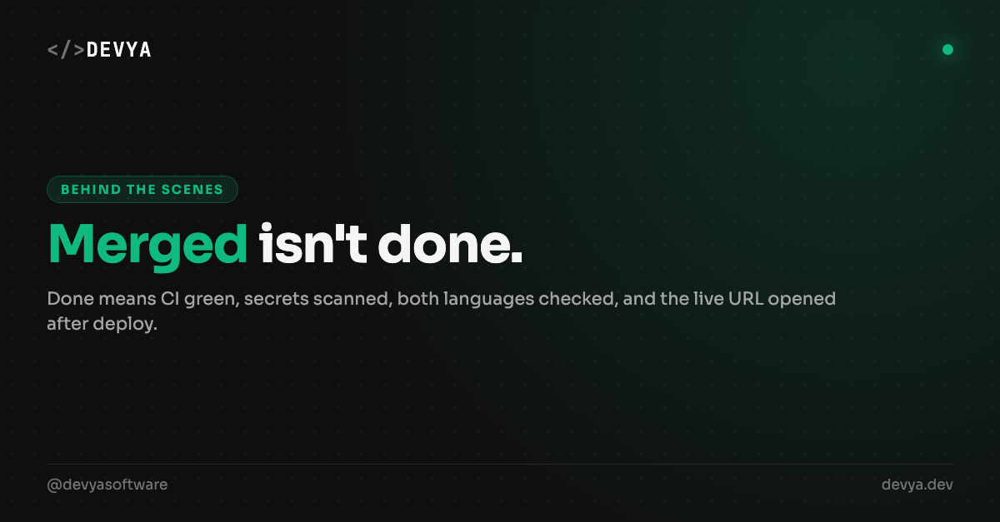 `1200×627`

```text
A pull request being merged doesn't mean the work is done. Here's the bar every change at Devya clears before we call it done:

→ The CI check on the pull request is green. No merging on red, and no merging without it.
→ Every commit passed a secret scan on the developer's machine first.
→ In bilingual products, anything a user reads exists in English and Arabic, and someone opened both.
→ After deploy, someone loads the live URL and checks the change is actually there.

None of this is novel. It's written down so it doesn't depend on who's on shift or how close the deadline is.

What's on your team's definition of done that most teams skip?

#SoftwareEngineering #DevOps #QualityAssurance #BuildWithDevya
```

### Facebook · 19:30 · Arabic

 `1080×1350`

```text
متى نعتبر العمل «منتهيًا» في ديفيا؟ ليس عند دمج الكود، بل عندما:
• تنجح الفحوص الآلية على طلب التعديل، فلا دمج قبلها.
• يمر كل حفظ للكود بفحص يمنع تسريب المفاتيح السرية.
• نراجع النصوص العربية والإنجليزية بأنفسنا في المنتجات ثنائية اللغة.
• نفتح الرابط الحي بعد النشر ونتأكد أن التعديل يعمل فعلًا.

قواعد بسيطة، لكنها مكتوبة حتى لا تتخطاها ضغوط المواعيد.

https://www.devya.dev/?utm_source=facebook&utm_medium=social
```

### Instagram · 21:00 · English

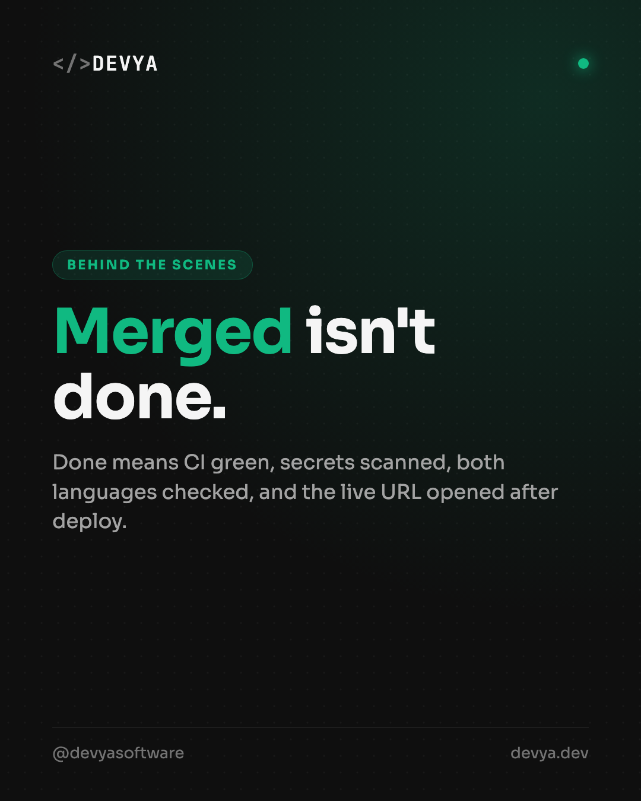 `1080×1350`

```text
Merged isn't done.
Done here means: CI green on the pull request, secrets scanned on every commit, both languages checked in bilingual products, and the live URL opened after deploy.
Boring rules, written down, so deadlines can't skip them.

#BuildWithDevya #SoftwareEngineering #DevOps #WebDevelopment #CodeQuality
```

### Vertical video · 1080×1920, 10 s · `visuals/2026-11-20/reel-<lang>.mp4` (rendered on the day)

One-liner EN: Merged isn't done. Here's what done means at Devya.

One-liner AR: الدمج ليس نهاية العمل. هكذا نعرّف العمل المنتهي في ديفيا.

**LinkedIn video** · 13:00 · English

```text
Merged isn't done. Here's what done means at Devya.

#SoftwareEngineering #DevOps #QualityAssurance
```

**Facebook Reel** · 13:00 · Arabic

```text
الدمج ليس نهاية العمل. هكذا نعرّف العمل المنتهي في ديفيا.

التفاصيل: https://www.devya.dev/about?utm_source=facebook&utm_medium=social&utm_content=reel
```

**Instagram Reel** · 13:00 · English

```text
Merged isn't done. Here's what done means at Devya.

#BuildWithDevya #SoftwareEngineering #DevOps #WebDevelopment #CodeQuality
```

**Stories** (same video, no caption): Facebook 19:30 Arabic · Instagram 21:00 English

## Day 7 · Sat 21 Nov · Arabic Business Resources: a verified bilingual guide we built

Pillar **case-study** · layout **compare** · accent lime · source https://www.devya.dev/projects/arabic-business-resources

Basis: devya.dev/projects/arabic-business-resources (live, 20+ verified sources, 5 categories)

### LinkedIn · 10:00 · English

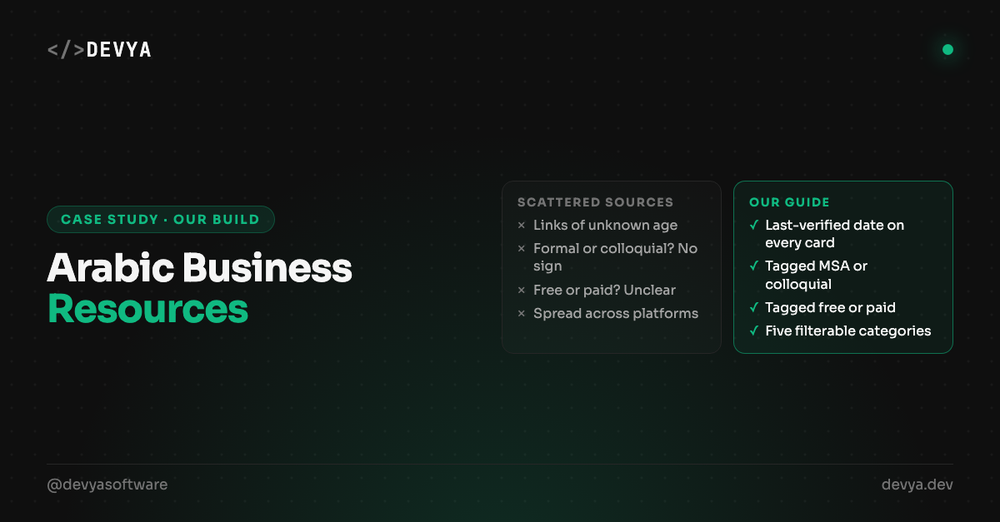 `1200×627`

```text
Free Arabic material on finance and investment terminology exists, but it's scattered, and nothing tells you whether a source is formal MSA or regional colloquial, still online, or actually free.

So we built a small guide that fixes exactly that:
→ 20+ verified sources in five categories: official glossaries, course platforms, podcast case studies, governance and risk, and a Pan-Arab section.
→ Every entry tagged MSA or colloquial, free or paid.
→ Every card links straight to the primary source and shows when it was last verified, so a dead link never hides.

It's a static, bilingual page with full RTL and zero dependencies. Small, careful and maintained beats big and stale.

https://www.devya.dev/projects/arabic-business-resources?utm_source=linkedin&utm_medium=social

#Arabic #FinancialLiteracy #OpenKnowledge #BuildWithDevya
```

### Facebook · 19:30 · English

 `1080×1350`

```text
Learning finance or investment terms in Arabic? Free material exists, but it's scattered, and it's hard to tell a formal government glossary from a colloquial podcast.

We put together a free bilingual guide: 20+ verified sources in five categories, each tagged MSA or colloquial and free or paid, each linking straight to the original, with the date it was last checked.

Free to use: https://www.devya.dev/projects/arabic-business-resources?utm_source=facebook&utm_medium=social
```

### Instagram · 21:00 · Arabic

 `1080×1350`

```text
تبحث عن مصادر عربية مجانية لتعلّم مصطلحات المال والاستثمار؟
جمعنا أكثر من 20 مصدرًا موثّقًا في دليل واحد ثنائي اللغة، وكل مصدر مصنّف فصحى أو عامية، مجاني أو مدفوع، مع تاريخ آخر تحقق.
الرابط في البايو.

#ريادة_الأعمال #الاستثمار #تعلم #اللغة_العربية #مصادر_مجانية #BuildWithDevya
```

### Vertical video · 1080×1920, 10 s · `visuals/2026-11-21/reel-<lang>.mp4` (rendered on the day)

One-liner EN: Free Arabic resources for finance and investment, verified and tagged.

One-liner AR: مصادر عربية مجانية للمال والاستثمار، موثّقة ومصنّفة.

**LinkedIn video** · 13:00 · English

```text
Free Arabic resources for finance and investment, verified and tagged.

#Arabic #FinancialLiteracy #OpenKnowledge
```

**Facebook Reel** · 13:00 · English

```text
Free Arabic resources for finance and investment, verified and tagged.

More: https://www.devya.dev/projects/arabic-business-resources?utm_source=facebook&utm_medium=social&utm_content=reel
```

**Instagram Reel** · 13:00 · Arabic

```text
مصادر عربية مجانية للمال والاستثمار، موثّقة ومصنّفة.

#ريادة_الأعمال #الاستثمار #تعلم #اللغة_العربية #مصادر_مجانية
```

**Stories** (same video, no caption): Facebook 19:30 English · Instagram 21:00 Arabic

## Day 8 · Sun 22 Nov · Build MENA products Arabic-first, then derive English

Pillar **client-value** · layout **compare** · accent ember · source https://www.devya.dev/services

Basis: devya-market-intel 2026-11-15 guide.do: Arabic-first copy and RTL layouts, local formats from sprint one

### LinkedIn · 10:00 · English

 `1200×627`

```text
If your customers are in Egypt or the Gulf, the Arabic version isn't a translation task at the end of the project. It's the primary product.

What goes wrong when Arabic comes last:
→ Labels overflow their buttons, because Arabic runs a different length.
→ Arrows, progress bars and swipe gestures point the wrong way.
→ Dates, currency and phone numbers break in RTL.
→ The copy reads like it was translated, because it was.

What we do instead: design the RTL layout first, write the Arabic for the reader, then derive the English. Mirroring, local formats (SAR and EGP, Hijri dates where they're needed, +966 and +20 phone numbers) and bilingual admin screens belong in sprint one, not in a "localisation phase".

Starting this way is cheaper than retrofitting it.

#Localization #RTL #ProductDesign #SaudiArabia
```

### Facebook · 19:30 · Arabic

 `1080×1350`

```text
إذا كان عملاؤك في مصر أو الخليج، فالنسخة العربية من تطبيقك ليست ترجمة تُضاف في النهاية، بل هي المنتج الأساسي.

حين تأتي العربية متأخرة تظهر المشكلات: نصوص تخرج عن الأزرار، وأسهم في الاتجاه المعاكس، وتواريخ وأرقام هواتف لا تُعرض بشكل صحيح، وكلام يبدو مترجمًا.

لذلك نبدأ بتصميم الواجهة العربية من اليمين إلى اليسار، ونكتب النص العربي لقارئه، ثم نشتق النسخة الإنجليزية.

تخطط لمنتج لعملاء عرب؟ تحدث معنا: https://www.devya.dev/contact?utm_source=facebook&utm_medium=social
```

### Instagram · 21:00 · English

 `1080×1350`

```text
Selling to Egypt or the Gulf? Build it Arabic-first.
Design RTL from day one, write Arabic for the reader, then derive the English. Retrofitting Arabic later means broken buttons, backwards arrows and copy that reads translated.

#BuildWithDevya #RTL #Localization #UXDesign #ProductDesign #SaudiArabia
```

### Vertical video · 1080×1920, 10 s · `visuals/2026-11-22/reel-<lang>.mp4` (rendered on the day)

One-liner EN: Selling to Egypt or the Gulf? Build it Arabic-first.

One-liner AR: تبيع لعملاء في مصر أو الخليج؟ ابنِ منتجك بالعربية أولًا.

**LinkedIn video** · 13:00 · English

```text
Selling to Egypt or the Gulf? Build it Arabic-first.

#Localization #RTL #ProductDesign
```

**Facebook Reel** · 13:00 · Arabic

```text
تبيع لعملاء في مصر أو الخليج؟ ابنِ منتجك بالعربية أولًا.

التفاصيل: https://www.devya.dev/services?utm_source=facebook&utm_medium=social&utm_content=reel
```

**Instagram Reel** · 13:00 · English

```text
Selling to Egypt or the Gulf? Build it Arabic-first.

#BuildWithDevya #RTL #Localization #UXDesign #ProductDesign
```

**Stories** (same video, no caption): Facebook 19:30 Arabic · Instagram 21:00 English

## Day 9 · Mon 23 Nov · Mocks agree with you, Postgres does not: Testcontainers

Pillar **engineering** · layout **terminal** · accent azure · source https://www.devya.dev/blogs/testcontainers-nodejs-postgres-integration-tests-field-notes

Basis: Devya blog field notes: integration tests against real PostgreSQL with Testcontainers

### LinkedIn · 10:00 · English

 `1200×627`

```text
Mocked repositories have one flaw: they agree with whatever you assumed. Our tests stayed green while the SQL underneath was wrong.

So our repository tests now run against a real PostgreSQL, started for each test run with Testcontainers:
→ The same database engine production runs, with the real migrations applied.
→ Unit tests may mock the repository. Repository tests never do.
→ CI runs the same containers as the laptop, so "works on my machine" stops being an argument.

It's slower than a mock. In exchange, a renamed column or a wrong JOIN fails on the laptop instead of in front of a customer.

How we set it up in Node.js: https://www.devya.dev/blogs/testcontainers-nodejs-postgres-integration-tests-field-notes?utm_source=linkedin&utm_medium=social

#NodeJS #PostgreSQL #Testing #BuildWithDevya
```

### Facebook · 19:30 · Arabic

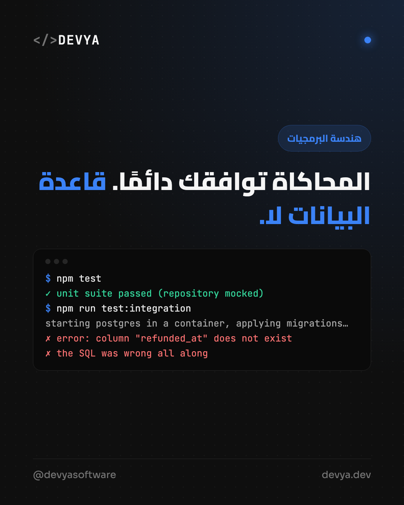 `1080×1350`

```text
كيف تنجح كل الاختبارات ثم يتعطل التطبيق عند العميل؟

أحد الأسباب: اختبارات تعتمد على «محاكاة» لقاعدة البيانات بدل قاعدة بيانات حقيقية. المحاكاة توافق دائمًا على افتراضاتك، حتى لو كان الاستعلام خاطئًا.

لهذا نشغّل اختبارات طبقة البيانات على قاعدة PostgreSQL حقيقية داخل حاوية، مع ملفات الترحيل نفسها المستخدمة في الإنتاج. أبطأ قليلًا، لكن الخطأ يظهر على جهاز المطوّر لا أمام عملائك.

التفاصيل التقنية: https://www.devya.dev/blogs/testcontainers-nodejs-postgres-integration-tests-field-notes?utm_source=facebook&utm_medium=social
```

### Instagram · 21:00 · English

 `1080×1350`

```text
Green tests, broken app?
Mocks agree with your assumptions, even when the SQL is wrong. We run repository tests against a real Postgres in a container, migrations and all. Slower, and worth it.
Link in bio.

#BuildWithDevya #Testing #PostgreSQL #NodeJS #SoftwareEngineering #DevOps
```

### Vertical video · 1080×1920, 10 s · `visuals/2026-11-23/reel-<lang>.mp4` (rendered on the day)

One-liner EN: Your mocks agree with you. A real Postgres won't.

One-liner AR: المحاكاة توافقك دائمًا، أما قاعدة البيانات الحقيقية فلا.

**LinkedIn video** · 13:00 · English

```text
Your mocks agree with you. A real Postgres won't.

#NodeJS #PostgreSQL #Testing
```

**Facebook Reel** · 13:00 · Arabic

```text
المحاكاة توافقك دائمًا، أما قاعدة البيانات الحقيقية فلا.

التفاصيل: https://www.devya.dev/blogs/testcontainers-nodejs-postgres-integration-tests-field-notes?utm_source=facebook&utm_medium=social&utm_content=reel
```

**Instagram Reel** · 13:00 · English

```text
Your mocks agree with you. A real Postgres won't.

#BuildWithDevya #Testing #PostgreSQL #NodeJS #SoftwareEngineering
```

**Stories** (same video, no caption): Facebook 19:30 Arabic · Instagram 21:00 English

## Day 10 · Tue 24 Nov · CopyForge: Arabic ad copy that doesn't read translated

Pillar **product** · layout **product** · accent lime · source https://www.devya.dev/projects/copyforge

Basis: devya.dev/projects/copyforge (live, 20 free credits, MSA/Egyptian/Khaleeji)

### LinkedIn · 10:00 · English

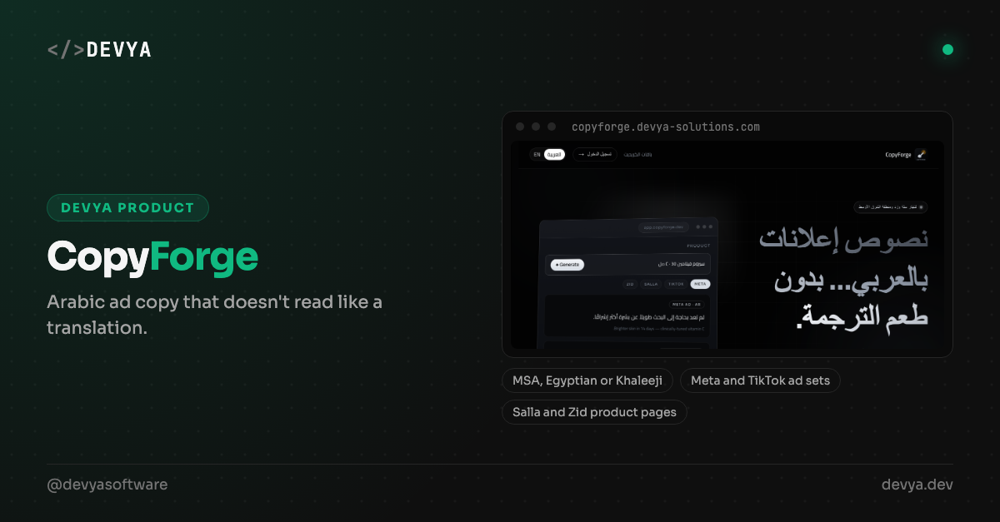 `1200×627`

```text
Most AI writing tools were built for English first. Ask them for Arabic and you get a translation: correct, stiff, and obviously not written by someone from the market.

CopyForge is our answer for MENA sellers:
→ One generation returns a full ad set for Meta or TikTok (five hooks, three bodies, three calls to action) or a complete Salla or Zid product description.
→ Written natively in the dialect you pick: Modern Standard Arabic, Egyptian or Khaleeji.
→ Credits instead of a subscription. Credits never expire, and new accounts start with 20 free.
→ Recent generations stay in your browser, not on our servers.

Built on the Vercel AI SDK with Google Gemini. Live in Arabic and English.

https://www.devya.dev/projects/copyforge?utm_source=linkedin&utm_medium=social

#ArabicMarketing #Ecommerce #AI #BuildWithDevya
```

### Facebook · 19:30 · English

 `1080×1350`

```text
Selling on Salla or Zid, or running Meta and TikTok ads in Arabic?

CopyForge writes your ad sets and product descriptions natively in Modern Standard Arabic, Egyptian or Khaleeji, so they don't read like a translation. One credit per generation, credits never expire, and every new account starts with 20 free credits.

Try it: https://www.devya.dev/projects/copyforge?utm_source=facebook&utm_medium=social
```

### Instagram · 21:00 · Arabic

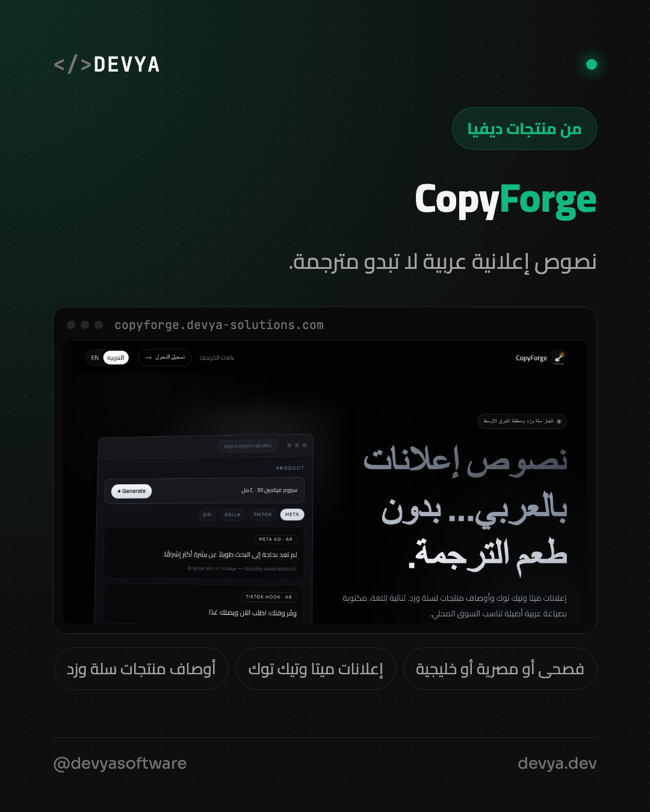 `1080×1350`

```text
إعلانات عربية لا تبدو مترجمة.
أداة CopyForge تكتب إعلانات ميتا وتيك توك وأوصاف منتجات سلة وزد بالفصحى أو المصرية أو الخليجية، حسب اختيارك.
عشرون رصيدًا مجانيًا لكل حساب جديد. الرابط في البايو.

#تسويق_إلكتروني #التجارة_الإلكترونية #سلة #زد #كتابة_إعلانية #BuildWithDevya
```

### Vertical video · 1080×1920, 10 s · `visuals/2026-11-24/reel-<lang>.mp4` (rendered on the day)

One-liner EN: CopyForge: Arabic ad copy that doesn't read like a translation.

One-liner AR: أداة CopyForge تكتب نصوصًا إعلانية عربية لا تبدو مترجمة.

**LinkedIn video** · 13:00 · English

```text
CopyForge: Arabic ad copy that doesn't read like a translation.

#ArabicMarketing #Ecommerce #AI
```

**Facebook Reel** · 13:00 · English

```text
CopyForge: Arabic ad copy that doesn't read like a translation.

More: https://www.devya.dev/projects/copyforge?utm_source=facebook&utm_medium=social&utm_content=reel
```

**Instagram Reel** · 13:00 · Arabic

```text
أداة CopyForge تكتب نصوصًا إعلانية عربية لا تبدو مترجمة.

#تسويق_إلكتروني #التجارة_الإلكترونية #سلة #زد #كتابة_إعلانية
```

**Stories** (same video, no caption): Facebook 19:30 English · Instagram 21:00 Arabic

## Day 11 · Wed 25 Nov · Engineer swaps: the handover clauses to ask for

Pillar **client-value** · layout **checklist** · accent ember · source https://www.devya.dev/services

Basis: devya-market-intel 2026-11-15 guide.avoid: engineer swaps without a handover protocol

### LinkedIn · 10:00 · English

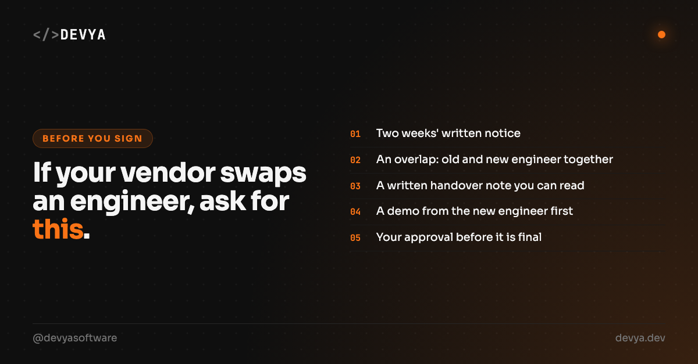 `1200×627`

```text
Projects rarely fail on the day an engineer leaves. They fail three weeks later, when nobody remembers why the payment retry works the way it does.

Engineer changes happen: people get sick, get promoted, move on. What matters is the handover. Put this in your contract:

1. Two weeks' written notice before anyone rotates off your project.
2. An overlap period where the leaving and joining engineers work together.
3. A written handover note: open work, known risks, and the decisions behind the odd parts.
4. A demo from the new engineer, on your codebase, before the handover is signed off.
5. Your approval before the swap is final.

A vendor who agrees to this easily has done it before. One who resists is telling you something.

#ProjectManagement #Outsourcing #Startups #BuildWithDevya
```

### Facebook · 19:30 · Arabic

 `1080×1350`

```text
تغيير المهندس المسؤول عن مشروعك أمر وارد، لكن التسليم السيئ هو ما يعطّل المشروع.

إن كنت تتعامل مع شركة برمجة، فاطلب في العقد:
1. إشعارًا مكتوبًا قبل أسبوعين من أي تغيير.
2. فترة يعمل فيها المهندس القديم والجديد معًا.
3. مذكرة تسليم مكتوبة بالأعمال المفتوحة والمخاطر المعروفة.
4. عرضًا عمليًا من المهندس الجديد قبل اعتماد التسليم.
5. موافقتك قبل أن يصبح التغيير نهائيًا.

بنود بسيطة تحمي وقتك ومالك.

https://www.devya.dev/contact?utm_source=facebook&utm_medium=social
```

### Instagram · 21:00 · English

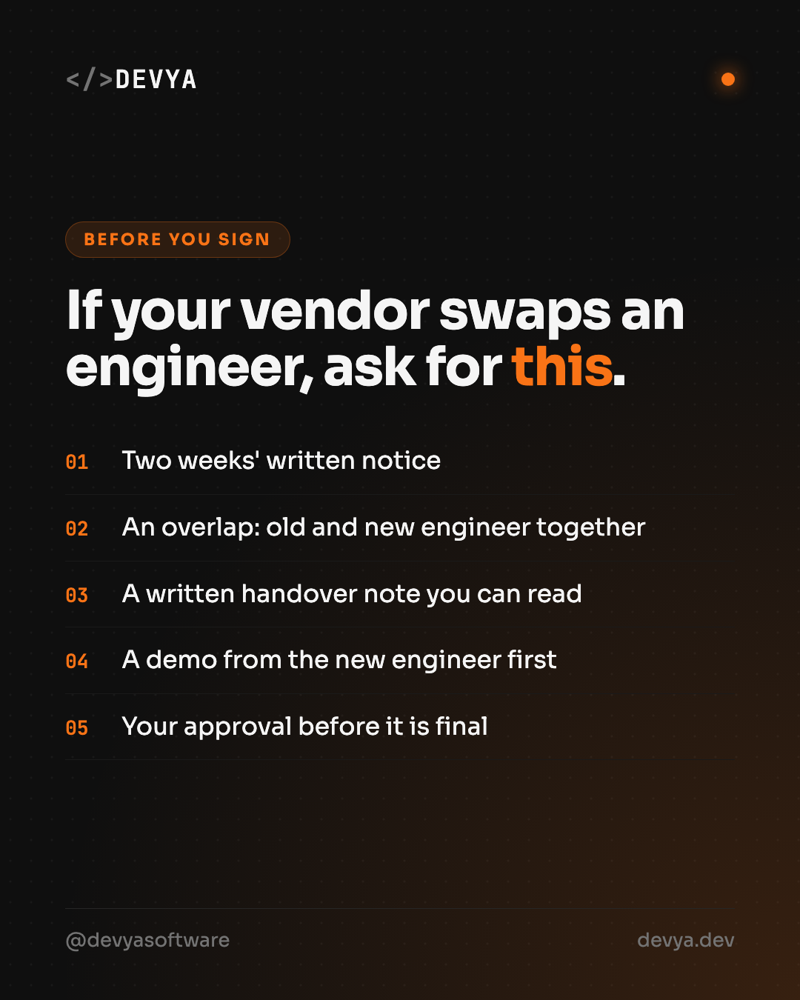 `1080×1350`

```text
Your vendor is swapping your engineer. Ask for:
1 Two weeks' written notice
2 An overlap period
3 A written handover note
4 A demo from the new engineer
5 Your sign-off before it's final
Save it for your next contract.

#BuildWithDevya #Founders #Outsourcing #ProjectManagement #TechTips #Startups
```

### Vertical video · 1080×1920, 10 s · `visuals/2026-11-25/reel-<lang>.mp4` (rendered on the day)

One-liner EN: Your vendor is swapping your engineer. Ask for these five things.

One-liner AR: شركة البرمجة ستغيّر مهندس مشروعك؟ اطلب هذه البنود الخمسة.

**LinkedIn video** · 13:00 · English

```text
Your vendor is swapping your engineer. Ask for these five things.

#ProjectManagement #Outsourcing #Startups
```

**Facebook Reel** · 13:00 · Arabic

```text
شركة البرمجة ستغيّر مهندس مشروعك؟ اطلب هذه البنود الخمسة.

التفاصيل: https://www.devya.dev/services?utm_source=facebook&utm_medium=social&utm_content=reel
```

**Instagram Reel** · 13:00 · English

```text
Your vendor is swapping your engineer. Ask for these five things.

#BuildWithDevya #Founders #Outsourcing #ProjectManagement #TechTips
```

**Stories** (same video, no caption): Facebook 19:30 Arabic · Instagram 21:00 English

## Day 12 · Thu 26 Nov · Parallel AI coding agents with git worktrees

Pillar **engineering** · layout **code** · accent azure · source https://www.devya.dev/blogs/git-worktrees-parallel-ai-coding-agents-field-notes

Basis: Devya blog field notes: running parallel AI coding agents with git worktrees

### LinkedIn · 10:00 · English

 `1200×627`

```text
We run several AI coding agents against the same repository at once. The first thing that breaks isn't the code. It's the shared folder: two agents editing one checkout overwrite each other's work.

Git worktrees fix the file problem with one command. Each agent gets its own working directory on its own branch, all backed by one repository.

What worktrees don't isolate, and you have to split yourself:
→ Ports. Two dev servers both want 3000, so give each tree its own.
→ Localhost cookies. Sessions on localhost leak between apps; use a separate hostname per tree.
→ The database. A seed script in one tree can wipe data another tree depends on.

Treat each worktree as a separate machine and parallel agents stop stepping on each other.

Field notes: https://www.devya.dev/blogs/git-worktrees-parallel-ai-coding-agents-field-notes?utm_source=linkedin&utm_medium=social

#AIEngineering #Git #DeveloperProductivity #BuildWithDevya
```

### Facebook · 19:30 · Arabic

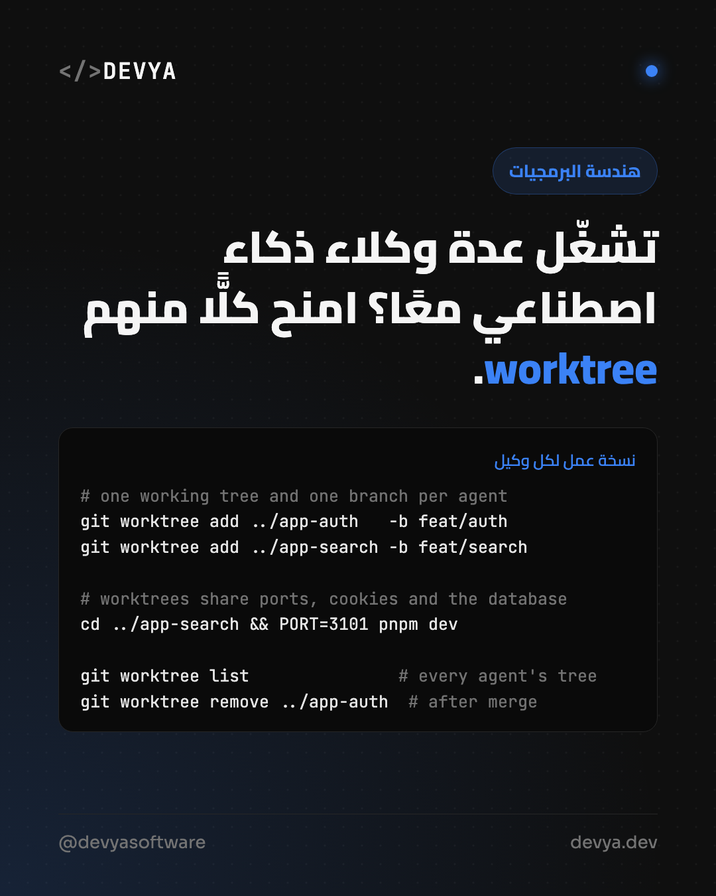 `1080×1350`

```text
نستخدم عدة وكلاء برمجة بالذكاء الاصطناعي على المشروع نفسه في الوقت ذاته. أول مشكلة واجهتنا لم تكن في الكود، بل في المجلد المشترك: وكيلان يعدّلان الملفات نفسها فيمحو أحدهما عمل الآخر.

الحل في Git اسمه worktree: لكل وكيل مجلد عمل وفرع خاص به، وكلها مرتبطة بمستودع واحد.

لكن انتبه: المنافذ وملفات تعريف الارتباط وقاعدة البيانات تبقى مشتركة ما لم تفصلها بنفسك.

الملاحظات الكاملة: https://www.devya.dev/blogs/git-worktrees-parallel-ai-coding-agents-field-notes?utm_source=facebook&utm_medium=social
```

### Instagram · 21:00 · English

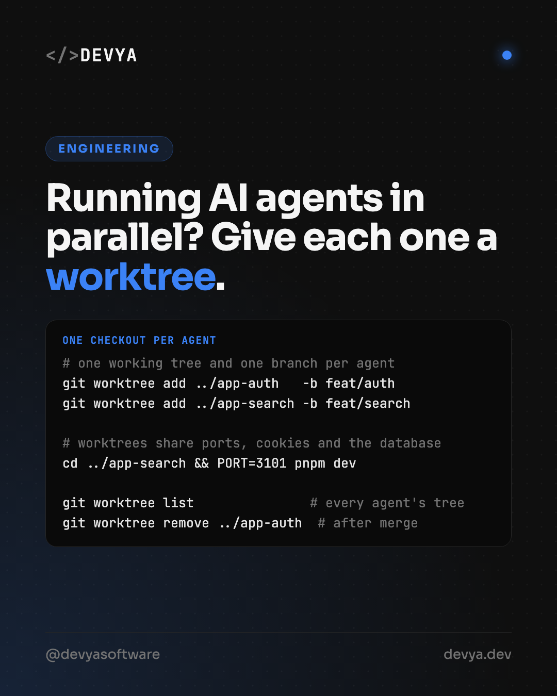 `1080×1350`

```text
Running several AI coding agents on one repo?
Give each its own git worktree: own folder, own branch, same repository. Then split what worktrees don't: ports, localhost cookies and the database.
Link in bio.

#BuildWithDevya #AI #Git #DeveloperTools #SoftwareEngineering #Coding
```

### Vertical video · 1080×1920, 10 s · `visuals/2026-11-26/reel-<lang>.mp4` (rendered on the day)

One-liner EN: Running AI coding agents in parallel? Give each one a git worktree.

One-liner AR: تشغّل عدة وكلاء برمجة معًا؟ امنح كلًّا منهم worktree خاصًا.

**LinkedIn video** · 13:00 · English

```text
Running AI coding agents in parallel? Give each one a git worktree.

#AIEngineering #Git #DeveloperProductivity
```

**Facebook Reel** · 13:00 · Arabic

```text
تشغّل عدة وكلاء برمجة معًا؟ امنح كلًّا منهم worktree خاصًا.

التفاصيل: https://www.devya.dev/blogs/git-worktrees-parallel-ai-coding-agents-field-notes?utm_source=facebook&utm_medium=social&utm_content=reel
```

**Instagram Reel** · 13:00 · English

```text
Running AI coding agents in parallel? Give each one a git worktree.

#BuildWithDevya #AI #Git #DeveloperTools #SoftwareEngineering
```

**Stories** (same video, no caption): Facebook 19:30 Arabic · Instagram 21:00 English

## Day 13 · Fri 27 Nov · Urania: a bilingual guide to the constellations we built

Pillar **case-study** · layout **product** · accent lime · source https://www.devya.dev/projects/urania

Basis: devya.dev/projects/urania (bilingual EN/AR illustrated constellation guide)

### LinkedIn · 10:00 · English

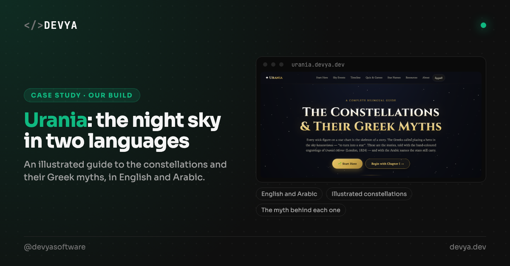 `1200×627`

```text
Not everything we build is for a client. Urania is a bilingual, illustrated guide to the constellations and the Greek myths behind them, in English and Arabic.

Side projects like this are where we practise the details client work depends on: Arabic typography that holds up next to Latin, RTL layouts that are designed rather than flipped, and content that reads natively in both languages instead of one being a translation of the other.

It's free and open to anyone curious about the sky. Look up tonight.

#Arabic #Bilingual #Astronomy #BuildWithDevya
```

### Facebook · 19:30 · Arabic

 `1080×1350`

```text
ليس كل ما نبنيه لعملاء. «Urania» دليل مصوّر ومجاني للكوكبات النجمية والأساطير الإغريقية المرتبطة بها، بالعربية والإنجليزية.

في مشاريع كهذه نتدرّب على التفاصيل التي يحتاجها عملاؤنا: خط عربي واضح بجوار الإنجليزي، وتصميم من اليمين إلى اليسار مدروس لا مقلوب، ونصوص تُقرأ بطبيعية في اللغتين.

جرّبه الليلة: https://www.devya.dev/projects/urania?utm_source=facebook&utm_medium=social
```

### Instagram · 21:00 · English

 `1080×1350`

```text
Not everything we build is for a client.
Urania is a free, illustrated guide to the constellations and their Greek myths, in English and Arabic. It's where we practise Arabic typography and RTL layouts that are designed, not flipped.
Link in bio.

#BuildWithDevya #Astronomy #Constellations #Arabic #WebDesign #SideProject
```

### Vertical video · 1080×1920, 10 s · `visuals/2026-11-27/reel-<lang>.mp4` (rendered on the day)

One-liner EN: Urania: the constellations and their myths, in English and Arabic.

One-liner AR: دليل Urania يشرح الكوكبات النجمية وأساطيرها، بالعربية والإنجليزية.

**LinkedIn video** · 13:00 · English

```text
Urania: the constellations and their myths, in English and Arabic.

#Arabic #Bilingual #Astronomy
```

**Facebook Reel** · 13:00 · Arabic

```text
دليل Urania يشرح الكوكبات النجمية وأساطيرها، بالعربية والإنجليزية.

التفاصيل: https://www.devya.dev/projects/urania?utm_source=facebook&utm_medium=social&utm_content=reel
```

**Instagram Reel** · 13:00 · English

```text
Urania: the constellations and their myths, in English and Arabic.

#BuildWithDevya #Astronomy #Constellations #Arabic #WebDesign
```

**Stories** (same video, no caption): Facebook 19:30 Arabic · Instagram 21:00 English

## Day 14 · Sat 28 Nov · Stop adding Postgres indexes by guesswork: EXPLAIN ANALYZE

Pillar **engineering** · layout **code** · source https://www.devya.dev/blogs/postgres-explain-analyze-query-plans-indexes-field-notes

Basis: Devya blog field notes: reading PostgreSQL EXPLAIN ANALYZE

### LinkedIn · 10:00 · English

 `1200×627`

```text
We used to add PostgreSQL indexes the way most teams do: someone says a page is slow, someone adds an index, everyone hopes.

Our process now has three steps:
1. Find the costliest query in pg_stat_statements, ordered by total execution time rather than the slowest single run. A fast query called a million times can cost more than a slow report run once a day.
2. Run EXPLAIN (ANALYZE, BUFFERS) on it and read what the planner actually did: sequential scans on big tables, row estimates that are far off, sorts spilling to disk.
3. Add the one index the plan asks for, then run it again and compare.

Every index slows down writes and costs disk. Each one should come with the plan that justified it.

#PostgreSQL #Database #BackendEngineering #BuildWithDevya
```

### Facebook · 19:30 · English

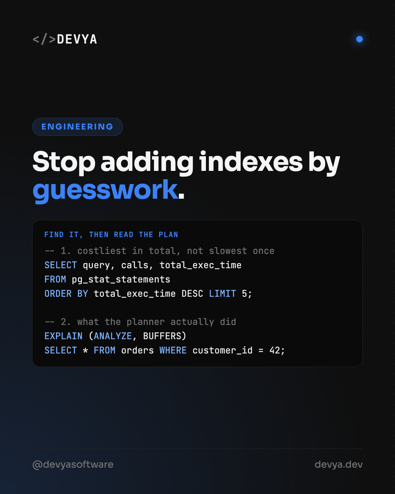 `1080×1350`

```text
When an app gets slow, the usual fix is to "add an index" and hope.

We do it in order instead: find the database query that costs the most in total, read the plan PostgreSQL actually used, add the one index that plan asks for, then measure again. Every index has a cost on writes, so each one has to earn its place.

Engineering notes: https://www.devya.dev/blogs/postgres-explain-analyze-query-plans-indexes-field-notes?utm_source=facebook&utm_medium=social&utm_campaign=2026-11-28-stop-adding-postgres-indexes-by-guesswork

#BuildWithDevya #PostgreSQL #Database
```

### Instagram · 21:00 · Arabic

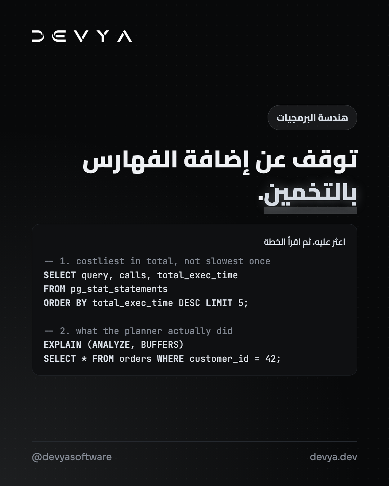 `1080×1350`

```text
توقف عن إضافة الفهارس إلى قاعدة البيانات بالتخمين.
ابحث أولًا عن الاستعلام الأعلى تكلفة إجمالًا، ثم اقرأ خطة التنفيذ الفعلية عبر EXPLAIN ANALYZE، وأضف الفهرس الذي تطلبه الخطة فقط، ثم قِس من جديد.
الرابط في البايو.

#قواعد_البيانات #برمجة #تطوير_البرمجيات #تقنية #BuildWithDevya
```

### Vertical video · 1080×1920, 10 s · `visuals/2026-11-28/reel-<lang>.mp4` (rendered on the day)

One-liner EN: Stop adding indexes by guesswork. Read the plan first.

One-liner AR: توقف عن إضافة الفهارس بالتخمين. اقرأ خطة التنفيذ أولًا.

**LinkedIn video** · 13:00 · English

```text
Stop adding indexes by guesswork. Read the plan first.

#PostgreSQL #Database #BackendEngineering
```

**Facebook Reel** · 13:00 · English

```text
Stop adding indexes by guesswork. Read the plan first.

More: https://www.devya.dev/blogs/postgres-explain-analyze-query-plans-indexes-field-notes?utm_source=facebook&utm_medium=social&utm_campaign=2026-11-28-stop-adding-postgres-indexes-by-guesswork&utm_content=reel

#BuildWithDevya #PostgreSQL #Database
```

**Instagram Reel** · 13:00 · Arabic

```text
توقف عن إضافة الفهارس بالتخمين. اقرأ خطة التنفيذ أولًا.

#قواعد_البيانات #برمجة #تطوير_البرمجيات #تقنية #BuildWithDevya
```

**Stories** (same video, no caption): Facebook 19:30 English · Instagram 21:00 Arabic

## Day 15 · Sun 29 Nov · Ask for repo, staging and admin access from sprint one

Pillar **client-value** · layout **checklist** · source https://www.devya.dev/solutions

Basis: devya-market-intel latest guide.avoid: backend, database and logs kept closed to the client during the build; give read access to repo, staging and admin from the first sprint, even on fixed price

### LinkedIn · 10:00 · English

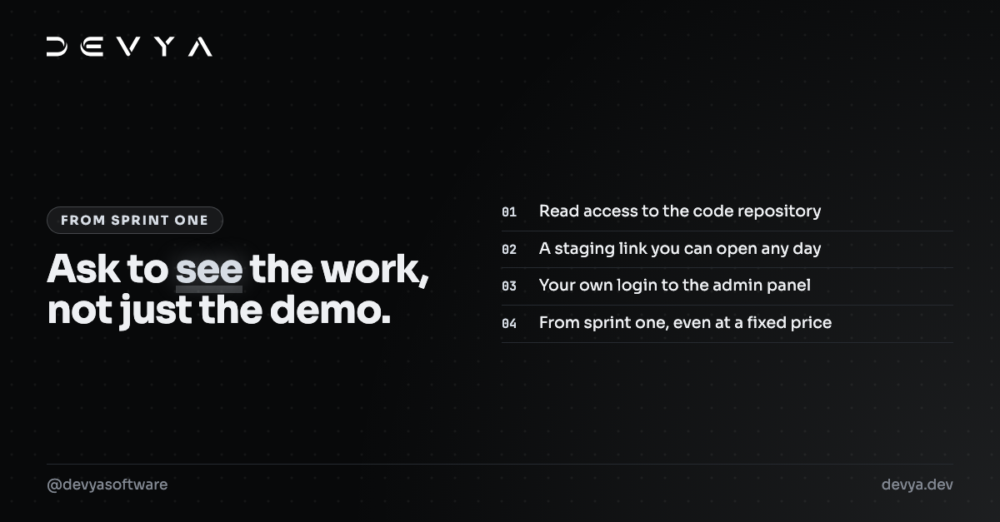 `1200×627`

```text
If the only way you see your product is a demo your vendor prepares, you're seeing what they chose to show you.

Ask for access from the first sprint, and write it into the contract:
→ Read access to the code repository. You don't have to read the code yourself; someone you trust can.
→ A staging link you can open on any day, not only on demo day.
→ Your own login to the admin panel, so you can try the real flows yourself.

This applies to fixed-price work too. A fixed price fixes the cost. It doesn't remove your right to see what you're paying for.

Access is cheap to give. If the answer is "after launch", you'll find the problems at the point where they cost the most to fix.

A vendor who is confident in the work says yes on the first call.

#Outsourcing #Founders #ProductDevelopment #BuildWithDevya
```

### Facebook · 19:30 · Arabic

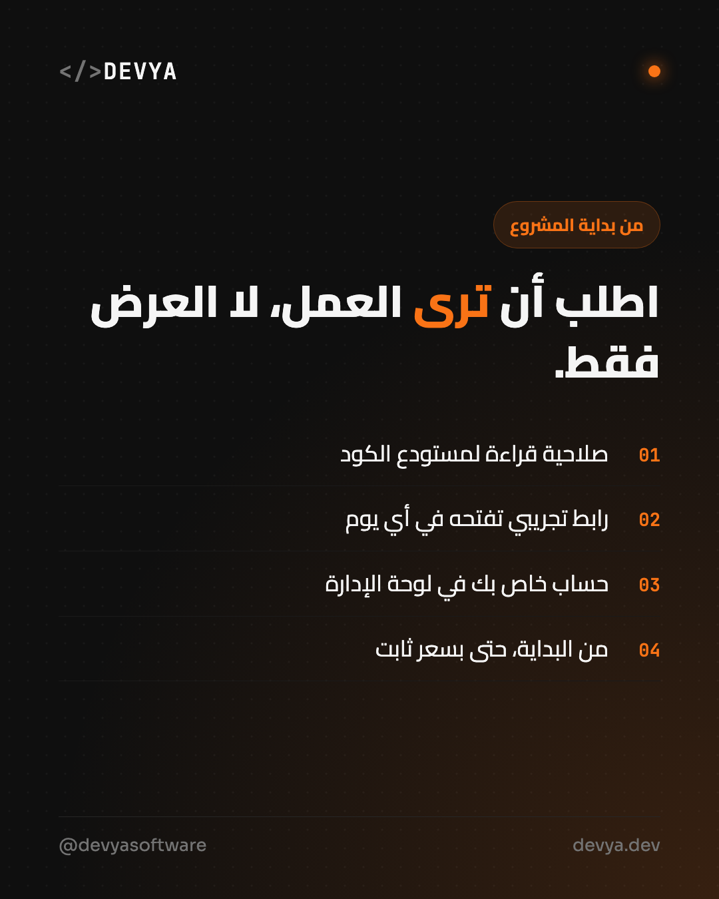 `1080×1350`

```text
إن كنت لا ترى مشروعك إلا في العروض التي تجهّزها شركة البرمجة، فأنت ترى فقط ما اختارت أن تعرضه عليك.

اطلب في العقد، ومن أول أسبوع عمل:
صلاحية قراءة لمستودع الكود، ليراجعه شخص تثق به.
رابطًا تجريبيًا تفتحه في أي يوم، لا في يوم العرض فقط.
حسابًا خاصًا بك في لوحة الإدارة لتجرّب بنفسك.

وهذا يشمل المشاريع ذات السعر الثابت أيضًا؛ فالسعر الثابت يحدد التكلفة، ولا يلغي حقك في رؤية ما تدفع ثمنه.

تخطط لمشروعك القادم؟ تحدث معنا: https://www.devya.dev/contact?utm_source=facebook&utm_medium=social&utm_campaign=2026-11-29-ask-for-repo-staging-and-admin-access-from

#BuildWithDevya #تطوير_البرمجيات
```

### Instagram · 21:00 · English

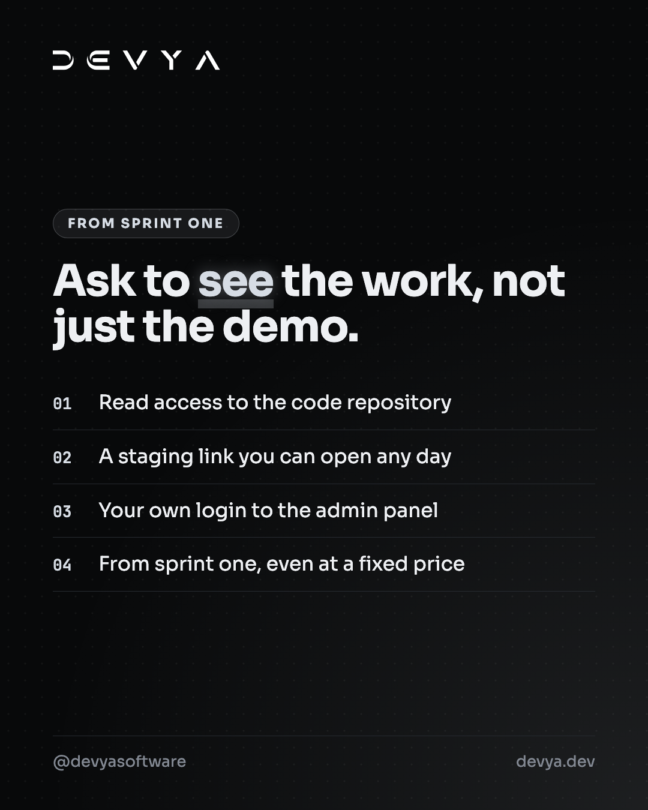 `1080×1350`

```text
Demos show what your vendor picks.
Ask for three things from sprint one: read access to the code repository, a staging link you can open any day, and your own admin login. A fixed price fixes the cost, not your right to see the work.
Save this for your next contract. Link in bio.

#BuildWithDevya #Founders #Startups #Outsourcing #SoftwareDevelopment
```

### Vertical video · 1080×1920, 10 s · `visuals/2026-11-29/reel-<lang>.mp4` (rendered on the day)

One-liner EN: Only seeing your app in demos? Ask for repo, staging and admin access from sprint one.

One-liner AR: ترى تطبيقك في العروض فقط؟ اطلب الوصول إلى الكود والنسخة التجريبية ولوحة الإدارة من البداية.

**LinkedIn video** · 13:00 · English

```text
Only seeing your app in demos? Ask for repo, staging and admin access from sprint one.

#Outsourcing #Founders #ProductDevelopment
```

**Facebook Reel** · 13:00 · Arabic

```text
ترى تطبيقك في العروض فقط؟ اطلب الوصول إلى الكود والنسخة التجريبية ولوحة الإدارة من البداية.

التفاصيل: https://www.devya.dev/contact?utm_source=facebook&utm_medium=social&utm_campaign=2026-11-29-ask-for-repo-staging-and-admin-access-from&utm_content=reel

#BuildWithDevya #تطوير_البرمجيات
```

**Instagram Reel** · 13:00 · English

```text
Only seeing your app in demos? Ask for repo, staging and admin access from sprint one.

#BuildWithDevya #Founders #Startups #Outsourcing #SoftwareDevelopment
```

**Stories** (same video, no caption): Facebook 19:30 Arabic · Instagram 21:00 English

## Day 16 · Mon 30 Nov · A JWT is encoded, not encrypted: decoding isn't verifying

Pillar **engineering** · layout **compare** · source https://www.devya.dev/projects/jwt-inspector

Basis: devya.dev/projects/jwt-inspector: decodes header and payload in the browser with zero network calls; online decoders send tokens to servers you don't control; signature verification needs a key kept on your server (page copy read from the site source, lib/community-projects.ts)

### LinkedIn · 10:00 · English

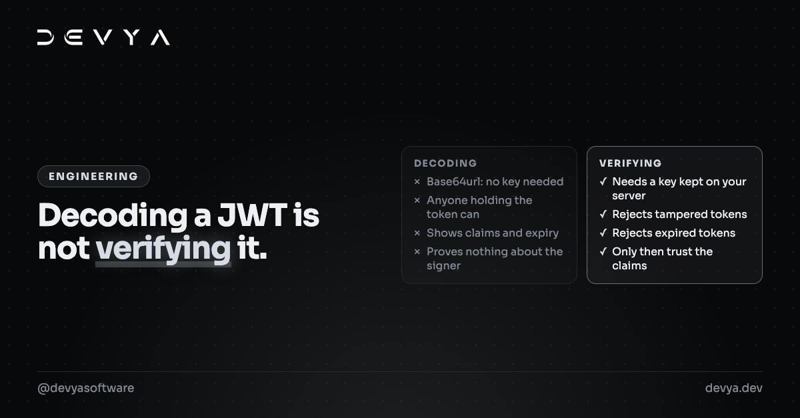 `1200×627`

```text
Paste a JWT into any online decoder and you'll usually see the user ID, the role and the expiry in plain text. Three things follow from that.

First, a JWT is encoded, not encrypted. Anyone holding the token can read its payload, so keep secrets and personal data out of it.

Second, decoding proves nothing. A decoded token tells you what it claims, not who signed it. Only a signature check with a key you keep on your server makes those claims worth trusting.

Third, those convenient online decoders send your token to a server you don't control. For anything but a throwaway token, that's a leak.

So we built jwt-inspector. It decodes the header and payload, shows the standard claims with readable dates and a live expiry status, and makes zero network calls. The token never leaves the page.

https://www.devya.dev/projects/jwt-inspector?utm_source=linkedin&utm_medium=social&utm_campaign=2026-11-30-a-jwt-is-encoded-not-encrypted-decoding-isn-t

#WebSecurity #JWT #Authentication #BuildWithDevya
```

### Facebook · 19:30 · Arabic

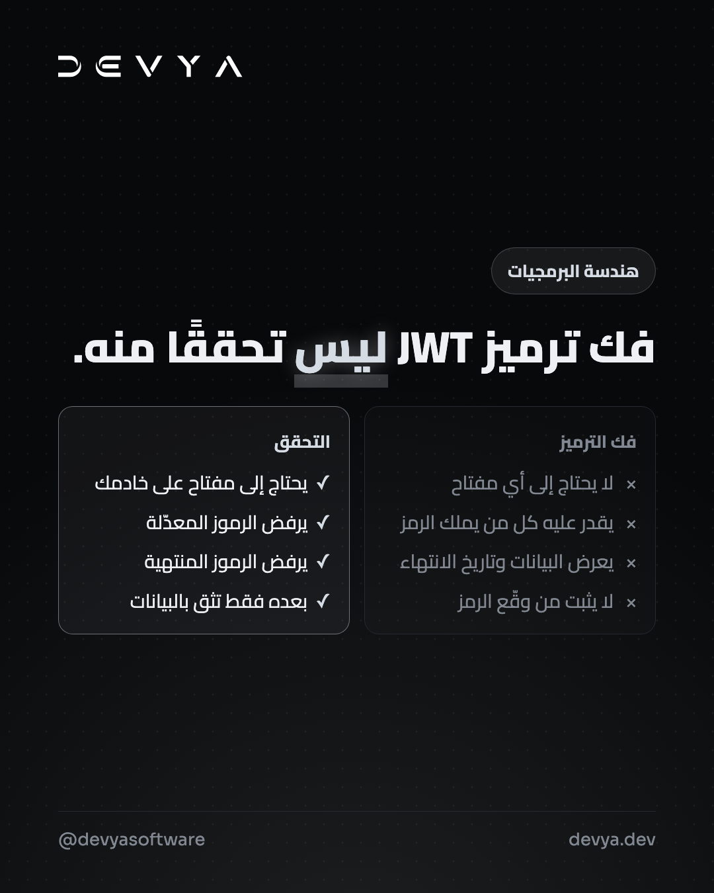 `1080×1350`

```text
رمز الدخول JWT الذي يستخدمه تطبيقك يستطيع أي شخص يحمله أن يقرأ محتواه، فهو مُرمَّز وليس مشفّرًا.

لذلك لا تضع فيه أسرارًا أو بيانات شخصية.
وقراءة الرمز لا تعني الثقة به؛ فالثقة تأتي بعد التحقق من توقيعه بمفتاح محفوظ على خادمك.
وانتبه: مواقع فك الترميز السريعة على الإنترنت ترسل رمزك إلى خادم لا تتحكم فيه.

لهذا بنينا أداة تفك الترميز داخل متصفحك فقط، دون أي اتصال بالشبكة، وتعرض تاريخ انتهاء الرمز بوضوح: https://www.devya.dev/projects/jwt-inspector?utm_source=facebook&utm_medium=social&utm_campaign=2026-11-30-a-jwt-is-encoded-not-encrypted-decoding-isn-t

#BuildWithDevya #أمن_المعلومات
```

### Instagram · 21:00 · English

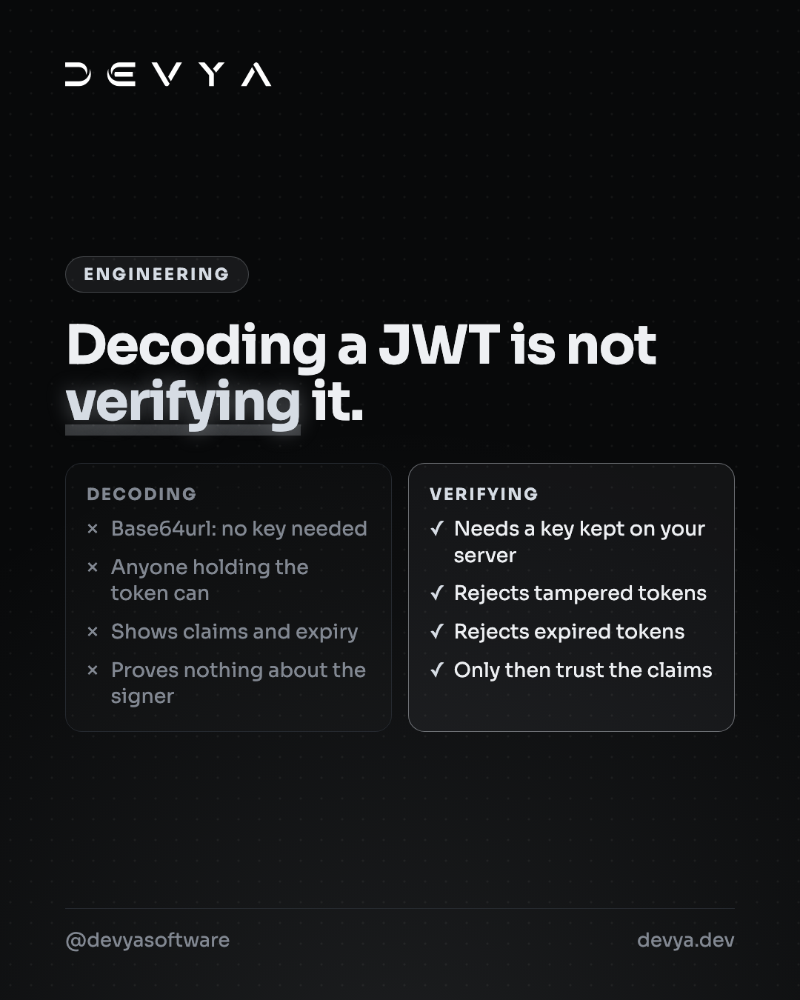 `1080×1350`

```text
A JWT is encoded, not encrypted.
Anyone holding the token can read the payload, so keep secrets out of it. And decoding proves nothing: trust the claims only after your server checks the signature.
Debugging? Decode in your browser, not on someone else's server. Link in bio.

#BuildWithDevya #WebSecurity #JWT #Authentication #CyberSecurity
```

### Vertical video · 1080×1920, 10 s · `visuals/2026-11-30/reel-<lang>.mp4` (rendered on the day)

One-liner EN: A JWT is encoded, not encrypted. Decoding it proves nothing.

One-liner AR: رمز JWT مُرمَّز وليس مشفّرًا، وفك ترميزه لا يثبت شيئًا.

**LinkedIn video** · 13:00 · English

```text
A JWT is encoded, not encrypted. Decoding it proves nothing.

#WebSecurity #JWT #Authentication
```

**Facebook Reel** · 13:00 · Arabic

```text
رمز JWT مُرمَّز وليس مشفّرًا، وفك ترميزه لا يثبت شيئًا.

التفاصيل: https://www.devya.dev/projects/jwt-inspector?utm_source=facebook&utm_medium=social&utm_campaign=2026-11-30-a-jwt-is-encoded-not-encrypted-decoding-isn-t&utm_content=reel

#BuildWithDevya #أمن_المعلومات
```

**Instagram Reel** · 13:00 · English

```text
A JWT is encoded, not encrypted. Decoding it proves nothing.

#BuildWithDevya #WebSecurity #JWT #Authentication #CyberSecurity
```

**Stories** (same video, no caption): Facebook 19:30 Arabic · Instagram 21:00 English

## Day 17 · Tue 1 Dec · Devya Converse: AI chat that answers from your own content

Pillar **product** · layout **product** · source https://www.devya.dev/converse

Basis: devya.dev/converse: assistant trained on your docs with sources, Arabic-first bilingual replies, website/WhatsApp/Messenger/API, lead capture and booking, human hand-off, no-training or self-hosted option, three-step setup, 20-minute demo (page copy read from the site source, app/(pages)/converse)

### LinkedIn · 10:00 · English

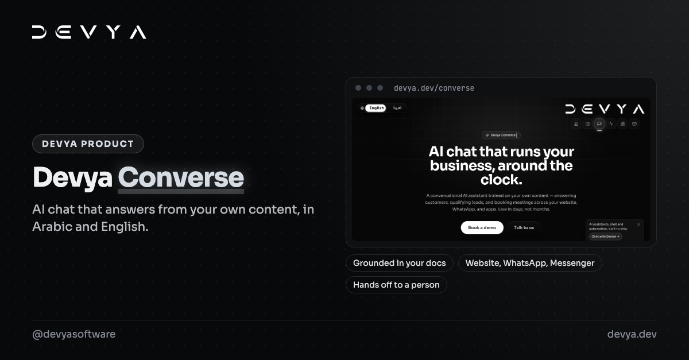 `1200×627`

```text
A chatbot that improvises is worse than no chatbot. One wrong answer about a refund policy costs more than the ticket it saved.

Devya Converse is built the other way round:
→ Trained on your own content. Point it at your docs, site and FAQs; every answer is grounded in that material, with sources.
→ Arabic-first. It replies in Arabic or English, matching each customer's language automatically.
→ One assistant, every channel: a website widget, WhatsApp, Messenger, or your own app through the API.
→ It qualifies leads and books meetings into your calendar and CRM.
→ It hands off cleanly to a person when it matters.
→ Private by design: choose a no-training model or a self-hosted deployment.

Setup is three steps: connect your content, shape and test it on real questions, then launch.

Bring a few real customer questions to a 20-minute demo and watch it answer them.

https://www.devya.dev/converse?utm_source=linkedin&utm_medium=social&utm_campaign=2026-12-01-devya-converse-ai-chat-that-answers-from-your

#ConversationalAI #CustomerSupport #MENA #BuildWithDevya
```

### Facebook · 19:30 · English

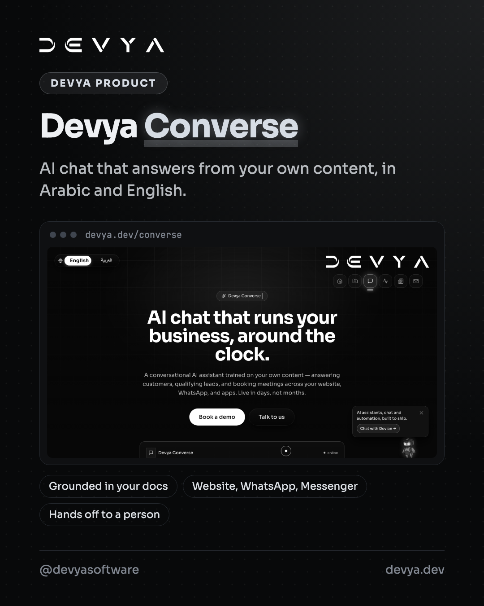 `1080×1350`

```text
Your team answers the same customer questions all day.

Devya Converse is an AI assistant trained on your own content: your site, documents, product catalogue and FAQs. It replies on your website, WhatsApp or Messenger, in Arabic or English, matching each customer's language. Every answer comes from your material, not guesswork. It can collect a customer's details, book the meeting in your calendar, and hand the conversation to a person when it matters.

See it answer your own questions in a short demo: https://www.devya.dev/converse?utm_source=facebook&utm_medium=social&utm_campaign=2026-12-01-devya-converse-ai-chat-that-answers-from-your

#BuildWithDevya #ConversationalAI #CustomerSupport
```

### Instagram · 21:00 · Arabic

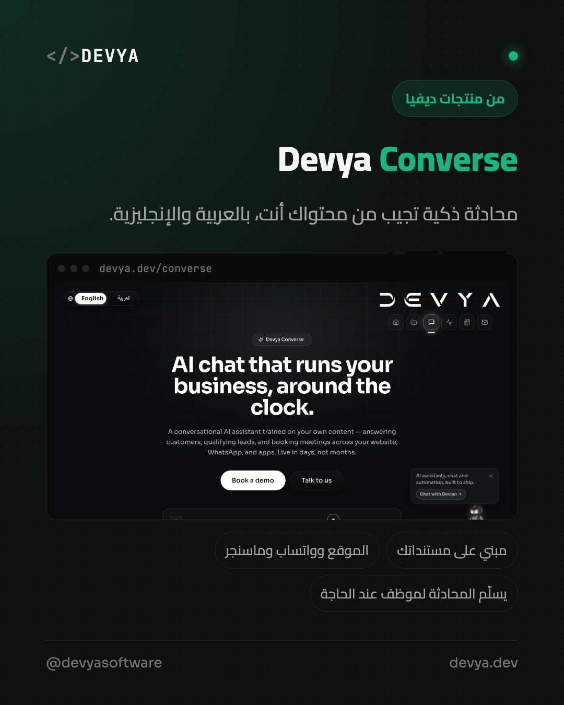 `1080×1350`

```text
مساعد محادثة يجيب عملاءك من محتواك أنت.
خدمة Devya Converse تقرأ مستنداتك وأسئلتك الشائعة، ثم تردّ على عملائك بالعربية أو الإنجليزية عبر موقعك وواتساب وماسنجر، وتحجز المواعيد، وتسلّم المحادثة لموظف عند الحاجة.
لا ردود مُختلقة: كل إجابة مبنية على موادك.
الرابط في البايو.

#ذكاء_اصطناعي #خدمة_العملاء #ريادة_الأعمال #التجارة_الإلكترونية #BuildWithDevya
```

### Vertical video · 1080×1920, 10 s · `visuals/2026-12-01/reel-<lang>.mp4` (rendered on the day)

One-liner EN: Devya Converse: AI chat that answers from your own content, in Arabic and English.

One-liner AR: مساعد Devya Converse يجيب عملاءك من محتواك أنت، بالعربية والإنجليزية.

**LinkedIn video** · 13:00 · English

```text
Devya Converse: AI chat that answers from your own content, in Arabic and English.

#ConversationalAI #CustomerSupport #MENA
```

**Facebook Reel** · 13:00 · English

```text
Devya Converse: AI chat that answers from your own content, in Arabic and English.

More: https://www.devya.dev/converse?utm_source=facebook&utm_medium=social&utm_campaign=2026-12-01-devya-converse-ai-chat-that-answers-from-your&utm_content=reel

#BuildWithDevya #ConversationalAI #CustomerSupport
```

**Instagram Reel** · 13:00 · Arabic

```text
مساعد Devya Converse يجيب عملاءك من محتواك أنت، بالعربية والإنجليزية.

#ذكاء_اصطناعي #خدمة_العملاء #ريادة_الأعمال #التجارة_الإلكترونية #BuildWithDevya
```

**Stories** (same video, no caption): Facebook 19:30 English · Instagram 21:00 Arabic

## Day 18 · Wed 2 Dec · Ask for the real start date and the named team in writing

Pillar **client-value** · layout **statement** · source https://www.devya.dev/solutions

Basis: devya-market-intel latest guide.do: when the team is booked, give the real start date in writing with the named team, and offer a paid discovery phase in the gap

### LinkedIn · 10:00 · English

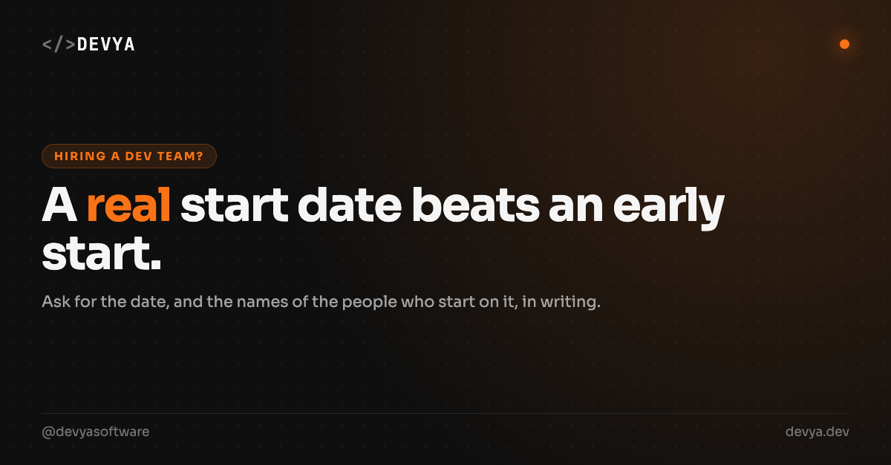 `1200×627`

```text
"We can start Monday." Before you celebrate, ask who exactly will start.

A fully booked vendor has two options. Start you early with whoever is free and fill the seats later, or tell you the real start date and wait for the right people. You want the second, in writing:
→ The actual start date.
→ The names and roles of the people who start on that date.
→ What happens if either changes: notice, and your right to say no.

If you want momentum before then, ask for a short, paid discovery phase in the gap: user roles, existing systems, the flows that matter. It moves the project forward without pretending the build has started.

An honest wait is easier to plan around than a team that's thin from week one.

#Outsourcing #Founders #ProjectManagement #BuildWithDevya
```

### Facebook · 19:30 · Arabic

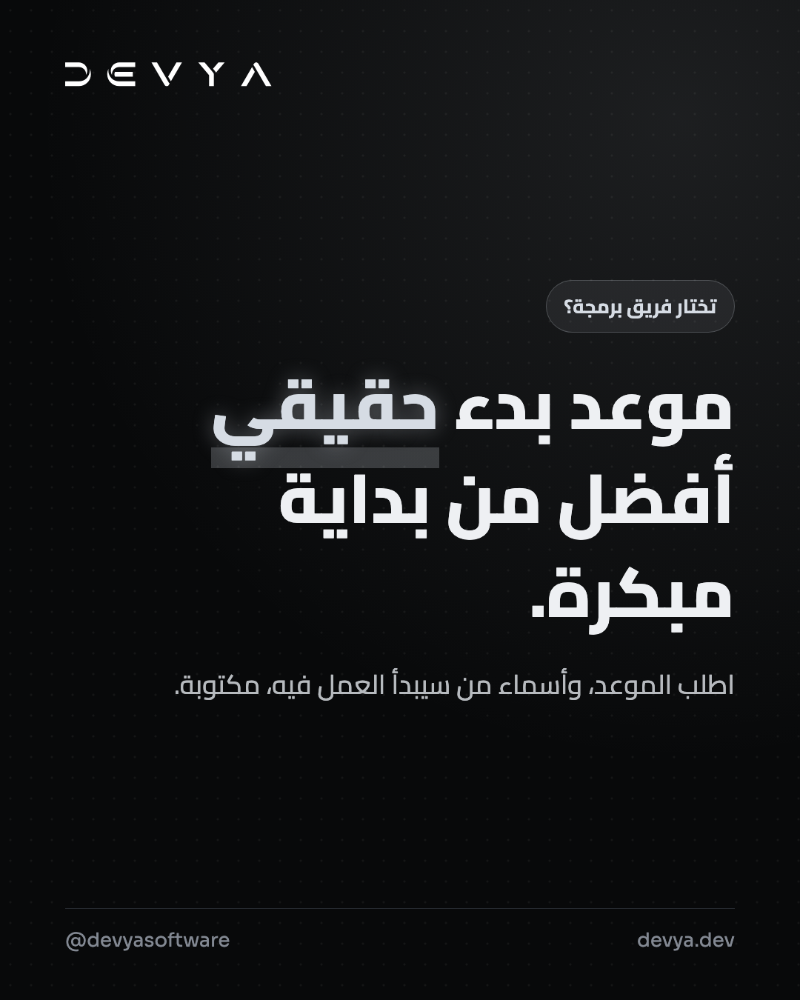 `1080×1350`

```text
عبارة «نبدأ الأسبوع القادم» مطمئنة، لكن اسأل أولًا: من الذي سيبدأ؟

حين تكون شركة البرمجة مشغولة، قد تبدأ مشروعك بمن هو متاح ثم تكمل الفريق لاحقًا.

اطلب كتابةً:
موعد البدء الحقيقي.
أسماء أعضاء الفريق الذين سيبدؤون فيه وأدوارهم.
ما يحدث إذا تغيّر أحدهما، وحقك في الرفض.

وإن أردت أن تستفيد من فترة الانتظار، فاطلب مرحلة استكشاف قصيرة ومدفوعة لتحديد المتطلبات.

تحدث معنا عن مشروعك: https://www.devya.dev/contact?utm_source=facebook&utm_medium=social&utm_campaign=2026-12-02-ask-for-the-real-start-date-and-the-named-team

#BuildWithDevya #ريادة_الأعمال
```

### Instagram · 21:00 · English

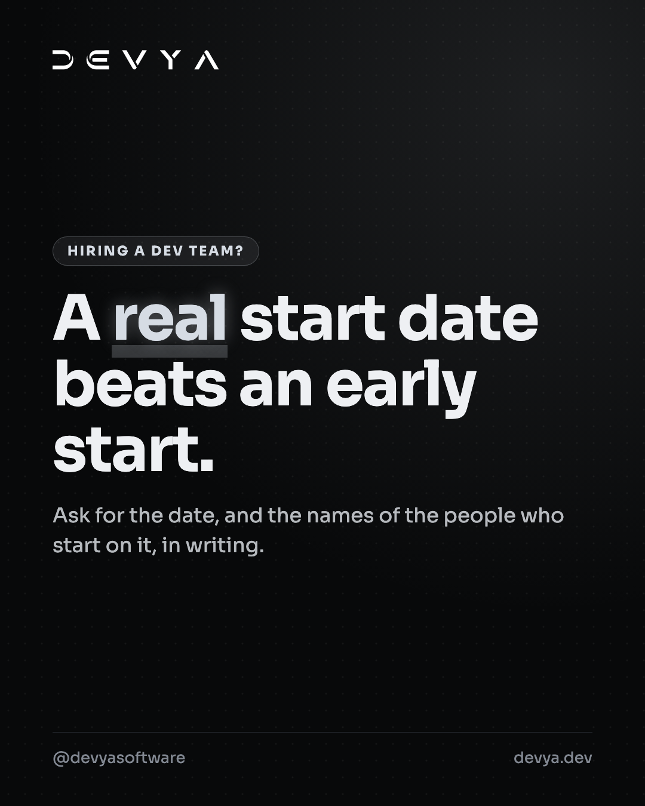 `1080×1350`

```text
"We can start Monday." Who, exactly?
Ask your vendor for the real start date and the names of the people starting on it, in writing. Want momentum before then? Ask for a short paid discovery phase in the gap.
An honest date beats an early start with half a team. Link in bio.

#BuildWithDevya #Founders #ProjectManagement #Egypt #SaudiArabia
```

### Vertical video · 1080×1920, 10 s · `visuals/2026-12-02/reel-<lang>.mp4` (rendered on the day)

One-liner EN: "We can start Monday." Ask who, exactly, and get it in writing.

One-liner AR: قبل أن توقّع: اطلب موعد البدء الحقيقي وأسماء الفريق مكتوبة.

**LinkedIn video** · 13:00 · English

```text
"We can start Monday." Ask who, exactly, and get it in writing.

#Outsourcing #Founders #ProjectManagement
```

**Facebook Reel** · 13:00 · Arabic

```text
قبل أن توقّع: اطلب موعد البدء الحقيقي وأسماء الفريق مكتوبة.

التفاصيل: https://www.devya.dev/contact?utm_source=facebook&utm_medium=social&utm_campaign=2026-12-02-ask-for-the-real-start-date-and-the-named-team&utm_content=reel

#BuildWithDevya #ريادة_الأعمال
```

**Instagram Reel** · 13:00 · English

```text
"We can start Monday." Ask who, exactly, and get it in writing.

#BuildWithDevya #Founders #ProjectManagement #Egypt #SaudiArabia
```

**Stories** (same video, no caption): Facebook 19:30 Arabic · Instagram 21:00 English

## Day 19 · Thu 3 Dec · A wrong cron line still runs: read it back before it ships

Pillar **engineering** · layout **code** · source https://www.devya.dev/projects/cron-builder

Basis: devya.dev/projects/cron-builder: a misread cron field silently runs a job at the wrong time; plain-English description and next run times in the browser (page copy read from the site source, lib/community-projects.ts)

### LinkedIn · 10:00 · English

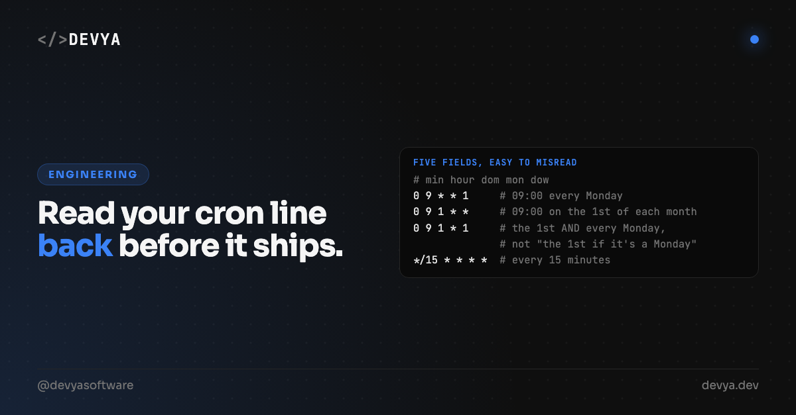 `1200×627`

```text
Nothing breaks when a cron line is wrong. The job still runs, just at the wrong time, and nobody notices until a weekly report is missing or a reminder goes out twice.

The classic trap: 0 9 1 * 1 looks like "9am on the 1st, if it's a Monday". It isn't. When both the day-of-month and day-of-week fields are set, cron runs when either one matches: on the 1st of every month, and on every Monday.

Another one: the schedule runs in the server's time zone, which is often UTC rather than Cairo or Riyadh time.

The habit that catches most of this: before a schedule ships, read it back in plain English and check the next few run times.

cron-builder does exactly that in the browser. Paste a standard five-field expression and get a plain-English description plus the upcoming run times, or build one from presets. No libraries, no server.

https://www.devya.dev/projects/cron-builder?utm_source=linkedin&utm_medium=social&utm_campaign=2026-12-03-a-wrong-cron-line-still-runs-read-it-back-before

#DevOps #Cron #BackendEngineering #BuildWithDevya
```

### Facebook · 19:30 · Arabic

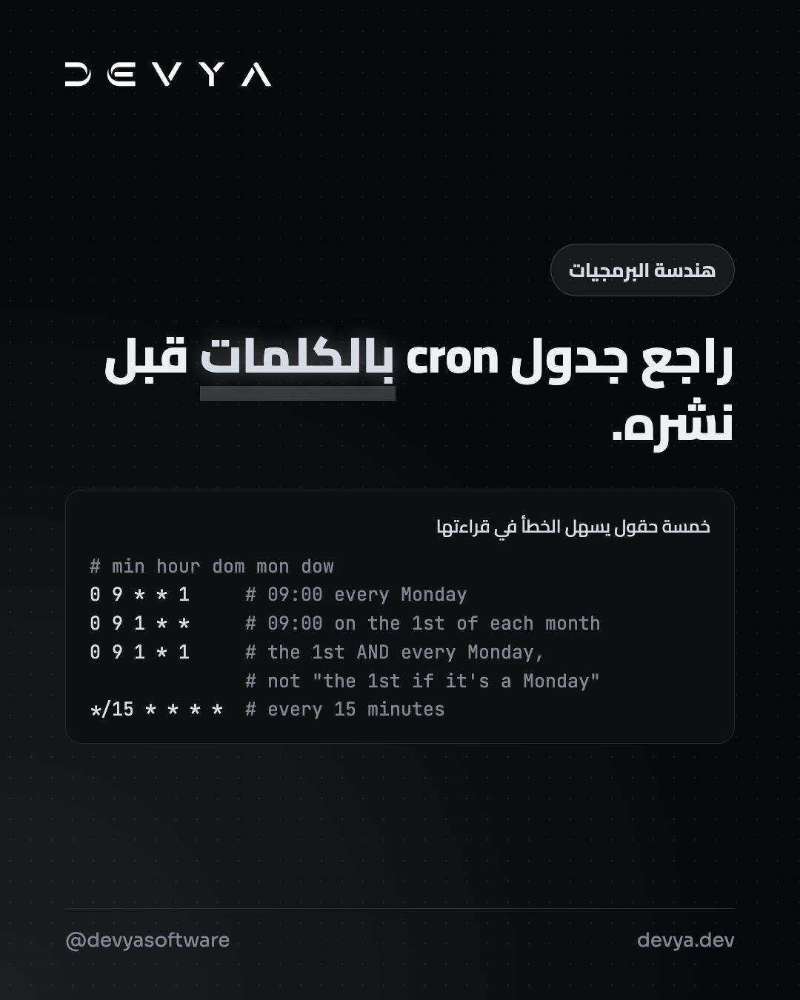 `1080×1350`

```text
تقرير أسبوعي أو رسالة تذكير تُرسَل تلقائيًا؟ غالبًا ما يُجدوَل ذلك بسطر cron من خمسة حقول.

خطأ واحد في هذا السطر لا يوقف المهمة، بل يشغّلها في توقيت خاطئ دون أن ينتبه أحد.

مثال شائع: السطر «0 9 1 * 1» لا يعني «التاسعة صباحًا أول الشهر إذا وافق يوم اثنين»، بل يعني أول كل شهر وكل يوم اثنين أيضًا.

نصيحتنا: اقرأ الجدول بكلمات واضحة، وراجع مواعيد التشغيل القادمة قبل اعتماده.

أداتنا تفعل ذلك داخل المتصفح: https://www.devya.dev/projects/cron-builder?utm_source=facebook&utm_medium=social&utm_campaign=2026-12-03-a-wrong-cron-line-still-runs-read-it-back-before

#BuildWithDevya #برمجة
```

### Instagram · 21:00 · English

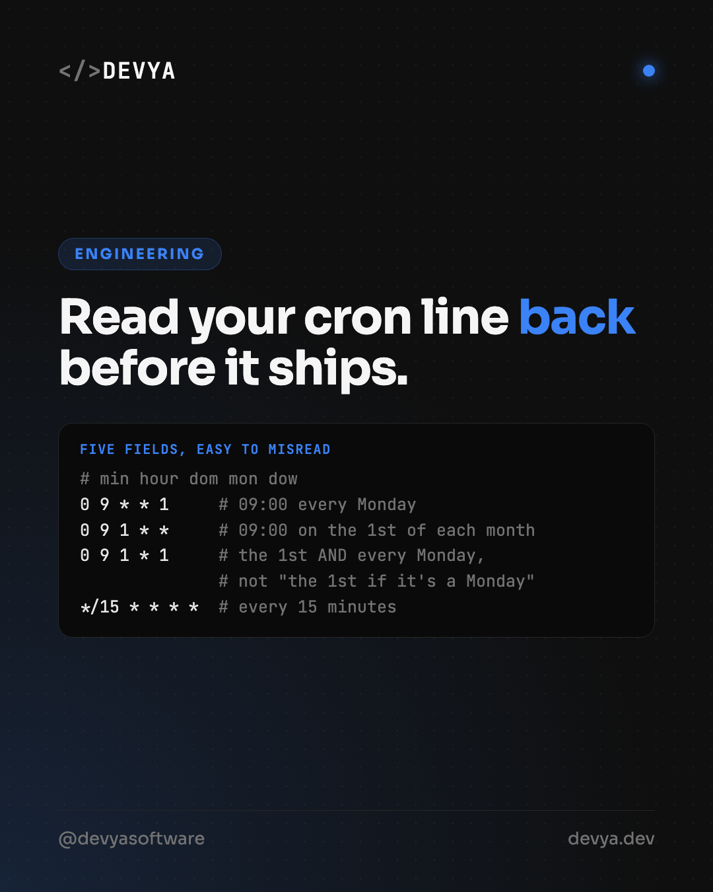 `1080×1350`

```text
Get a cron line wrong and it still runs. Just at the wrong time.
0 9 1 * 1 isn't "9am on the 1st if it's a Monday". It runs on the 1st of every month and on every Monday.
Read a schedule back in plain English and check its next run times before it ships. Link in bio.

#BuildWithDevya #DevOps #Cron #BackendDevelopment #CodingTips
```

### Vertical video · 1080×1920, 10 s · `visuals/2026-12-03/reel-<lang>.mp4` (rendered on the day)

One-liner EN: A wrong cron line doesn't fail. It runs at the wrong time.

One-liner AR: سطر cron الخاطئ لا يتوقف، بل يعمل في التوقيت الخاطئ.

**LinkedIn video** · 13:00 · English

```text
A wrong cron line doesn't fail. It runs at the wrong time.

#DevOps #Cron #BackendEngineering
```

**Facebook Reel** · 13:00 · Arabic

```text
سطر cron الخاطئ لا يتوقف، بل يعمل في التوقيت الخاطئ.

التفاصيل: https://www.devya.dev/projects/cron-builder?utm_source=facebook&utm_medium=social&utm_campaign=2026-12-03-a-wrong-cron-line-still-runs-read-it-back-before&utm_content=reel

#BuildWithDevya #برمجة
```

**Instagram Reel** · 13:00 · English

```text
A wrong cron line doesn't fail. It runs at the wrong time.

#BuildWithDevya #DevOps #Cron #BackendDevelopment #CodingTips
```

**Stories** (same video, no caption): Facebook 19:30 Arabic · Instagram 21:00 English

## Day 20 · Fri 4 Dec · Our security practices on one page, before procurement asks

Pillar **bts** · layout **checklist** · source https://www.devya.dev/security

Basis: devya.dev/security 'Our Security Practices': HTTPS/TLS with HSTS, argon2id, RBAC with lockout, audit logging, daily backups with documented restores, no trackers before consent, breach-response runbook (page copy read from the site source, app/security)

### LinkedIn · 10:00 · English

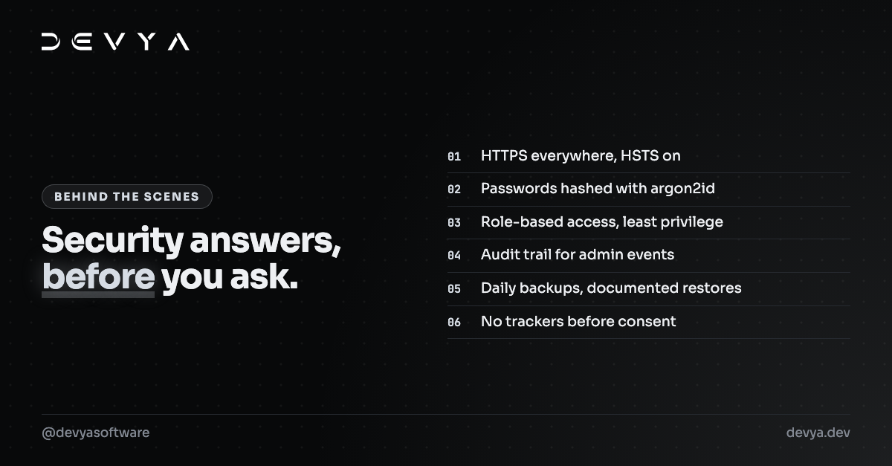 `1200×627`

```text
Procurement teams send security questionnaires. We'd rather answer the common questions before they're asked, so they're published on one page.

What it covers:
→ Encryption in transit: HTTPS/TLS on every website, API and admin system, with HSTS enabled. No unencrypted endpoints.
→ Passwords hashed with argon2id, a memory-hard algorithm built to resist GPU cracking. Never stored or logged in plaintext.
→ Role-based access control on least privilege, with lockout after repeated failed sign-ins.
→ An audit trail for sign-ins, permission changes, data exports and deletions.
→ Automated daily backups with documented restore procedures.
→ No analytics or marketing trackers before consent, and endpoints for data export and erasure requests.
→ A documented breach-response runbook.

If you're assessing us, or any vendor, this is the list to ask for in writing.

https://www.devya.dev/security?utm_source=linkedin&utm_medium=social&utm_campaign=2026-12-04-our-security-practices-on-one-page-before

#CyberSecurity #DataProtection #Procurement #BuildWithDevya
```

### Facebook · 19:30 · Arabic

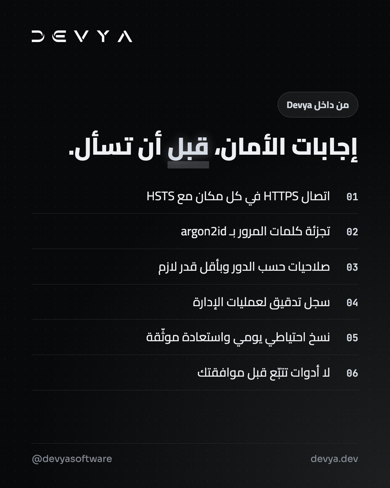 `1080×1350`

```text
كيف نحمي بيانات عملائنا وبيانات مستخدميهم؟ جمعنا الإجابة في صفحة واحدة.

اتصال مشفّر في كل مواقعنا وواجهاتنا وأنظمة الإدارة، دون أي نقطة غير مشفّرة.
كلمات مرور لا تُحفظ ولا تُسجَّل كنص صريح أبدًا.
صلاحيات لكل مستخدم بقدر ما يحتاجه فقط.
سجل تدقيق لعمليات الدخول وتغيير الصلاحيات والتصدير والحذف.
نسخ احتياطي يومي تلقائي، وخطوات استعادة موثّقة.
ولا أدوات تتبّع قبل موافقتك.

إن كنت تقيّم أي شركة برمجة، فاطلب منها قائمة كهذه مكتوبة.

التفاصيل: https://www.devya.dev/security?utm_source=facebook&utm_medium=social&utm_campaign=2026-12-04-our-security-practices-on-one-page-before

#BuildWithDevya #أمن_المعلومات
```

### Instagram · 21:00 · English

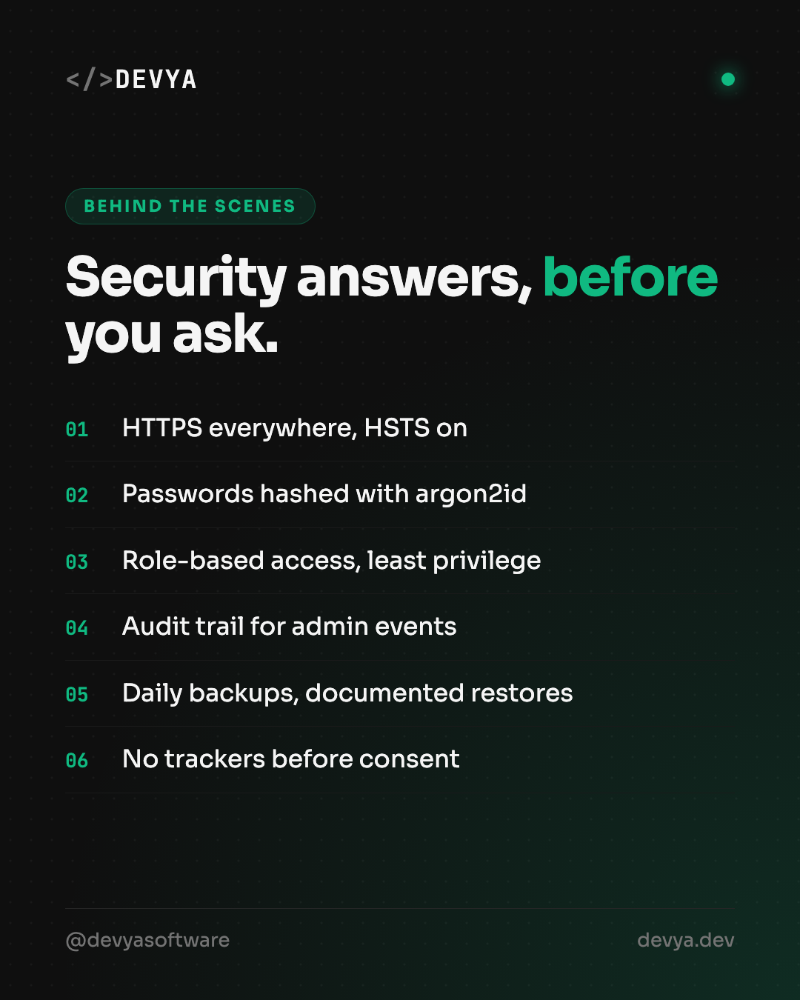 `1080×1350`

```text
Security answers, before you ask.
HTTPS everywhere with HSTS. Passwords hashed with argon2id. Role-based access. An audit trail for admin actions. Daily backups with documented restores. No trackers before consent.
All on one page, written for procurement and due-diligence reviews. Link in bio.

#BuildWithDevya #CyberSecurity #DataPrivacy #InfoSec #WebDevelopment
```

### Vertical video · 1080×1920, 10 s · `visuals/2026-12-04/reel-<lang>.mp4` (rendered on the day)

One-liner EN: How we protect client data, on one page: argon2id, HSTS, audit logs, daily backups.

One-liner AR: كيف نحمي بيانات عملائنا؟ الإجابة في صفحة واحدة: تشفير ونسخ احتياطي يومي وسجل تدقيق.

**LinkedIn video** · 13:00 · English

```text
How we protect client data, on one page: argon2id, HSTS, audit logs, daily backups.

#CyberSecurity #DataProtection #Procurement
```

**Facebook Reel** · 13:00 · Arabic

```text
كيف نحمي بيانات عملائنا؟ الإجابة في صفحة واحدة: تشفير ونسخ احتياطي يومي وسجل تدقيق.

التفاصيل: https://www.devya.dev/security?utm_source=facebook&utm_medium=social&utm_campaign=2026-12-04-our-security-practices-on-one-page-before&utm_content=reel

#BuildWithDevya #أمن_المعلومات
```

**Instagram Reel** · 13:00 · English

```text
How we protect client data, on one page: argon2id, HSTS, audit logs, daily backups.

#BuildWithDevya #CyberSecurity #DataPrivacy #InfoSec #WebDevelopment
```

**Stories** (same video, no caption): Facebook 19:30 Arabic · Instagram 21:00 English

## Day 21 · Sat 5 Dec · og-preview: see your link card before you share it

Pillar **product** · layout **product** · source https://www.devya.dev/projects/og-preview

Basis: devya.dev/projects/og-preview: Google, Facebook, X and LinkedIn card previews, live character counters, ready-to-paste meta tags, single static page, free and open source (page copy read from the site source, lib/community-projects.ts)

### LinkedIn · 10:00 · English

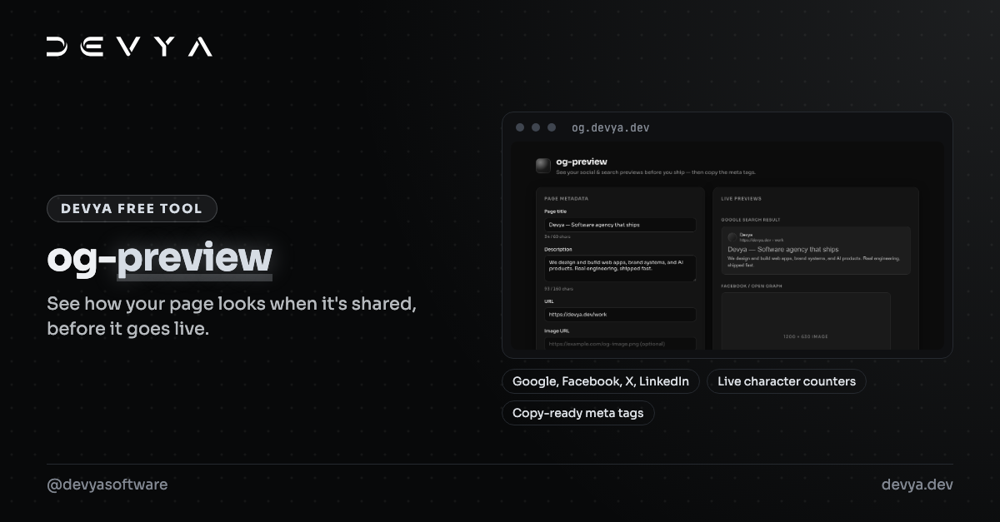 `1200×627`

```text
The first time many teams see their link preview is when a customer shares it: the wrong image, a title cut in half, or no card at all.

By then the fix is expensive. The post is already out, and platforms cache what they saw.

og-preview is a free tool we built to catch it earlier:
→ Fill in the page's metadata and see it rendered as a Google result and as Facebook, X and LinkedIn cards.
→ Live character counters show where your title and description get cut.
→ Copy a ready-to-paste meta block in one click.

It's a single static page with zero dependencies. Nothing to install, it runs entirely in your browser, and it's open source.

Worth a minute before your next launch page goes live.

#SEO #OpenGraph #WebDevelopment #BuildWithDevya
```

### Facebook · 19:30 · English

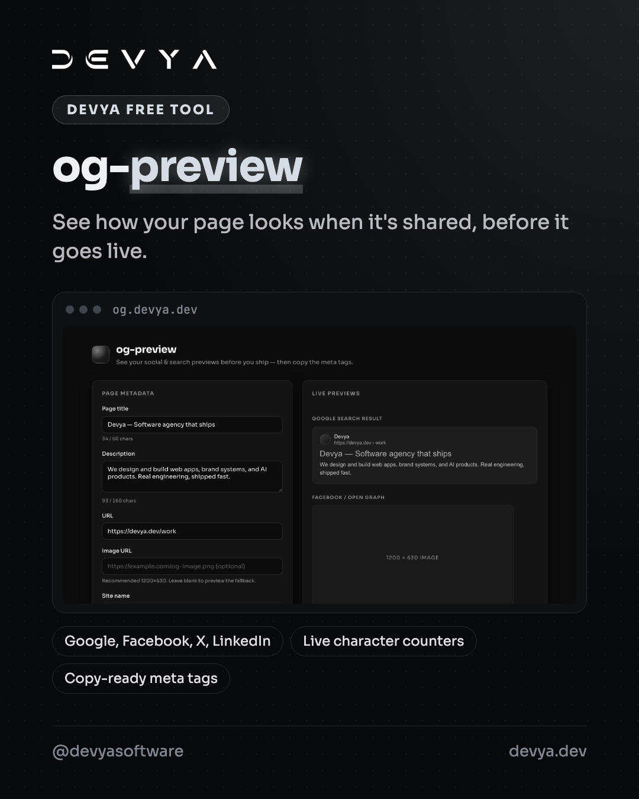 `1080×1350`

```text
Shared your website link and got the wrong image, or a title cut in half?

That preview card is built from a few hidden tags on your page. og-preview, a free tool we built, shows how your page will look as a Google result and as Facebook, X and LinkedIn cards before you publish, then gives you the exact tags to paste in. It runs in your browser, with nothing to install.

Try it before your next launch: https://www.devya.dev/projects/og-preview?utm_source=facebook&utm_medium=social&utm_campaign=2026-12-05-og-preview-see-your-link-card-before-you-share-it

#BuildWithDevya #SEO #OpenGraph
```

### Instagram · 21:00 · Arabic

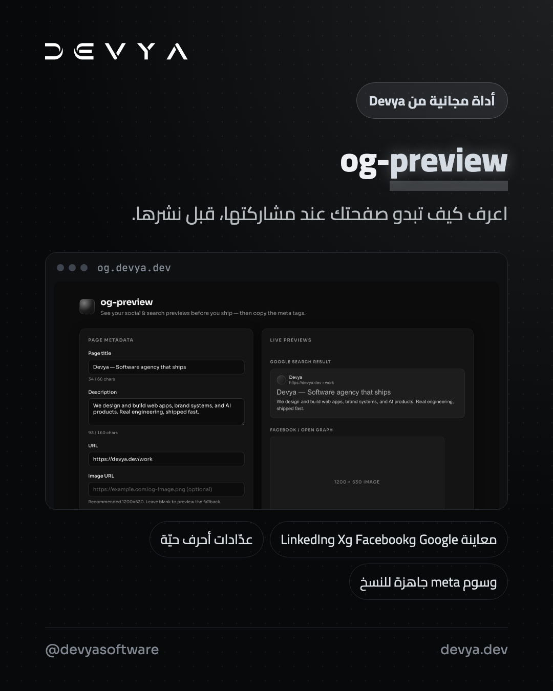 `1080×1350`

```text
هل شاركت رابط موقعك فظهرت صورة خاطئة أو عنوان مقطوع؟
أداة og-preview المجانية تريك كيف ستبدو صفحتك على Google وFacebook وX وLinkedIn قبل النشر، وتعطيك الوسوم الجاهزة للصق.
تعمل داخل متصفحك، ولا تحتاج إلى تثبيت، وهي مفتوحة المصدر.
الرابط في البايو.

#تسويق_رقمي #تحسين_محركات_البحث #تطوير_المواقع #ريادة_الأعمال #BuildWithDevya
```

### Vertical video · 1080×1920, 10 s · `visuals/2026-12-05/reel-<lang>.mp4` (rendered on the day)

One-liner EN: Link preview check: see how your link looks on Google, Facebook, X and LinkedIn before you share it.

One-liner AR: اعرف كيف يظهر رابطك على Google وFacebook وX وLinkedIn قبل أن تشاركه.

**LinkedIn video** · 13:00 · English

```text
Link preview check: see how your link looks on Google, Facebook, X and LinkedIn before you share it.

#SEO #OpenGraph #WebDevelopment
```

**Facebook Reel** · 13:00 · English

```text
Link preview check: see how your link looks on Google, Facebook, X and LinkedIn before you share it.

More: https://www.devya.dev/projects/og-preview?utm_source=facebook&utm_medium=social&utm_campaign=2026-12-05-og-preview-see-your-link-card-before-you-share-it&utm_content=reel

#BuildWithDevya #SEO #OpenGraph
```

**Instagram Reel** · 13:00 · Arabic

```text
اعرف كيف يظهر رابطك على Google وFacebook وX وLinkedIn قبل أن تشاركه.

#تسويق_رقمي #تحسين_محركات_البحث #تطوير_المواقع #ريادة_الأعمال #BuildWithDevya
```

**Stories** (same video, no caption): Facebook 19:30 English · Instagram 21:00 Arabic

## Day 22 · Sun 6 Dec · Before launch, ask for a written test pass on real content

Pillar **client-value** · layout **checklist** · source https://www.devya.dev/solutions

Basis: devya-market-intel latest guide.avoid: no launch without a written pre-launch test pass on the client's real content, devices and payment or login paths; don't end the project on launch day (two-week support with visible bug triage)

### LinkedIn · 10:00 · English

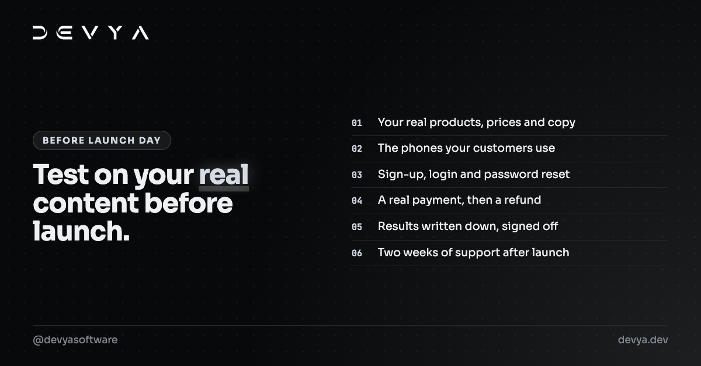 `1200×627`

```text
Launch-day bugs are rarely new. Most were there all along; they just never met real data.

Test content is tidy: short product names, round prices, one language. Real content isn't. A long Arabic title breaks a layout, a missing image breaks a page, and a payment flow that passed with a test card can fail with a real one.

Before you approve a launch, ask your vendor for a written test pass on:
1. Your real products, prices and copy, in every language you ship.
2. The phones and browsers your customers actually use.
3. Every sign-up, login and password-reset path.
4. A real payment, end to end, then a refund.

Ask for the results in writing, and sign them off.

Then don't let the project end on launch day. Agree a two-week support window with a daily bug review you can see. Real users will find what testing missed.

#ProductLaunch #QA #Founders #BuildWithDevya
```

### Facebook · 19:30 · Arabic

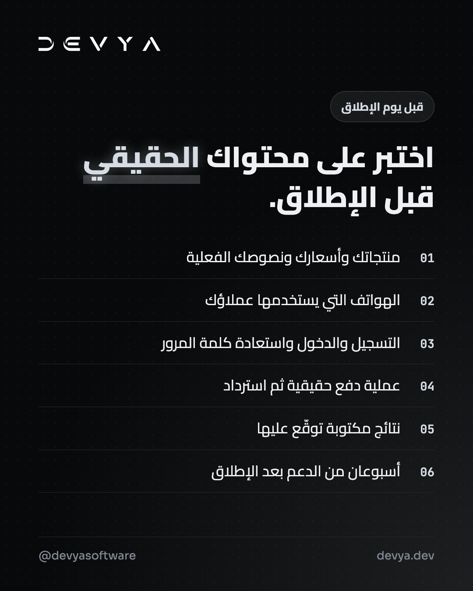 `1080×1350`

```text
أخطاء يوم الإطلاق نادرًا ما تكون جديدة، فهي موجودة منذ البداية لكنها لم تُختبر على بيانات حقيقية.

قبل أن توافق على إطلاق موقعك أو تطبيقك، اطلب من شركة البرمجة اختبارًا مكتوبًا يشمل:
منتجاتك وأسعارك ونصوصك الفعلية بكل اللغات.
الهواتف والمتصفحات التي يستخدمها عملاؤك.
التسجيل والدخول واستعادة كلمة المرور.
عملية دفع حقيقية كاملة، ثم استرداد المبلغ.

ولا تجعل المشروع ينتهي يوم الإطلاق: اتفق على أسبوعين من الدعم بعده.

تحدث معنا: https://www.devya.dev/contact?utm_source=facebook&utm_medium=social&utm_campaign=2026-12-06-before-launch-ask-for-a-written-test-pass-on

#BuildWithDevya #ريادة_الأعمال
```

### Instagram · 21:00 · English

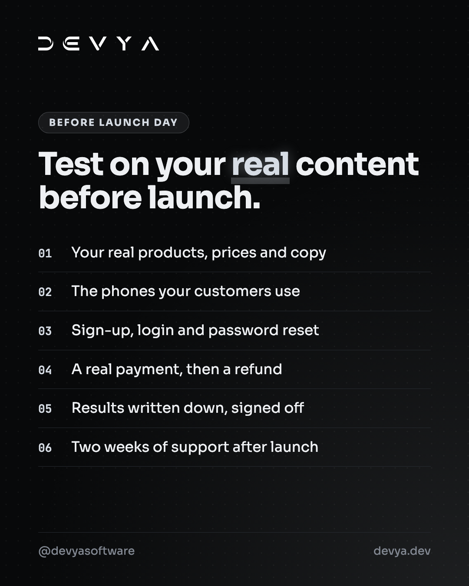 `1080×1350`

```text
Dummy data hides launch-day bugs.
Before you approve a launch, ask for a written test pass: your real products and prices, your customers' phones, every login path, and a real payment plus a refund. Then agree two weeks of support after launch.
Save this for launch week. Link in bio.

#BuildWithDevya #ProductLaunch #QA #Startups #AppDevelopment
```

### Vertical video · 1080×1920, 10 s · `visuals/2026-12-06/reel-<lang>.mp4` (rendered on the day)

One-liner EN: Launch-day bugs are rarely new. Test on your real content first.

One-liner AR: أخطاء يوم الإطلاق نادرًا ما تكون جديدة. اختبر على محتواك الحقيقي أولًا.

**LinkedIn video** · 13:00 · English

```text
Launch-day bugs are rarely new. Test on your real content first.

#ProductLaunch #QA #Founders
```

**Facebook Reel** · 13:00 · Arabic

```text
أخطاء يوم الإطلاق نادرًا ما تكون جديدة. اختبر على محتواك الحقيقي أولًا.

التفاصيل: https://www.devya.dev/contact?utm_source=facebook&utm_medium=social&utm_campaign=2026-12-06-before-launch-ask-for-a-written-test-pass-on&utm_content=reel

#BuildWithDevya #ريادة_الأعمال
```

**Instagram Reel** · 13:00 · English

```text
Launch-day bugs are rarely new. Test on your real content first.

#BuildWithDevya #ProductLaunch #QA #Startups #AppDevelopment
```

**Stories** (same video, no caption): Facebook 19:30 Arabic · Instagram 21:00 English

## Day 23 · Mon 7 Dec · Light grey text can fail WCAG contrast: measure it

Pillar **engineering** · layout **code** · source https://www.devya.dev/projects/contrast-check

Basis: devya.dev/projects/contrast-check: WCAG 2.1 ratio, AA/AAA pass-fail, real-text preview, nearest accessible colour; low-contrast text passes a visual review but fails users and audits (page copy read from the site source, lib/community-projects.ts)

### LinkedIn · 10:00 · English

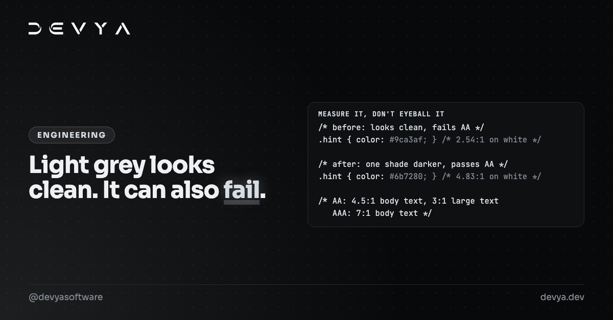 `1200×627`

```text
Light grey text is a design favourite: placeholders, captions, helper text. It looks clean on a large monitor. On a phone in bright light, or for a reader with weaker eyesight, it fades away.

Contrast has a number. To pass WCAG 2.1 at level AA, body text needs a contrast ratio of at least 4.5:1 against its background, and large text 3:1. AAA asks for 7:1.

A common case: the light grey 9CA3AF on white measures about 2.54:1 and fails AA. One shade darker, 6B7280, measures 4.83:1 and passes.

Low-contrast text gets through a quick visual review, then fails real users and accessibility audits. Measuring it takes seconds.

contrast-check, a tool we built, does this in the browser: it computes the WCAG 2.1 ratio for any two colours, shows pass or fail at every level, previews real sample text, and suggests the nearest accessible colour when a pair fails. Nothing to install.

#Accessibility #WebDesign #UXDesign #BuildWithDevya
```

### Facebook · 19:30 · Arabic

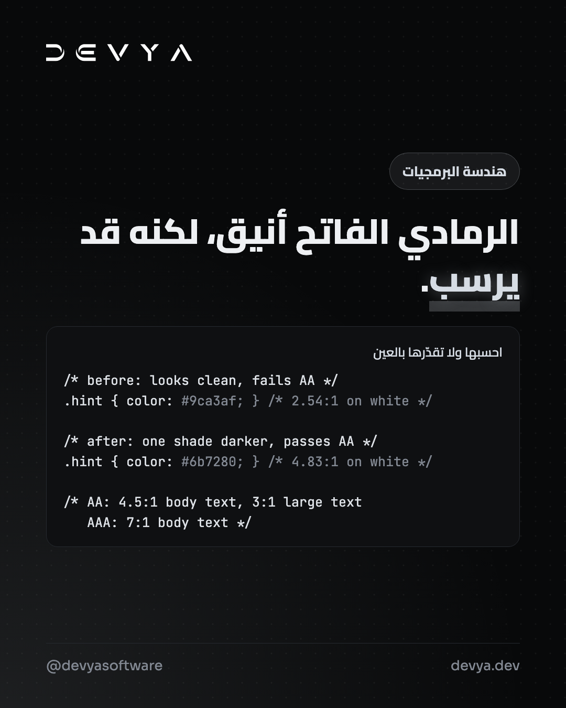 `1080×1350`

```text
في موقعك نصوص رمادية فاتحة تبدو أنيقة؟ قد يصعب على بعض عملائك قراءتها، خاصة على الهاتف.

للوضوح مقياس معروف اسمه نسبة التباين، ومعيار WCAG يطلب 4.5 إلى 1 على الأقل للنص العادي.

مثلًا، اللون الرمادي 9CA3AF على خلفية بيضاء نسبته نحو 2.5 فقط فيرسب، أما الأغمق قليلًا 6B7280 فنسبته نحو 4.8 فينجح.

لا تعتمد على العين، بل احسبها.

أداتنا تحسب النسبة داخل متصفحك وتقترح أقرب لون ناجح: https://www.devya.dev/projects/contrast-check?utm_source=facebook&utm_medium=social&utm_campaign=2026-12-07-light-grey-text-can-fail-wcag-contrast-measure-it

#BuildWithDevya #تصميم_المواقع
```

### Instagram · 21:00 · English

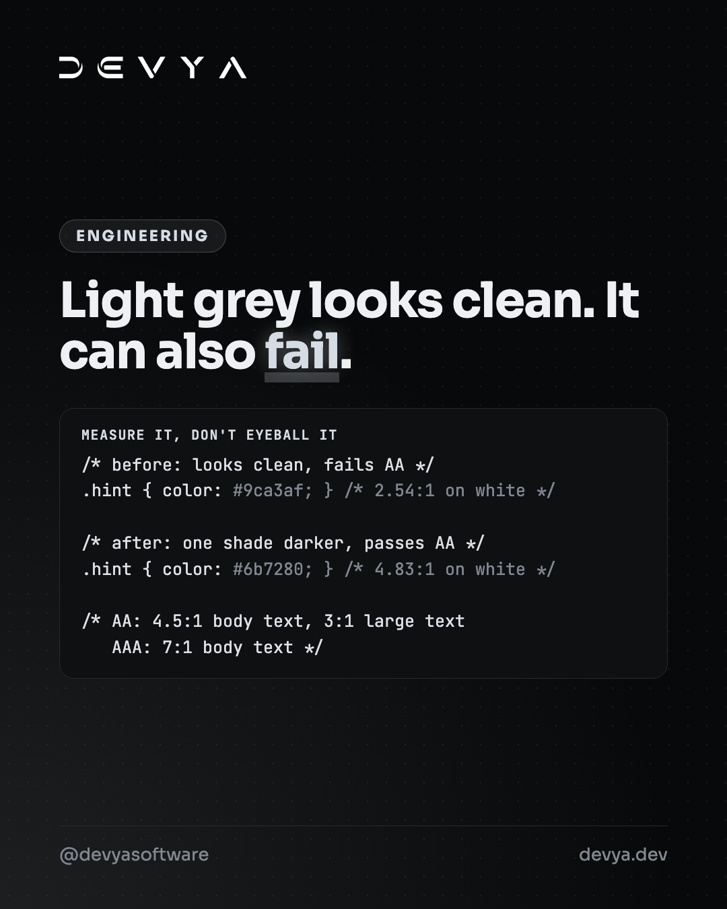 `1080×1350`

```text
That pale grey text? Measure it.
A typical light grey on white scores about 2.5:1. WCAG AA asks for 4.5:1 for body text, so one shade darker can be the difference between pass and fail.
Don't eyeball contrast. Link in bio.

#BuildWithDevya #Accessibility #WebDesign #UXDesign #A11y
```

### Vertical video · 1080×1920, 10 s · `visuals/2026-12-07/reel-<lang>.mp4` (rendered on the day)

One-liner EN: Light grey text looks clean. Measure it: it can fail WCAG contrast.

One-liner AR: النص الرمادي الفاتح يبدو أنيقًا، لكنه قد يرسب في اختبار التباين. احسبه.

**LinkedIn video** · 13:00 · English

```text
Light grey text looks clean. Measure it: it can fail WCAG contrast.

#Accessibility #WebDesign #UXDesign
```

**Facebook Reel** · 13:00 · Arabic

```text
النص الرمادي الفاتح يبدو أنيقًا، لكنه قد يرسب في اختبار التباين. احسبه.

التفاصيل: https://www.devya.dev/projects/contrast-check?utm_source=facebook&utm_medium=social&utm_campaign=2026-12-07-light-grey-text-can-fail-wcag-contrast-measure-it&utm_content=reel

#BuildWithDevya #تصميم_المواقع
```

**Instagram Reel** · 13:00 · English

```text
Light grey text looks clean. Measure it: it can fail WCAG contrast.

#BuildWithDevya #Accessibility #WebDesign #UXDesign #A11y
```

**Stories** (same video, no caption): Facebook 19:30 Arabic · Instagram 21:00 English

## Day 24 · Tue 8 Dec · Moving POS: a restaurant POS with an AI companion that reads your own sales

Pillar **product** · layout **product** · source https://www.devya.dev/projects/moving-pos-film

Basis: Moving POS AI – Founders Live pitch (Devya YouTube channel, description and chapters) and the Moving POS page on devya.dev

### LinkedIn · 10:00 · English

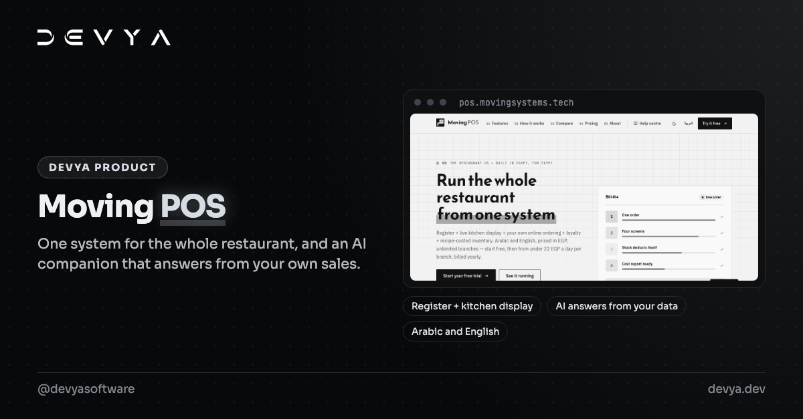 `1200×627`

```text
Moving POS is our restaurant POS for Egypt and Saudi Arabia, and it now has an AI companion that answers from the restaurant's own numbers.

Most owners are not short of data. They are short of time to dig through reports and find where the week's profit went.

Moving POS already runs the whole restaurant from one system: the register, a live kitchen display, online ordering, loyalty and recipe-costed inventory, in Arabic and English. 25 branches run on it every day.

The AI companion sits in the back office. It reads the restaurant's own sales and stock and answers the owner's questions about them in plain words. Insight cards add a demand forecast and menu costing notes.

We entered it in the Founders Live pitch challenge. The pitch walks through a week of questions in under 90 seconds:
https://www.youtube.com/watch?v=GsNGR6vv_eU&utm_source=linkedin&utm_medium=social&utm_campaign=2026-12-08-moving-pos-a-restaurant-pos-with-an-ai-companion

#MovingPOS #RestaurantTech #AI #BuildWithDevya
```

### Facebook · 19:30 · English

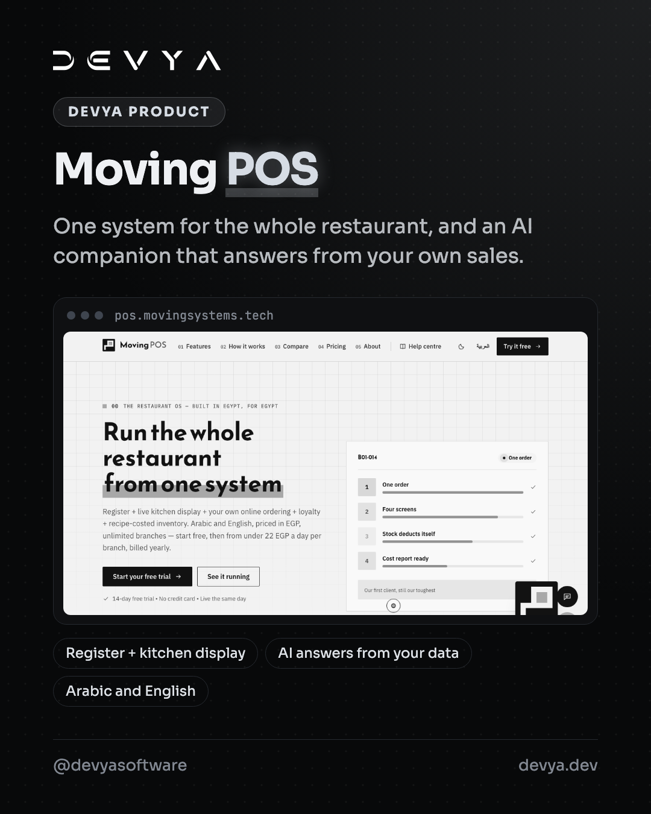 `1080×1350`

```text
Moving POS: the restaurant POS with an AI companion that answers from your own sales.

Ask it about your week, and it reads your restaurant's sales and stock to answer in plain words. Insight cards add a demand forecast and menu costing notes. Around it, Moving POS runs the register, the kitchen display, online ordering, loyalty and recipe-costed inventory, in Arabic and English, in Egypt and Saudi Arabia.

Watch the pitch video:
https://www.youtube.com/watch?v=GsNGR6vv_eU&utm_source=facebook&utm_medium=social&utm_campaign=2026-12-08-moving-pos-a-restaurant-pos-with-an-ai-companion

#BuildWithDevya #MovingPOS #RestaurantTech
```

### Instagram · 21:00 · Arabic

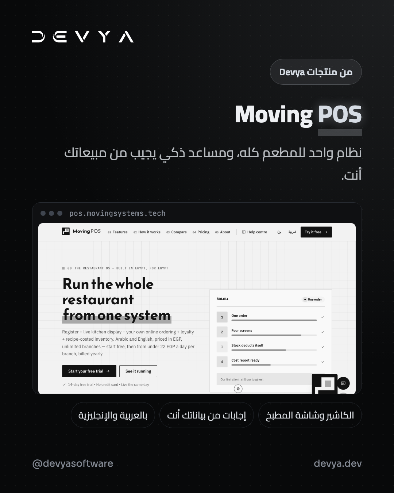 `1080×1350`

```text
نظام نقاط البيع Moving POS يدير مطعمك كله، ومعه مساعد ذكي يجيب من مبيعاتك أنت.
اسأله عن أسبوعك، فيقرأ مبيعات المطعم ومخزونه ويجيبك بكلمات واضحة، مع توقع للطلب وملاحظات عن تكلفة الأصناف.
يعمل في مصر والسعودية، بالعربية والإنجليزية.
شاهد فيديو العرض على قناة Devya في يوتيوب.

#BuildWithDevya #MovingPOS #مطاعم #ذكاء_اصطناعي
```

### Vertical video · 1080×1920, 10 s · `visuals/2026-12-08/reel-<lang>.mp4` (rendered on the day)

One-liner EN: Moving POS: a restaurant POS with an AI companion that answers from your own sales.

One-liner AR: نظام نقاط البيع Moving POS: مساعد ذكي يجيب من مبيعات مطعمك أنت.

**LinkedIn video** · 13:00 · English

```text
Moving POS: a restaurant POS with an AI companion that answers from your own sales.

#MovingPOS #RestaurantTech #AI
```

**Facebook Reel** · 13:00 · English

```text
Moving POS: a restaurant POS with an AI companion that answers from your own sales.

More: https://www.youtube.com/watch?v=GsNGR6vv_eU&utm_source=facebook&utm_medium=social&utm_campaign=2026-12-08-moving-pos-a-restaurant-pos-with-an-ai-companion&utm_content=reel

#BuildWithDevya #MovingPOS #RestaurantTech
```

**Instagram Reel** · 13:00 · Arabic

```text
نظام نقاط البيع Moving POS: مساعد ذكي يجيب من مبيعات مطعمك أنت.

#BuildWithDevya #MovingPOS #مطاعم #ذكاء_اصطناعي
```

**Stories** (same video, no caption): Facebook 19:30 English · Instagram 21:00 Arabic

## Day 25 · Wed 9 Dec · Random 502s behind a load balancer: the Node.js keep-alive timeout

Pillar **engineering** · layout **terminal** · source https://www.devya.dev/blogs/nodejs-keep-alive-timeout-load-balancer-502-nestjs-field-notes

Basis: Devya blog field notes: Node.js keep-alive timeouts behind a load balancer (keepAliveTimeout 5 s vs ALB/Nginx 60 s idle timeout, the one-line NestJS fix, how to confirm the cause)

### LinkedIn · 10:00 · English

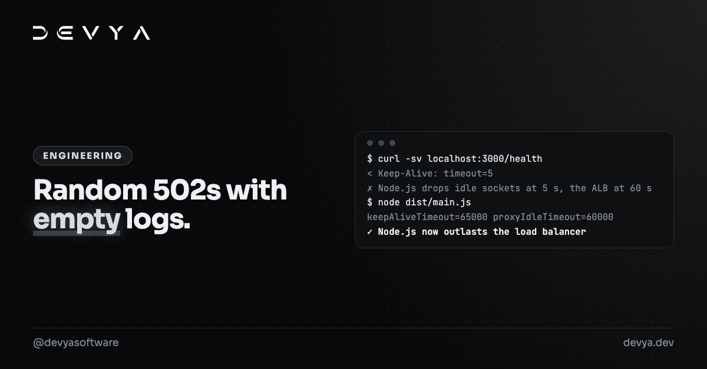 `1200×627`

```text
Random 502s from the load balancer, no pattern by endpoint, nothing in the application logs. That bug report always reads the same way, and it usually comes down to one default.

Node.js closes a keep-alive connection after 5 seconds of idle time: server.keepAliveTimeout defaults to 5000 ms. An AWS Application Load Balancer keeps idle connections for 60 seconds, and so does an Nginx upstream keep-alive pool. When the load balancer reuses a connection at the moment Node.js closes it, Node.js answers with a TCP reset and the client gets a 502. The handler never ran, so the logs stay clean. Quiet services hit this more often than busy ones.

The rule for every hop: the side that sends requests must give up on an idle connection before the side that receives them does.

In NestJS on the Express adapter, that's one line in main.ts: app.getHttpServer().keepAliveTimeout = 65_000, above the ALB's 60-second default. Fastify already defaults to 72 seconds.

We keep the number in one environment variable next to the load balancer config, because the two values are only correct relative to each other.

The field notes, including the outbound fetch version of the same race:
https://www.devya.dev/blogs/nodejs-keep-alive-timeout-load-balancer-502-nestjs-field-notes?utm_source=linkedin&utm_medium=social&utm_campaign=2026-12-09-random-502s-behind-a-load-balancer-the-node-js

#NodeJS #NestJS #DevOps #AWS #BuildWithDevya
```

### Facebook · 19:30 · Arabic

 `1080×1350`

```text
أخطاء 502 تظهر لبعض زوار موقعك بلا نمط واضح، وسجلات التطبيق فارغة؟

قد يكون السبب إعدادًا افتراضيًا واحدًا. خادم Node.js يغلق الاتصال الخامل بعد 5 ثوانٍ، بينما يبقيه موازن الأحمال مفتوحًا 60 ثانية. فإذا أرسل الموازن طلبًا على اتصال يُغلق في اللحظة نفسها، يصل الخطأ إلى الزائر دون أن يصل الطلب إلى التطبيق أصلًا، ولهذا تبقى السجلات فارغة.

القاعدة التي نطبقها: الطرف الذي يرسل الطلبات يتخلى عن الاتصال الخامل قبل الطرف الذي يستقبلها. لذلك نضبط مهلة Node.js على 65 ثانية خلف موازن مهلته 60 ثانية.

التفاصيل التقنية لفريقك:
https://www.devya.dev/blogs/nodejs-keep-alive-timeout-load-balancer-502-nestjs-field-notes?utm_source=facebook&utm_medium=social&utm_campaign=2026-12-09-random-502s-behind-a-load-balancer-the-node-js

#تطوير_البرمجيات #BuildWithDevya
```

### Instagram · 21:00 · English

 `1080×1350`

```text
Random 502s and nothing in the logs?
Node.js closes idle connections after 5 seconds. An AWS load balancer keeps them for 60. When both act at once, the request never reaches your code.
The fix: set keepAliveTimeout above the proxy's idle timeout. We use 65 seconds behind a default ALB.
Link in bio.

#BuildWithDevya #NodeJS #NestJS #BackendDevelopment #WebDevelopment
```

### Vertical video · 1080×1920, 10 s · `visuals/2026-12-09/reel-<lang>.mp4` (rendered on the day)

One-liner EN: Random 502s behind a load balancer and nothing in the logs? Check the Node.js keep-alive timeout.

One-liner AR: أخطاء 502 عشوائية خلف موازن الأحمال والسجلات فارغة؟ راجع مهلة keep-alive في Node.js.

**LinkedIn video** · 13:00 · English

```text
Random 502s behind a load balancer and nothing in the logs? Check the Node.js keep-alive timeout.

#NodeJS #NestJS #DevOps
```

**Facebook Reel** · 13:00 · Arabic

```text
أخطاء 502 عشوائية خلف موازن الأحمال والسجلات فارغة؟ راجع مهلة keep-alive في Node.js.

التفاصيل: https://www.devya.dev/blogs/nodejs-keep-alive-timeout-load-balancer-502-nestjs-field-notes?utm_source=facebook&utm_medium=social&utm_campaign=2026-12-09-random-502s-behind-a-load-balancer-the-node-js&utm_content=reel

#تطوير_البرمجيات #BuildWithDevya
```

**Instagram Reel** · 13:00 · English

```text
Random 502s behind a load balancer and nothing in the logs? Check the Node.js keep-alive timeout.

#BuildWithDevya #NodeJS #NestJS #BackendDevelopment #WebDevelopment
```

**Stories** (same video, no caption): Facebook 19:30 Arabic · Instagram 21:00 English

## Day 26 · Thu 10 Dec · Moving Loyalty: loyalty cards in Apple Wallet and Google Wallet, no app

Pillar **product** · layout **compare** · source https://www.devya.dev/projects/moving-loyalty

Basis: Moving Loyalty – Founders Live pitch (Devya YouTube channel, description and chapters) and the Moving Loyalty page on devya.dev

### LinkedIn · 10:00 · English

 `1200×627`

```text
Loyalty cards work best where customers already look: the wallet on their phone. That is the idea behind Moving Loyalty.

Moving Loyalty puts a café's, restaurant's or shop's loyalty card in Apple Wallet and Google Wallet, in Arabic and English, for businesses in Egypt and Saudi Arabia.

The customer scans once and enters a mobile number. No app to install, no password, no e-mail.
The staff add a stamp in three taps at the counter, and the card in the customer's wallet updates itself.
The owner picks one of eight card templates, adds the brand and previews the card in the wallet before launch.

The pitch walks through the join, the stamp and the templates:
https://www.youtube.com/watch?v=lvcq-RFultk&utm_source=linkedin&utm_medium=social&utm_campaign=2026-12-10-moving-loyalty-loyalty-cards-in-apple-wallet-and

#MovingLoyalty #LoyaltyProgram #Retail #BuildWithDevya
```

### Facebook · 19:30 · Arabic

 `1080×1350`

```text
بطاقة الولاء من Moving Loyalty تعيش في محفظة هاتف العميل: Apple Wallet وGoogle Wallet.
يكفي أن يمسح العميل الرمز مرة واحدة ويكتب رقم هاتفه، بلا تطبيق ولا كلمة مرور ولا بريد إلكتروني. ويضيف الموظف الختم في ثلاث نقرات، فتتحدث البطاقة في المحفظة تلقائيًا.
للمقاهي والمطاعم والمتاجر في مصر والسعودية، بالعربية والإنجليزية.
شاهد فيديو العرض:
https://www.youtube.com/watch?v=lvcq-RFultk&utm_source=facebook&utm_medium=social&utm_campaign=2026-12-10-moving-loyalty-loyalty-cards-in-apple-wallet-and

#BuildWithDevya #برنامج_ولاء
```

### Instagram · 21:00 · English

 `1080×1350`

```text
Loyalty cards in Apple Wallet and Google Wallet, with no app to install.
With Moving Loyalty, customers join with one scan and a mobile number. Staff add a stamp in three taps, and the card updates itself in the wallet.
For cafés, restaurants and shops in Egypt and Saudi Arabia.
Watch the pitch on Devya's YouTube channel.

#BuildWithDevya #MovingLoyalty #LoyaltyProgram #SmallBusiness
```

### Vertical video · 1080×1920, 10 s · `visuals/2026-12-10/reel-<lang>.mp4` (rendered on the day)

One-liner EN: Loyalty cards in Apple Wallet and Google Wallet: one scan to join, three taps to stamp. Moving Loyalty.

One-liner AR: بطاقة الولاء في محفظة الهاتف: مسحة واحدة للانضمام وثلاث نقرات للختم. Moving Loyalty.

**LinkedIn video** · 13:00 · English

```text
Loyalty cards in Apple Wallet and Google Wallet: one scan to join, three taps to stamp. Moving Loyalty.

#MovingLoyalty #LoyaltyProgram #Retail
```

**Facebook Reel** · 13:00 · Arabic

```text
بطاقة الولاء في محفظة الهاتف: مسحة واحدة للانضمام وثلاث نقرات للختم. Moving Loyalty.

التفاصيل: https://www.youtube.com/watch?v=lvcq-RFultk&utm_source=facebook&utm_medium=social&utm_campaign=2026-12-10-moving-loyalty-loyalty-cards-in-apple-wallet-and&utm_content=reel

#BuildWithDevya #برنامج_ولاء
```

**Instagram Reel** · 13:00 · English

```text
Loyalty cards in Apple Wallet and Google Wallet: one scan to join, three taps to stamp. Moving Loyalty.

#BuildWithDevya #MovingLoyalty #LoyaltyProgram #SmallBusiness
```

**Stories** (same video, no caption): Facebook 19:30 Arabic · Instagram 21:00 English

## Day 27 · Fri 11 Dec · Rules an AI coding agent must never skip live in hooks, not the prompt

Pillar **bts** · layout **statement** · source https://www.devya.dev/blogs/claude-code-hooks-deterministic-guardrails-field-notes

Basis: Devya blog field notes: Claude Code hooks as deterministic guardrails (why Devya moved must-never-skip rules out of CLAUDE.md into hooks: secret-file guard, per-edit formatter, type-check gate on Stop)

### LinkedIn · 10:00 · English

 `1200×627`

```text
Our AI coding agent followed the rules in CLAUDE.md most of the time. "Never touch .env files." "Run the formatter after editing." Most of the time is fine for style advice. It isn't good enough for a guardrail.

A rule in CLAUDE.md is text in the model's context, weighed on each turn. A Claude Code hook is a handler the harness itself runs every time an event fires.

So we sort every rule into one of three layers:
→ CLAUDE.md for conventions, architecture notes and "prefer X over Y" advice.
→ Permission rules for a hard allow or deny on tools and commands.
→ Hooks for anything that must never be skipped: blocking secret files before a read or edit, formatting each file after Claude edits it, and refusing to finish while the type-check fails.

One lesson from setting it up: only exit code 2 blocks a tool call. Our first secrets guard exited 1, which Claude Code treats as a non-blocking error, so the call still ran.

The fix was never a louder instruction. It was moving the rule out of the prompt.

#AI #ClaudeCode #DeveloperTools #SoftwareEngineering #BuildWithDevya
```

### Facebook · 19:30 · Arabic

 `1080×1350`

```text
هل يتبع وكيل البرمجة بالذكاء الاصطناعي تعليماتك في كل مرة؟ في أغلب المرات فقط.

هذا يكفي لنصائح الأسلوب، لكنه لا يكفي لقاعدة مثل «لا تلمس ملفات الإعدادات السرية».

لذلك نقلنا في Devya كل قاعدة لا يجوز تخطيها من ملف التعليمات إلى hooks في Claude Code، وهي برامج صغيرة تشغّلها الأداة نفسها في كل مرة: تمنع قراءة ملفات الأسرار أو تعديلها، وتنسّق كل ملف بعد تعديله، وترفض إنهاء العمل قبل نجاح فحص الأنواع.

ويبقى ملف التعليمات للإرشادات والسياق.

القصة كاملة:
https://www.devya.dev/blogs/claude-code-hooks-deterministic-guardrails-field-notes?utm_source=facebook&utm_medium=social&utm_campaign=2026-12-11-rules-an-ai-coding-agent-must-never-skip-live-in

#الذكاء_الاصطناعي #BuildWithDevya
```

### Instagram · 21:00 · English

 `1080×1350`

```text
Does your AI coding agent follow its rules every time? Ours did most of the time.
That's fine for style advice, not for a guardrail. So anything that must never be skipped (blocking secret files, formatting every edit, no finishing on a failing type-check) runs as a Claude Code hook, every time.
Link in bio.

#BuildWithDevya #AI #ClaudeCode #DeveloperTools #BehindTheScenes
```

### Vertical video · 1080×1920, 10 s · `visuals/2026-12-11/reel-<lang>.mp4` (rendered on the day)

One-liner EN: Our AI coding agent followed CLAUDE.md most of the time. Rules that must hold every time now run as hooks.

One-liner AR: وكيل البرمجة بالذكاء الاصطناعي يتبع التعليمات أغلب الوقت، لذلك ننقل القواعد التي لا تُتخطى إلى hooks.

**LinkedIn video** · 13:00 · English

```text
Our AI coding agent followed CLAUDE.md most of the time. Rules that must hold every time now run as hooks.

#AI #ClaudeCode #DeveloperTools
```

**Facebook Reel** · 13:00 · Arabic

```text
وكيل البرمجة بالذكاء الاصطناعي يتبع التعليمات أغلب الوقت، لذلك ننقل القواعد التي لا تُتخطى إلى hooks.

التفاصيل: https://www.devya.dev/blogs/claude-code-hooks-deterministic-guardrails-field-notes?utm_source=facebook&utm_medium=social&utm_campaign=2026-12-11-rules-an-ai-coding-agent-must-never-skip-live-in&utm_content=reel

#الذكاء_الاصطناعي #BuildWithDevya
```

**Instagram Reel** · 13:00 · English

```text
Our AI coding agent followed CLAUDE.md most of the time. Rules that must hold every time now run as hooks.

#BuildWithDevya #AI #ClaudeCode #DeveloperTools #BehindTheScenes
```

**Stories** (same video, no caption): Facebook 19:30 Arabic · Instagram 21:00 English

## Day 28 · Sat 12 Dec · Ask your vendor: can a retried payment charge twice?

Pillar **client-value** · layout **checklist** · source https://www.devya.dev/blogs/idempotency-keys-retries-circuit-breakers-field-notes

Basis: Devya blog field notes: when retries make an outage worse (idempotency keys, safe-to-retry failures, backoff with jitter, per-attempt timeouts, circuit breakers), phrased as buyer advice for any vendor

### LinkedIn · 10:00 · English

 `1200×627`

```text
A payment request times out. Did the charge go through? Your app doesn't know, and the code about to retry it doesn't either.

That's the hard case in every retry policy. A timeout or an HTTP 500 is ambiguous: the write may have committed before the response was lost. Retry it blindly and you risk a duplicate charge. Don't retry and you risk losing a legitimate payment.

If you're hiring a team to build anything that takes money, ask your vendor how they handle it:
1. An idempotency key on every payment write, generated once per operation and reused on every retry, so a repeat returns the original result instead of charging again.
2. A timeout on every call to an outside service, so one hung request can't hold a worker indefinitely.
3. Retries only for failures that are safe to repeat, two or three at most, with random jitter so clients don't all come back at the same instant.
4. A circuit breaker on a dependency that is fully down: fail fast instead of piling on.

Careless retries make outages worse. With three retries per request, a service at its breaking point can receive up to four times its normal load.

#Payments #Fintech #SoftwareArchitecture #BuildWithDevya
```

### Facebook · 19:30 · English

 `1080×1350`

```text
Building an app or online store that takes payments? Ask one question before launch: what happens when a payment request is retried?

Connections drop. When a request times out, the charge may already have gone through, and a careless retry can charge your customer twice.

Ask your vendor for three things:
• An idempotency key on every payment, so a retry returns the first result instead of charging again.
• A time limit on every call to an outside service.
• Retries only for errors that are safe to repeat, two or three at most.

Planning something that takes payments? Talk to us:
https://www.devya.dev/contact?utm_source=facebook&utm_medium=social&utm_campaign=2026-12-12-ask-your-vendor-can-a-retried-payment-charge

#BuildWithDevya #Payments #Ecommerce
```

### Instagram · 21:00 · Arabic

 `1080×1350`

```text
إعادة المحاولة قد تجعل عميلك يدفع مرتين.
عندما تنقطع الاستجابة أثناء الدفع، قد تكون العملية قد تمت فعلًا، وإعادة المحاولة دون حماية قد تكررها.
اطلب من شركة البرمجة مفتاح منع تكرار لكل عملية دفع، ومهلة زمنية لكل اتصال خارجي، وإعادة محاولة محدودة للأخطاء الآمنة فقط.
احفظ المنشور لمشروعك القادم. الرابط في البايو.

#الدفع_الإلكتروني #ريادة_الأعمال #تطوير_البرمجيات #السعودية #BuildWithDevya
```

### Vertical video · 1080×1920, 10 s · `visuals/2026-12-12/reel-<lang>.mp4` (rendered on the day)

One-liner EN: Payment timed out? Ask your vendor whether the retry can charge your customer twice.

One-liner AR: انقطع الاتصال أثناء الدفع؟ اسأل شركة البرمجة: هل يمكن أن تخصم إعادة المحاولة المبلغ مرتين؟

**LinkedIn video** · 13:00 · English

```text
Payment timed out? Ask your vendor whether the retry can charge your customer twice.

#Payments #Fintech #SoftwareArchitecture
```

**Facebook Reel** · 13:00 · English

```text
Payment timed out? Ask your vendor whether the retry can charge your customer twice.

More: https://www.devya.dev/contact?utm_source=facebook&utm_medium=social&utm_campaign=2026-12-12-ask-your-vendor-can-a-retried-payment-charge&utm_content=reel

#BuildWithDevya #Payments #Ecommerce
```

**Instagram Reel** · 13:00 · Arabic

```text
انقطع الاتصال أثناء الدفع؟ اسأل شركة البرمجة: هل يمكن أن تخصم إعادة المحاولة المبلغ مرتين؟

#الدفع_الإلكتروني #ريادة_الأعمال #تطوير_البرمجيات #السعودية #BuildWithDevya
```

**Stories** (same video, no caption): Facebook 19:30 English · Instagram 21:00 Arabic

## Day 29 · Sun 13 Dec · Moving Stores: an online store whose menu comes from the till

Pillar **product** · layout **product** · source https://www.devya.dev/projects/moving-stores

Basis: Moving Stores – Founders Live pitch (Devya YouTube channel, description and chapters) and the Moving Stores page on devya.dev

### LinkedIn · 10:00 · English

 `1200×627`

```text
An online store and a POS that don't talk to each other mean two menus and two price lists to keep in step. Moving Stores is built the other way round.

Moving Stores builds an online store in Arabic and English for shops and restaurants in Egypt and the Gulf. Linked to Moving POS, the store takes its menu, prices and branches from the till.

An online order then behaves exactly like a counter sale: it lands on the kitchen screen, prints on the kitchen printer and takes the stock off. The till re-checks every price before it accepts the order, and the customer follows its progress live.

There's a free plan; the Moving POS link comes with the Growth and Enterprise plans.

The pitch follows an order from the store to the kitchen:
https://www.youtube.com/watch?v=SbZVZ12EyBo&utm_source=linkedin&utm_medium=social&utm_campaign=2026-12-13-moving-stores-an-online-store-whose-menu-comes

#MovingStores #Ecommerce #RestaurantTech #BuildWithDevya
```

### Facebook · 19:30 · Arabic

 `1080×1350`

```text
متجر إلكتروني يأخذ قائمته وأسعاره وفروعه من الكاشير مباشرة: هذا هو Moving Stores.
عند ربطه بنظام Moving POS، يصل الطلب الإلكتروني إلى شاشة المطبخ، ويُطبع على طابعة المطبخ، ويُخصم من المخزون، تمامًا مثل البيع عند الكاشير. ويتحقق الكاشير من كل سعر قبل قبول الطلب، ويتابع العميل حالة طلبه مباشرة.
للمتاجر والمطاعم في مصر والخليج، بالعربية والإنجليزية، مع خطة مجانية.
شاهد فيديو العرض:
https://www.youtube.com/watch?v=SbZVZ12EyBo&utm_source=facebook&utm_medium=social&utm_campaign=2026-12-13-moving-stores-an-online-store-whose-menu-comes

#BuildWithDevya #تجارة_إلكترونية
```

### Instagram · 21:00 · English

 `1080×1350`

```text
An online store whose menu comes straight from the till.
Moving Stores builds your store in Arabic and English. Linked to Moving POS, every online order lands on the kitchen screen and takes the stock off, just like a counter sale.
For shops and restaurants in Egypt and the Gulf, with a free plan.
Watch the pitch on Devya's YouTube channel.

#BuildWithDevya #MovingStores #Ecommerce #OnlineOrdering
```

### Vertical video · 1080×1920, 10 s · `visuals/2026-12-13/reel-<lang>.mp4` (rendered on the day)

One-liner EN: An online store whose menu, prices and branches come from the till: Moving Stores.

One-liner AR: متجر إلكتروني تأتي قائمته وأسعاره من الكاشير: Moving Stores.

**LinkedIn video** · 13:00 · English

```text
An online store whose menu, prices and branches come from the till: Moving Stores.

#MovingStores #Ecommerce #RestaurantTech
```

**Facebook Reel** · 13:00 · Arabic

```text
متجر إلكتروني تأتي قائمته وأسعاره من الكاشير: Moving Stores.

التفاصيل: https://www.youtube.com/watch?v=SbZVZ12EyBo&utm_source=facebook&utm_medium=social&utm_campaign=2026-12-13-moving-stores-an-online-store-whose-menu-comes&utm_content=reel

#BuildWithDevya #تجارة_إلكترونية
```

**Instagram Reel** · 13:00 · English

```text
An online store whose menu, prices and branches come from the till: Moving Stores.

#BuildWithDevya #MovingStores #Ecommerce #OnlineOrdering
```

**Stories** (same video, no caption): Facebook 19:30 Arabic · Instagram 21:00 English

## Day 30 · Mon 14 Dec · OFFSET pagination slows down on every page: keyset cursors

Pillar **engineering** · layout **code** · source https://www.devya.dev/blogs/cursor-pagination-keyset-postgres-field-notes

Basis: Devya blog field notes: why OFFSET pagination gets slower every page, keyset cursors with a unique tie-breaker, and the composite index that makes them work

### LinkedIn · 10:00 · English

 `1200×627`

```text
OFFSET pagination gets slower on every page. Here's why, and what we use instead.

LIMIT 20 OFFSET 10000 doesn't jump to row 10,000. PostgreSQL produces 10,020 rows in sort order and discards the first 10,000. EXPLAIN ANALYZE shows it: the Limit node returns 20 rows while the index scan under it reads 10,020.

OFFSET also drifts under concurrent writes. A row inserted above the window pushes everything down, and the user sees a duplicate.

Keyset pagination remembers the sort-key values of the last row on the page and asks for the rows after them: WHERE (created_at, id) < ($1, $2). The index scan starts right there, so page 500 costs about what page 1 costs.

What makes it work:
→ End every ORDER BY with a unique tie-breaker, normally the primary key, or rows that share a timestamp get skipped or repeated.
→ Give each sort option a composite index that matches the ORDER BY, direction included.
→ Fetch one row more than the page size. If it comes back, there's a next page.

OFFSET is still fine for a small admin table with page numbers. Feeds, activity logs and export endpoints should be keyset from the start.

https://www.devya.dev/blogs/cursor-pagination-keyset-postgres-field-notes?utm_source=linkedin&utm_medium=social&utm_campaign=2026-12-14-offset-pagination-slows-down-on-every-page

#PostgreSQL #BackendEngineering #SQL #BuildWithDevya
```

### Facebook · 19:30 · Arabic

 `1080×1350`

```text
قائمة المنتجات أو الطلبات في تطبيقك تبطؤ كلما تقدمت في الصفحات؟

أحد الأسباب طريقة ترقيم الصفحات. مع OFFSET لا تقفز قاعدة البيانات إلى الصفحة المطلوبة، بل تقرأ كل الصفوف التي قبلها ثم تتجاهلها. فلعرض 20 صفًا بعد أول 10,000 صف، تقرأ 10,020 صفًا.

البديل الذي نعتمده للقوائم الطويلة وسجلات النشاط وعمليات التصدير هو ترقيم keyset: يتذكر آخر صف ظهر لك ويبدأ منه مباشرة، فتكلّف الصفحة 500 تقريبًا ما تكلّفه الصفحة الأولى.

التفاصيل التقنية لفريقك:
https://www.devya.dev/blogs/cursor-pagination-keyset-postgres-field-notes?utm_source=facebook&utm_medium=social&utm_campaign=2026-12-14-offset-pagination-slows-down-on-every-page

#قواعد_البيانات #BuildWithDevya
```

### Instagram · 21:00 · English

 `1080×1350`

```text
Why does page 500 load slower than page 1?
With OFFSET pagination, LIMIT 20 OFFSET 10000 makes PostgreSQL produce 10,020 rows and throw away 10,000. Keyset pagination starts from the last row you saw, so page 500 costs about what page 1 costs.
End the sort with a unique key, and index it in the same order.
Link in bio.

#BuildWithDevya #PostgreSQL #SQL #WebDevelopment #TechTips
```

### Vertical video · 1080×1920, 10 s · `visuals/2026-12-14/reel-<lang>.mp4` (rendered on the day)

One-liner EN: OFFSET pagination gets slower on every page. Keyset cursors make page 500 cost about what page 1 costs.

One-liner AR: ترقيم الصفحات بـ OFFSET يبطؤ مع كل صفحة، ومع keyset تكلّف الصفحة 500 تقريبًا ما تكلّفه الأولى.

**LinkedIn video** · 13:00 · English

```text
OFFSET pagination gets slower on every page. Keyset cursors make page 500 cost about what page 1 costs.

#PostgreSQL #BackendEngineering #SQL
```

**Facebook Reel** · 13:00 · Arabic

```text
ترقيم الصفحات بـ OFFSET يبطؤ مع كل صفحة، ومع keyset تكلّف الصفحة 500 تقريبًا ما تكلّفه الأولى.

التفاصيل: https://www.devya.dev/blogs/cursor-pagination-keyset-postgres-field-notes?utm_source=facebook&utm_medium=social&utm_campaign=2026-12-14-offset-pagination-slows-down-on-every-page&utm_content=reel

#قواعد_البيانات #BuildWithDevya
```

**Instagram Reel** · 13:00 · English

```text
OFFSET pagination gets slower on every page. Keyset cursors make page 500 cost about what page 1 costs.

#BuildWithDevya #PostgreSQL #SQL #WebDevelopment #TechTips
```

**Stories** (same video, no caption): Facebook 19:30 Arabic · Instagram 21:00 English

## Day 31 · Tue 15 Dec · Moving Accounting: double-entry books with ZATCA and ETA e-invoicing built in

Pillar **product** · layout **checklist** · source https://www.devya.dev/projects/moving-accounting

Basis: Moving Accounting – Founders Live pitch (Devya YouTube channel, description and chapters) and the Moving Accounting page on devya.dev

### LinkedIn · 10:00 · English

 `1200×627`

```text
Accounting that is rebuilt once a month from exports is always a month behind. Moving Accounting keeps the books current instead.

Moving Accounting is double-entry accounting in Arabic and English for Saudi Arabia and Egypt. Follow an invoice line into the books and every entry balances; the database itself enforces it.

Tax invoices go to ZATCA or to Egypt's ETA from inside the system, and the VAT return builds itself from your own documents.

Once linked, Moving POS branches and a Moving Stores shop post their sales on their own: each day's close becomes one balanced entry per branch.

There's a free plan. The pitch follows one invoice line into the books:
https://www.youtube.com/watch?v=dOvsiOFMj_E&utm_source=linkedin&utm_medium=social&utm_campaign=2026-12-15-moving-accounting-double-entry-books-with-zatca

#MovingAccounting #EInvoicing #ZATCA #BuildWithDevya
```

### Facebook · 19:30 · English

 `1080×1350`

```text
Moving Accounting: double-entry accounting in Arabic and English, with e-invoicing built in.

Tax invoices go to ZATCA in Saudi Arabia or the ETA in Egypt from inside the system, and the VAT return builds itself from your own documents. Linked to Moving POS and Moving Stores, each day's sales close into one balanced entry per branch.

There's a free plan. Watch the pitch video:
https://www.youtube.com/watch?v=dOvsiOFMj_E&utm_source=facebook&utm_medium=social&utm_campaign=2026-12-15-moving-accounting-double-entry-books-with-zatca

#BuildWithDevya #MovingAccounting #EInvoicing
```

### Instagram · 21:00 · Arabic

 `1080×1350`

```text
المحاسبة بالقيد المزدوج بالعربية والإنجليزية، مع الفواتير الإلكترونية من داخل النظام: هذا هو Moving Accounting.
تُرسل الفواتير الضريبية إلى ZATCA في السعودية أو منظومة ETA في مصر، ويُبنى الإقرار الضريبي من مستنداتك أنت.
ومع ربطه بنظامي Moving POS وMoving Stores تُرحَّل مبيعات كل يوم في قيد واحد متوازن لكل فرع.
شاهد فيديو العرض على قناة Devya في يوتيوب.

#BuildWithDevya #MovingAccounting #محاسبة #فاتورة_إلكترونية
```

### Vertical video · 1080×1920, 10 s · `visuals/2026-12-15/reel-<lang>.mp4` (rendered on the day)

One-liner EN: Moving Accounting: every entry balances, and e-invoices reach ZATCA or Egypt's ETA from inside the system.

One-liner AR: المحاسبة بالقيد المزدوج مع الفواتير الإلكترونية إلى ZATCA وETA: Moving Accounting.

**LinkedIn video** · 13:00 · English

```text
Moving Accounting: every entry balances, and e-invoices reach ZATCA or Egypt's ETA from inside the system.

#MovingAccounting #EInvoicing #ZATCA
```

**Facebook Reel** · 13:00 · English

```text
Moving Accounting: every entry balances, and e-invoices reach ZATCA or Egypt's ETA from inside the system.

More: https://www.youtube.com/watch?v=dOvsiOFMj_E&utm_source=facebook&utm_medium=social&utm_campaign=2026-12-15-moving-accounting-double-entry-books-with-zatca&utm_content=reel

#BuildWithDevya #MovingAccounting #EInvoicing
```

**Instagram Reel** · 13:00 · Arabic

```text
المحاسبة بالقيد المزدوج مع الفواتير الإلكترونية إلى ZATCA وETA: Moving Accounting.

#BuildWithDevya #MovingAccounting #محاسبة #فاتورة_إلكترونية
```

**Stories** (same video, no caption): Facebook 19:30 English · Instagram 21:00 Arabic
